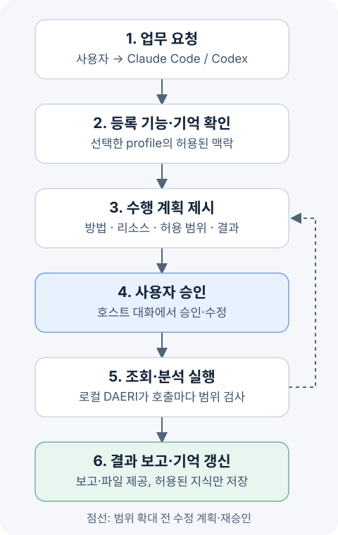

# DAERI

서버 운영 업무를 대리 수행하는 AI 에이전트입니다.
Claude Code 또는 Codex에서 자연어로 요청하면 연결된 리소스를 조회·분석하고 결과를 보고합니다.

서비스별 **profile**에 연결 정보·권한·업무 이력·재사용할 기억을 관리합니다.
실행기와 저장소는 사용자 PC에서 동작합니다.
업무 판단과 답변은 선택한 호스트의 모델이 담당합니다.

현재는 **조회·분석을 위한 초기 버전**이며 운영 리소스 변경·배포는 후속 확장 범위입니다.

## 동작 방식



사용자는 호스트 대화에서 계획을 확인하고 “승인할게”처럼 답합니다.
승인 범위 안에서는 자율적으로 진행하며 범위 확대가 필요하면 수정 계획을 다시 승인받습니다.
기억에는 허용된 출처에서 재사용할 지식을 선별해 남깁니다.

## 설치

플러그인 기능을 지원하는 **Codex CLI 또는 Claude Code가 설치·로그인된 환경**에서 시작합니다.
저장소 접근과 필요한 패키지 다운로드를 위한 네트워크가 필요합니다.
기억 검색은 로컬 모델·회사 임베딩 API·키워드 전용 중에서 선택하며 로컬 선택에만 모델을 준비합니다.
실행 중인 호스트는 종료하고 아래 명령을 터미널 또는 PowerShell에서 순서대로 실행합니다.
각 설치 명령의 성공을 확인한 뒤 마지막 명령으로 호스트를 시작합니다.

| 사용자 환경 | 설치·호스트 실행 위치 | setup의 환경 준비 |
|---|---|---|
| macOS | 터미널 | macOS 준비 도구 사용 |
| Windows | PowerShell | Windows 준비 도구 사용 |

### Codex

터미널 또는 PowerShell에서 플러그인을 설치한 뒤 Codex를 시작합니다.

```shell
codex plugin marketplace add https://github.com/VVoodyHong/DAERI.git --ref main
codex plugin add daeri@daeri-marketplace
codex
```

Codex 대화창에서 setup을 실행합니다.

```text
$daeri:setup service-prod
```

`/skills` 또는 `$` 선택기에서도 **DAERI의 setup**을 찾을 수 있습니다.
선택·확인 도구에 Plan 모드가 필요하면 `/plan`으로 전환합니다.
설치·설정 저장·로그인은 실행 가능한 모드로 돌아온 뒤 진행합니다.
설치 명령은 [OpenAI 공식 안내](https://learn.chatgpt.com/docs/developer-commands#codex-plugin-marketplace)를 참고하세요.

### Claude Code

터미널 또는 PowerShell에서 플러그인을 설치한 뒤 Claude Code를 시작합니다.

```shell
claude plugin marketplace add 'https://github.com/VVoodyHong/DAERI.git#main'
claude plugin install daeri@daeri-marketplace --scope user
claude
```

Claude Code 대화창에서 setup을 실행합니다.

```text
/daeri:setup service-prod
```

설치 명령은 [Claude Code 공식 안내](https://code.claude.com/docs/en/discover-plugins#manage-plugins-from-your-shell)를 참고하세요.
사내 저장소로 배포했다면 위 명령의 URL을 해당 Git 저장소 주소로 바꿉니다.
비공개 저장소의 Git 인증은 먼저 준비해야 합니다.

## 최초 설정과 첫 업무

`service-prod`는 예시 이름이며 서비스·환경별로 여러 profile을 만들 수 있습니다.
접속값은 선택한 연결의 YAML 파일에 입력합니다.

1. “DAERI 세팅을 시작할까요?”에서 **세팅 시작**을 선택합니다.
2. 필요한 리소스와 제품, 기억 검색 방식을 선택합니다.
3. 생성한 `setup.yaml`에서 접속 정보와 조회·자료 제공 범위를 입력합니다.
4. 호스트에 작성을 마쳤다고 알리고 검증한 변경 요약을 확인해 **적용**합니다.
5. 안내에 따라 인증한 뒤 리소스·기억 검색·MCP 연결의 실제 상태를 확인합니다.
6. 준비한 profile에서 work 또는 자연어로 업무를 요청하고 계획을 승인합니다.

setup이 Python·uv와 필요한 프로그램을 DAERI 전용 환경에 준비합니다.
기존 Python·가상환경·사용자 PATH는 사용자가 관리하는 환경으로 유지합니다.
비밀번호·토큰은 안내된 터미널 숨김 입력 또는 제공자 로그인으로 등록합니다.
회사 임베딩 API를 선택하면 YAML에 주소·모델과 기억·검색 질의의 전송 허용을 설정합니다.
실제 비밀은 별도로 등록하며 파일에는 인증 참조만 남깁니다.
선택한 회사 API로 기억 검색을 준비하며 상세 입력은 [임베딩 선택](docs/spec/configuration/profiles.md#임베딩-제공자-선택)을 참고하세요.

최초에는 실행 환경이 없어 MCP 연결 실패가 표시될 수 있습니다.
setup으로 준비한 뒤 MCP를 다시 연결하며 필요한 경우 호스트를 재시작합니다.

| 할 일 | Claude Code | Codex |
|---|---|---|
| 환경·profile 설정 | `/daeri:setup service-prod` | `$daeri:setup service-prod` |
| 이 대화의 profile 전환 | `/daeri:profile service-prod` | `$daeri:profile service-prod` |
| profile과 관련 로컬 자료 삭제 | `/daeri:profile delete service-prod` | `$daeri:profile delete service-prod` |
| 업무 지시 | `/daeri:work 요청 내용` | `$daeri:work 요청 내용` |
| profile 목록 | `/daeri:list-profiles` | `$daeri:list-profiles` |

삭제는 대상·범위를 확인한 뒤 진행합니다.
해당 profile의 업무·기억·관리 파일·설정을 정리하며 공유 설치 자산·공유 인증·원격 리소스는 유지합니다.
자세한 범위와 실패 시 재시도는 [profile 삭제](docs/spec/configuration/profiles.md#profile-삭제)를 참고하세요.

가상 업무 요청 예시입니다.
실제로 등록된 기능과 권한 안에서 계획을 세웁니다.

```text
현재 profile의 소스와 운영 문서를 비교해서 설정 차이를 정리해줘.
어떤 리소스를 읽고 어떤 결과를 만들지 먼저 계획을 보여줘.
```

## 지원 범위와 추가 안내

macOS의 로컬 실행·자동 준비·모의 리소스 통합을 검증했습니다.
실제 호스트 설치·회사 리소스 연결과 Windows 실행은 해당 환경에서 추가 검증이 필요합니다.

- [지원 어댑터와 조회 제한](docs/spec/resources/initial-adapters.md#어댑터별-실제-지원-경계)
- [플러그인 업데이트](docs/spec/hosts/plugins.md#설치한-플러그인-업데이트)
- [환경 준비와 문제 해결](docs/spec/installation/environment.md)
- [상세 문서 지도](docs/development/documentation-architecture.md)
