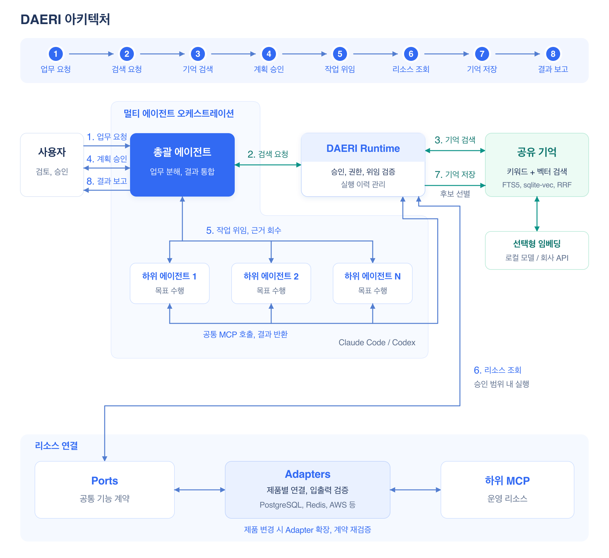

# DAERI

**서버 운영 업무를 대리 수행하는 멀티 오케스트레이션 에이전트입니다.**
Claude Code 또는 Codex에 플러그인으로 설치하고, 자연어로 리소스 조회·분석·보고를 요청합니다.

- **자율적인 업무 수행** — 사용자가 계획을 승인하면 그 범위에서 도구·방법·실행 순서를 선택해 진행합니다.
- **여러 에이전트의 협업** — 총괄 에이전트가 업무를 나누고 하위 에이전트의 결과를 통합합니다.
- **업무 경험의 재사용** — 결과와 피드백에서 확인한 지식을 profile별로 자동 저장하고 다음 업무에 활용합니다.

PostgreSQL·Redis·AWS·로컬 소스 코드·Confluence·Jira를 연결하며 같은 제품도 여러 연결로 사용할 수 있습니다.
현재는 **조회·분석을 위한 초기 버전**이며 운영 리소스 변경·배포는 후속 범위입니다.

## 구성도



총괄 에이전트(orchestrator)가 업무 분해·위임·결과 통합을 맡고, 하위 에이전트(subagent)가 필요한 리소스를 조회합니다.
소스 코드는 이 PC의 디렉터리를 등록하고 Claude Code·Codex의 기존 파일·검색·Git 도구로 조사합니다.
DAERI runtime은 승인·실행 이력·기억을 관리합니다.

runtime과 저장소는 사용자 PC에서 동작하며 업무 판단과 답변은 Claude Code 또는 Codex의 모델이 담당합니다.
자세한 역할과 연결 방식은 [아키텍처](docs/architecture/overview.md)를 참고하세요.

## 설치

플러그인을 지원하는 **Codex CLI 또는 Claude Code를 설치하고 로그인**한 상태에서 시작합니다.
실행 중인 프로그램을 종료하고 macOS 터미널 또는 Windows PowerShell에서 아래 설치 명령을 순서대로 실행합니다.
설치가 성공하면 마지막 명령으로 프로그램을 시작합니다.
저장소 접근과 다운로드를 위한 네트워크가 필요합니다.

### Codex

```shell
codex plugin marketplace add https://github.com/VVoodyHong/DAERI.git --ref main
codex plugin add daeri@daeri-marketplace
codex
```

Codex 대화창에서 setup을 실행합니다.

```text
$daeri:setup service-prod
```

`/skills` 또는 `$` 선택기에서도 DAERI의 setup을 찾을 수 있습니다.

### Claude Code

```shell
claude plugin marketplace add 'https://github.com/VVoodyHong/DAERI.git#main'
claude plugin install daeri@daeri-marketplace --scope user
claude
```

Claude Code 대화창에서 setup을 실행합니다.

```text
/daeri:setup service-prod
```

사내 저장소를 사용하면 URL을 해당 Git 주소로 바꾸고 비공개 저장소의 Git 인증을 준비합니다.
명령이 보이지 않거나 설치에 문제가 있으면 [호스트별 설치·새로고침 안내](docs/spec/hosts/plugins.md#호스트별-구성)를 참고하세요.

## 최초 설정

**profile**은 서비스·환경별 연결 정보와 업무 기억을 묶는 단위입니다.
위의 `service-prod`는 예시이며 필요한 profile로 바꿔 시작합니다.

1. **세팅 시작**을 선택하고 연결할 리소스 종류·제품·개수를 정합니다.
2. 기억 검색에 사용할 **로컬 임베딩 모델·OpenAI 호환 회사 임베딩 API·키워드 전용** 중 하나를 선택합니다.
3. DAERI가 안내한 YAML에 접속 정보와 필요한 비밀번호·토큰을 입력합니다.
   소스 코드는 로컬 디렉터리의 절대 경로를 입력하며 여러 경로를 각각 등록할 수 있습니다.
4. 작성을 마쳤다고 알린 뒤 검증한 변경 요약을 확인하고 **적용**합니다.
5. 안내에 따라 필요한 로그인을 마치고 연결 상태를 확인합니다.

설정 파일은 [사용자 저장소](docs/development/dependencies.md#저장-위치와-데이터-역할)의 `config/profiles/<profile>.yaml`입니다.
이후 연결·임베딩 설정도 같은 파일에서 수정하고 검증·적용합니다.
적용한 비밀번호·토큰은 OS 인증 저장소로 옮기고 YAML에는 인증 참조를 남깁니다.

첫 설정 후에는 새 연결 구성을 반영하도록 **Claude Code에서 `/reload-plugins`를 실행하거나 프로그램을 다시 시작**합니다.
Codex는 지원되는 새로고침을 사용하거나 재시작합니다.
DAERI의 실제 MCP 연결을 확인한 뒤 첫 업무를 요청합니다.

## 첫 업무

연결한 리소스에 맞춰 자연어로 요청합니다.
다음은 소스 코드와 운영 문서를 연결한 경우의 가상 예시입니다.

```text
현재 profile의 소스와 운영 문서를 비교해서 설정 차이를 정리해줘.
```

DAERI가 관련 기억을 찾고 계획을 제시하면 **“승인할게”**처럼 답합니다.
승인한 범위에서 조회·분석을 진행하고 결과를 보고하며 재사용할 지식을 자동 저장·색인합니다.
업무 중 피드백을 전달할 수 있고, 범위가 달라지면 수정 계획을 확인합니다.

## 주요 명령

| 할 일 | Claude Code | Codex |
|---|---|---|
| 설정·연결 수정 | `/daeri:setup service-prod` | `$daeri:setup service-prod` |
| profile 전환 | `/daeri:profile service-prod` | `$daeri:profile service-prod` |
| profile 목록 | `/daeri:list-profiles` | `$daeri:list-profiles` |
| 업무 요청 | `/daeri:work 요청 내용` | `$daeri:work 요청 내용` |
| profile 삭제 | `/daeri:profile delete service-prod` | `$daeri:profile delete service-prod` |

삭제는 대상·범위를 확인한 뒤 해당 profile의 설정·업무·기억·관리 파일을 정리합니다.
자세한 범위와 PC 이동 절차는 [profile 삭제](docs/spec/configuration/profiles.md#profile-삭제)·[백업과 복원](docs/spec/configuration/profiles.md#이관백업복원)을 참고하세요.

## 지원 범위와 문서

macOS의 로컬 실행·자동 준비·모의 리소스 통합을 검증했습니다.
실제 호스트 설치·회사 리소스 연결과 Windows 실행은 해당 환경에서 추가 검증이 필요합니다.

- [지원 제품과 연결 범위](docs/spec/resources/initial-adapters.md#어댑터별-실제-지원-경계)
- [플러그인 업데이트](docs/spec/hosts/plugins.md#설치한-플러그인-업데이트)
- [환경 준비와 문제 해결](docs/spec/installation/environment.md)
- [상세 문서 지도](docs/development/documentation-architecture.md)
