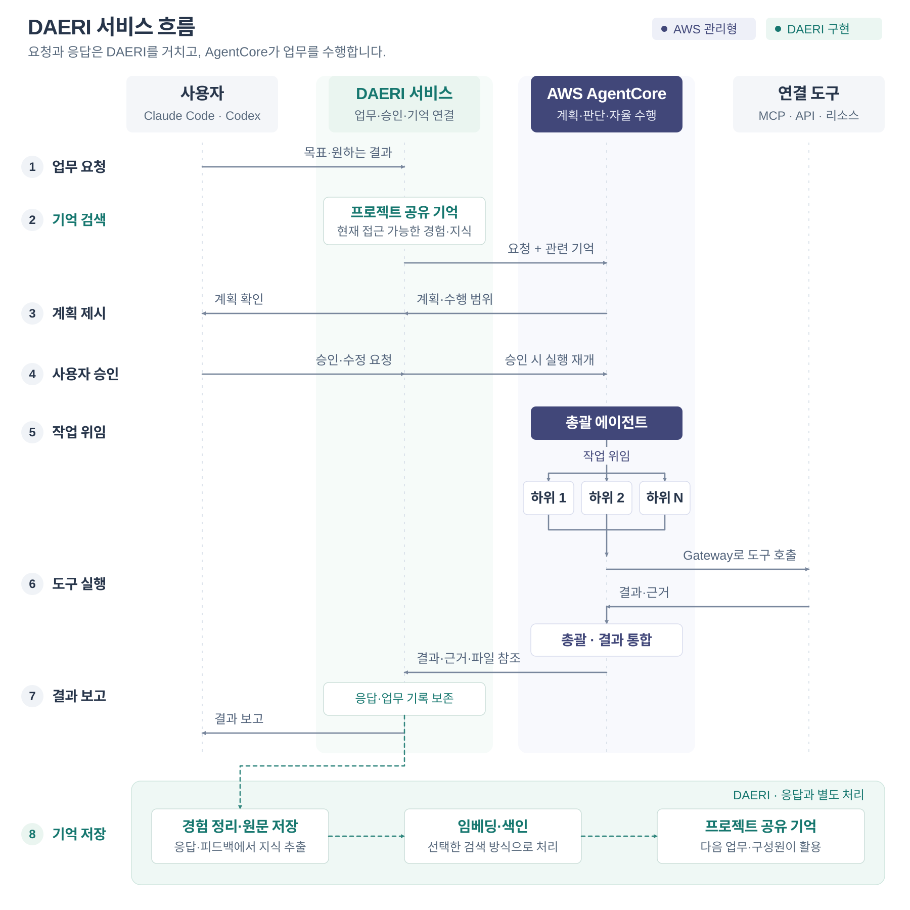

# DAERI

**프로젝트 업무를 대리 수행하는 멀티 오케스트레이션 에이전트입니다.**
Claude Code 또는 Codex에 플러그인을 설치하고, 회사 로그인 뒤 프로젝트를 선택해 리소스 조회·분석·보고를 요청합니다.

- **자율적인 업무 수행** — 사용자가 계획을 승인하면 그 범위에서 도구·방법·실행 순서를 선택해 진행합니다.
- **여러 에이전트의 협업** — 총괄 에이전트가 업무를 나누고 하위 에이전트의 결과를 통합합니다.
- **업무 경험의 재사용** — 결과와 피드백에서 확인한 지식을 프로젝트에 자동 저장하고 구성원의 다음 업무에 함께 활용합니다.

## 구성도

요청부터 기억 재사용까지 이어지는 클라우드 서비스의 [목표 흐름](docs/spec/product.md#업무-흐름)입니다.



총괄 에이전트(orchestrator)가 업무 분해·위임·결과 통합을 맡고, 하위 에이전트(subagent)가 필요한 리소스를 조회합니다.
AgentCore managed harness가 모델·도구 호출과 문맥을 관리하고, 프로젝트별 Memory가 경험을 추출·검색합니다.
DAERI 서비스는 업무·승인·세션을 연결하고 S3에 업무 상태와 수신한 원본을 보존합니다.

남색은 AWS 관리형 기능, 청록색은 AWS에 배포하는 DAERI 구현 영역입니다.
자세한 역할과 연결 방식은 [아키텍처](docs/architecture/overview.md)를 참고하세요.

## 설치

목표 사용 흐름은 **플러그인 설치 → 회사 로그인 → 허용된 프로젝트 선택 → 업무 요청**입니다.
회사의 기존 로그인 체계로 신원을 확인하고, 운영자가 중앙 등록한 프로젝트의 리소스·도구를 사용합니다.
사용자마다 PC에 개별 MCP와 리소스 자격을 설정하는 부담을 없애는 것이 목표입니다.

현재 `main`은 중앙 프로젝트 조회·harness 호출과 S3 업무 저장·복구를 처리하는 Python 라이브러리를 제공합니다.
사용자용 플러그인·회사 로그인·HTTP 접속·AWS 배포는 후속 구현이며, 아래 사용 흐름은 공용 서비스 연결 후의 동작입니다.
실제 제공·검증 상태는 [개발 안내](docs/development/dependencies.md#클라우드-개발-상태)에서 확인할 수 있습니다.

PC에서 바로 설치해 사용하는 버전은 [local-agent 브랜치의 설치 안내](https://github.com/VVoodyHong/DAERI/tree/local-agent#설치)를 참고하세요.

## 최초 설정

프로젝트는 자료·대화·도구 결과·과거 기억을 모든 구성원이 함께 사용할 수 있는 단위입니다.
운영자가 리소스 연결과 권한을 중앙에서 등록하면 구성원은 허용된 프로젝트를 선택합니다.
개인 권한으로 접근하는 리소스는 필요한 로그인·동의를 거칩니다.

1. 회사 계정으로 로그인합니다.
2. 접근 가능한 프로젝트 목록에서 업무할 프로젝트를 선택합니다.
3. 새 업무를 요청하거나 같은 프로젝트의 자신의 업무를 이어갑니다.

프로젝트를 전환해 새 업무를 요청하거나 해당 프로젝트에서 자신의 기존 업무를 선택할 수 있습니다.

## 첫 업무

연결한 리소스에 맞춰 자연어로 요청합니다.
다음은 소스 코드와 운영 문서를 연결한 경우의 가상 예시입니다.

```text
이 프로젝트의 소스와 운영 문서를 비교해서 설정 차이를 정리해줘.
```

DAERI가 관련 기억을 검색하고 계획을 제시하면 **“승인할게”**처럼 답합니다.
승인한 범위에서 조회·분석을 진행하고 결과를 보고하며 Memory가 재사용할 경험을 비동기로 정리합니다.
업무 중 피드백을 전달할 수 있고, 범위가 달라지면 수정 계획을 확인합니다.

Claude Code와 Codex를 바꿔 사용할 때는 같은 프로젝트에서 자신의 업무를 선택하고 “이전 업무 이어서 해줘”라고 요청합니다.
저장된 계획·결과·기억을 활용해 이어가며, 프로젝트의 다른 구성원도 공유 경험을 다음 업무에 활용합니다.
