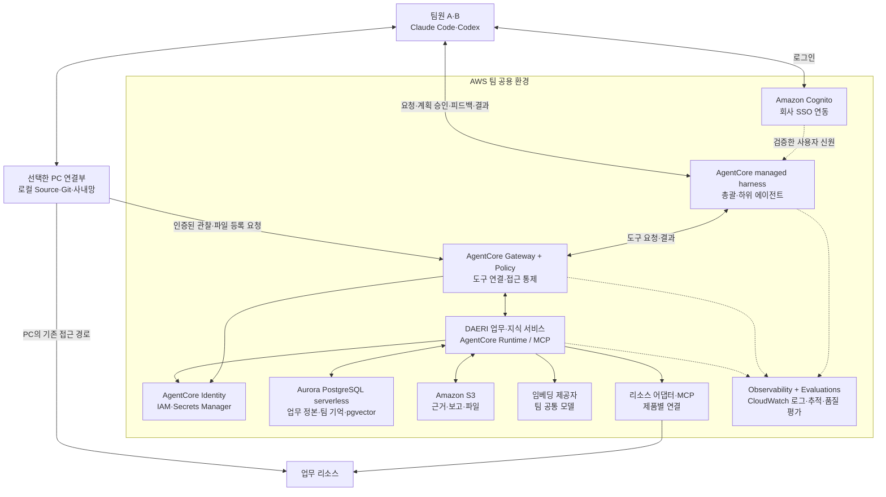

# DAERI 팀 에이전트의 AWS AgentCore 이관 검토·아키텍처

상태: 이관 목적은 확정, 아래 서비스 구성·동작은 검토할 설계 제안이다.
현재 제품 구현은 [기존 아키텍처](overview.md)를 따른다.
AWS 기능은 2026-10-28 공식 문서 기준으로 확인했다.

## 목적과 선택 기준

| 확정 목적 | 이관 후 기대 동작 |
|---|---|
| 직접 관리하는 기능·운영 부담 최소화 | AWS 관리형 실행·인증·정책·연결·관측·평가 기능을 사용하고 DAERI 코드는 업무에 필요한 의미를 담당한다. |
| AWS의 인증·인가·보안·권한·Gateway·Evaluation 활용 | 공통 도구 접근 경로에 AWS 인증·정책을 적용하고 운영 로그와 품질 평가를 함께 관리한다. |
| 개인 에이전트에서 팀 에이전트로 전환 | 팀원이 같은 에이전트·연결 구성·공용 pgvector 기억을 사용하고 PC·호스트 변경 뒤에도 접근 가능한 지식을 바로 회상한다. |

추천 구성은 **AgentCore managed harness + Gateway·Policy·Identity·Observability·Evaluations + Aurora PostgreSQL serverless·pgvector + S3**다.
사용자는 Claude Code·Codex 플러그인에서 접속하고 업무 판단·협업은 AWS에서 실행하는 방향을 제안한다.
기존 호스트가 판단하는 방식은 이관 검증 중의 연결 경로로 사용할 수 있다.

AgentCore Runtime은 코드 호스팅을, managed harness는 Strands 기반 모델·도구 호출 루프까지 제공한다.
직접 소유할 agent loop를 줄이는 목적에 맞춰 harness를 우선 검증하고, 충족하지 못한 동작이 확인될 때 그 부분의 구현 범위를 결정한다.
근거: [Harness와 Runtime](https://docs.aws.amazon.com/bedrock-agentcore/latest/devguide/harness-vs-runtime.html), [Managed harness](https://docs.aws.amazon.com/bedrock-agentcore/latest/devguide/harness.html).

## 목표 아키텍처

이 그림은 책임 구성도이며 로그인→harness→Gateway→업무 서비스의 사용자·팀 문맥 전달은 첫 실험에서 확정한다.
업무 리소스·팀 지식 MCP 도구 요청은 Gateway·Policy를 경유하고 DAERI 업무 서비스가 실제 대상·현재 계획·근거를 연결한다.
등록된 리소스의 인증·읽기 의미를 구현하는 어댑터는 관리형 연결 기능과 대조해 필요한 부분을 유지한다.

총괄 에이전트가 목표에 따라 필요한 수와 역할의 하위 에이전트를 배정하고 결과를 통합한다.
동일 harness 정의의 독립 세션을 하위 에이전트 실행 후보로 사용하며 위임·진행 확인·취소·결과 수집의 연결은 검증 대상이다.
각 세션의 문맥과 실행 자격은 해당 사용자·업무에 연결하고 팀 지식은 공용 DB에서 조회한다.

## AWS에 맡길 기능과 DAERI에 남길 책임

| 영역 | 사용 서비스·기능 | DAERI가 담당할 내용 |
|---|---|---|
| agent loop·실행 환경 | AgentCore managed harness·Runtime | 업무 Skill·목표, 동적 위임 연결과 완료 판단 기준 |
| 사용자 로그인 | Cognito와 회사 IdP 연동 | 검증한 사용자·조직 그룹을 팀·업무에 연결 |
| 외부 서비스 인증 | AgentCore Identity·IAM·Secrets Manager | 팀 공용 연결과 사용자 위임 연결의 참조·실제 대상 |
| 도구 연결·인가 | Gateway·Policy | 업무 도구의 의미·입력과 회사가 허용한 접근 조건을 정책으로 정의 |
| 암호화·망 접근 | KMS·S3/Aurora 암호화·VPC·보안 그룹 | 자료 분류·접근 경로·보존 설정과 배포 구성 |
| 실행 로그·감사 | Observability·CloudWatch·CloudTrail | 업무·도구 호출과 trace의 연결, 로그에 제공할 자료 범위 |
| 품질 평가 | AgentCore Evaluations | 팀 업무 사례·기대 결과·회상 평가 자료와 개선 기준 |
| 공용 업무·벡터 기억 | Aurora PostgreSQL serverless·pgvector·Data API | 업무 상태·지식 스키마, 검색·정정·출처·공유 범위 |
| 근거·산출물 보관 | S3·수명 주기·관리형 백업 | 출처·해시·자료 접근 조건과 업무 연결 |

Gateway·Policy·Identity·Observability·Evaluations는 목표 구성의 기본 기능으로 채택을 제안한다.
정책·팀 매핑·데이터 모델·배포 설정은 제품 요구로 정의하고 AWS가 해당 기반 기능의 실행·운영을 담당한다.
근거: [Policy](https://docs.aws.amazon.com/bedrock-agentcore/latest/devguide/policy.html), [Identity](https://docs.aws.amazon.com/bedrock-agentcore/latest/devguide/key-features-and-benefits.html), [Observability](https://docs.aws.amazon.com/bedrock-agentcore/latest/devguide/observability.html), [Evaluations](https://docs.aws.amazon.com/bedrock-agentcore/latest/devguide/evaluations.html).

DAERI의 자체 구현은 세 책임으로 모은다.
**업무 기록**은 현재 계획·실제 사용자 승인·호출·결과·중단과 재개를 연결한다.
**리소스 의미**는 실제 대상·승인 범위·읽기 동작·근거를 해소한다.
**팀 지식**은 재사용할 내용의 저장·검색·정정과 현재 출처 접근 조건을 처리한다.

## 팀 공용 기억과 데이터 구조

팀의 업무 기록·지식 원문·메타데이터·벡터를 **Aurora PostgreSQL serverless의 공용 정본**에 저장한다.
pgvector가 벡터 검색을 담당하고, PostgreSQL 키워드 검색과 기존 RRF 결합을 검증해 하이브리드 회상을 제공한다.
공용 DB는 VPC의 팀 서비스가 사용하는 저장소로 구성하고 사용자 PC는 에이전트의 인증된 도구를 통해 접근한다.
근거: [Aurora serverless](https://docs.aws.amazon.com/AmazonRDS/latest/AuroraUserGuide/aurora-serverless-v2.html), [Aurora pgvector](https://docs.aws.amazon.com/AmazonRDS/latest/AuroraUserGuide/AuroraPostgreSQL.VectorDB.html).

| 데이터·구분 | 의미와 공유 기준 |
|---|---|
| 조직·팀 | 회사의 검증한 조직 그룹에서 정하는 지식 소유·공유 경계 |
| profile | 팀 공용 운영 환경·리소스 묶음과 기억의 적용 맥락 |
| 작성자 | 지식을 남긴 사람의 추적 정보; 공유 범위는 팀·출처 기준 |
| 출처 | 실제 리소스·대상과 해당 자료에 접근할 수 있는 조건 |
| 지식 버전·기한 | 현재 내용·정정·폐기·반환 가능한 기간 |
| 업무·대화 세션 | 해당 사용자·담당자에게 허용한 작업 문맥·승인·진행 기록 |
| 파일·큰 근거 | S3에 보관하고 DB에는 위치·해시·접근 조건을 연결 |

공유하도록 등록한 팀 리소스의 검증된 운영 지식은 팀 공용으로 축적한다.
사용자의 현재 팀 소속·출처 접근 조건·profile 적용 맥락·현재 버전·기한을 충족한 기억을 검색하고 모델에 제공한다.
여러 출처를 합친 지식은 그 출처 전체의 접근 조건을 적용한다.
실제 출처별 접근 차이가 있는 경우 기존 회사 그룹을 연결하고 기본 공유 경계는 팀으로 유지한다.

예를 들어 A가 Claude에서 확인한 서비스 DB의 테이블 의미·운영 절차를 저장하면, 같은 팀에서 해당 출처를 읽을 수 있는 B가 다른 PC의 Codex에서 회상한다.
로그인한 사용자와 업무 세션은 구분되며 B의 실제 실행은 B의 현재 계획·승인으로 진행한다.
팀 지식의 이용은 중앙 저장소 조회로 이어지고 export/import는 기존 로컬 자료를 처음 옮길 때 필요한 범위에서 처리한다.

벡터 생성·질의에는 팀 공통 임베딩 제공자·모델·차원·버전을 사용한다.
관리형 Bedrock 임베딩 모델을 우선 평가하고 기존 회사 API를 사용할 경우에도 서버의 팀 설정으로 해소한다.
모델 변경은 새 색인 검증과 전환으로 처리하며 회사 API의 클라우드 접근성도 확인한다.
기존 FTS5 BM25와 PostgreSQL 키워드 검색의 순위 차이는 한국어·오류 코드·리소스 식별자 회상 평가로 확인한다.

AgentCore Memory는 대화 이벤트·요약·개인화에 필요한 경우 사용하는 별도 관리형 기능으로 구분한다.
**팀 지식·벡터 기억의 정본은 Aurora·pgvector**로 두고 해당 데이터를 쓰는 저장·검색 도구를 harness에 연결한다.
초기 harness는 `memory: disabled` 구성으로 이 경로를 사용하고, 대화 기억을 도입할 때 사용자·세션 보존 범위를 별도로 정의한다.
근거: [Harness Memory의 기본 동작](https://docs.aws.amazon.com/bedrock-agentcore/latest/devguide/harness-memory.html).

## 인증·권한·승인 경계

사용자는 회사 SSO와 연동한 Cognito 로그인으로 JWT를 발급받는 경로를 기본안으로 한다.
Harness의 inbound OAuth를 사용해 사용자 신원을 연결하고 Identity·Gateway가 사용하는 자격과 실제 사용자·팀 문맥의 전달을 검증한다.
회사 IdP의 토큰 교환·위임 기능과 Gateway 구성에 맞춰 경로를 결정한다.
근거: [Cognito SSO 연동](https://docs.aws.amazon.com/cognito/latest/developerguide/cognito-user-pools-saml-idp.html), [Harness의 사용자 신원·보안 책임](https://docs.aws.amazon.com/bedrock-agentcore/latest/devguide/harness-security.html).

| 경계 | 적용 기준 |
|---|---|
| AWS 기능 접근 | IAM·리소스 정책으로 harness·업무 서비스·관리자의 역할을 구분 |
| 업무·기억 도구 호출 | Gateway·Policy가 인증 주체·도구·입력 조건으로 판단 |
| 팀 지식 행 접근 | 검증한 조직·팀·출처 문맥을 SQL 조건과 PostgreSQL RLS에 적용 |
| 현재 업무 실행 | 실제 사용자가 승인한 현재 계획과 대상·완료 조건을 연결 |
| 로컬·클라우드 shell·파일·inline 도구 | Harness `allowedTools`·IAM·접속부 실행 권한으로 관리하고 근거를 업무에 등록 |

인증·도구 접근 정책의 정본과 집행은 AWS에 두고 Gateway Policy는 운영에서 `ENFORCE` 모드로 적용한다.
DAERI Runtime의 업무·기억 MCP 진입점은 지정 Gateway에서 온 호출을 받도록 구성한다.
정책 변경·관리 권한은 에이전트의 업무 실행 역할과 분리한다.
근거: [Policy 집행 모드](https://docs.aws.amazon.com/bedrock-agentcore/latest/devguide/policy-enforcement-modes.html), [Runtime 진입 인증](https://docs.aws.amazon.com/bedrock-agentcore/latest/devguide/runtime-oauth.html).

팀 데이터 접근은 인증 결과에서 해소한 문맥으로 처리하며 모델이 입력한 팀 식별자는 그 문맥과 대조한다.
Data API의 IAM 권한과 DB의 팀별 행 접근은 각각 적용한다.
RLS는 적용 대상 DB 역할과 트랜잭션 문맥까지 포함해 검증한다.
근거: [Data API와 RLS 적용 예](https://aws.amazon.com/blogs/database/enforce-row-level-security-with-the-rds-data-api/), [PostgreSQL RLS](https://www.postgresql.org/docs/current/ddl-rowsecurity.html).

팀 지식은 Policy가 평가하는 MCP 도구로 제공하고 업무 서비스에서도 반환 자료의 접근 조건을 검사한다.
MCP prompts·resources와 도구 호출의 정책 적용 범위는 [Gateway Policy 계약](https://docs.aws.amazon.com/bedrock-agentcore/latest/devguide/use-gateway-with-policy.html)에 맞춘다.
AgentCore Policy의 세션 조건은 지원 범위 안에서 활용하고 장기간의 업무·계획·실제 승인 기록은 공용 업무 정본으로 관리한다.

## 업무 수행과 관리형 평가

1. 팀원이 로그인해 공용 profile과 업무 목표를 선택한다.
2. 총괄 에이전트가 접근 가능한 팀 기억을 회상하고 계획을 제시한다.
3. 사용자가 현재 계획을 승인하면 총괄·하위 에이전트가 도구·질의·순서·분석·재시도·결과 표현을 자율적으로 선택한다.
4. 업무 서비스가 현재 실행과 실제 근거를 기록하고 최종 결과·파일을 연결한다.
5. 선별한 지식을 팀 공용 기억에 저장·임베딩하고 저장·색인 결과를 기록한다.
6. 다음 업무와 다른 팀원의 요청에서 현재 접근 조건으로 회상한다.

Harness의 inline function으로 승인 응답·PC 도구 결과를 전달하는 경로를 검증한다.
업무 정본에서 대기·중단·재개를 복구하고 동적 위임·결과 통합을 연결한다.
사용자가 요청한 목표·승인 범위·완료 근거를 기준으로 동작하며 보고·파일 형식은 업무에 맞춰 선택한다.
근거: [Harness 도구·inline function](https://docs.aws.amazon.com/bedrock-agentcore/latest/devguide/harness-tools.html).

CloudWatch Transaction Search를 준비하고 Observability에 업무·도구 trace를 연결한다.
Evaluations의 관리형 평가로 도구 선택·답변 품질·근거 활용을 측정한다.
대표 업무 데이터셋으로 배포 전 평가를 실행하고 운영에는 샘플링 평가를 구성한다.
기존 한국어 회상 평가 자료와 권한·정정·만료 테스트는 평가 입력과 정확성 검증에 재사용한다.
품질 평가 결과와 실제 접근 제어 검증은 각각 완료 근거로 기록한다.
근거: [Harness 관측 구성](https://docs.aws.amazon.com/bedrock-agentcore/latest/devguide/harness-operations.html), [온라인 평가 구성](https://docs.aws.amazon.com/bedrock-agentcore/latest/devguide/create-online-evaluations.html).

## 운영 부담을 줄일 저장·배포 방식

Aurora serverless의 자동 용량 조절과 관리형 백업을 사용하고 DB 연결은 RDS Data API를 우선 검증한다.
Data API는 HTTPS·AWS SDK 경로와 Secrets Manager의 DB 인증으로 연결 풀 운영을 줄이며 PostgreSQL VECTOR 타입을 지원한다.
팀 서비스의 IAM 역할에 필요한 cluster·secret 접근을 부여한다.
근거: [Data API](https://docs.aws.amazon.com/AmazonRDS/latest/AuroraUserGuide/data-api.html), [지원 타입·트랜잭션](https://docs.aws.amazon.com/AmazonRDS/latest/AuroraUserGuide/data-api-operations.html).

데이터 크기·응답시간·트랜잭션 한도를 실제 검색과 업무 저장으로 확인한다.
큰 근거·파일은 S3에 두고 DB 트랜잭션은 상태 저장 단위로 완료한다.
AgentCore 실행·모델·Gateway·DB·로그·평가·네트워크 비용을 합산해 팀의 최소 용량·예산·샘플링 범위를 정한다.
근거: [Data API 한도](https://docs.aws.amazon.com/AmazonRDS/latest/AuroraUserGuide/data-api.limitations.html), [AgentCore 가격](https://aws.amazon.com/bedrock/agentcore/pricing/).

배포는 공식 AgentCore CLI·CDK 구성으로 재현하고 실행 버전·endpoint·정책·DB schema를 함께 관리한다.
로컬 프로그램 설치·DB 백업·모델 캐시 관리와 사용자별 기억 이관을 중심으로 한 현재 운영을 공용 AWS 환경의 배포·권한·관측 관리로 전환한다.

## 현재 코드에서 전환할 부분

| 현재 책임 | 이관 후 구성 |
|---|---|
| PC runtime 시작·중지·실행 환경 준비 | 관리형 Runtime 배포와 접속부; PC 도구 준비는 필요한 연결에 한정 |
| 호스트 하위 에이전트 실행 | managed harness의 세션 실행과 작은 위임 연결 |
| 자체 인증 저장·MCP 연결·접근 정책 | Identity·Gateway·Policy·IAM 정본과 제품별 대상 해소 |
| SQLite·로컬 profile·기억·파일 | Aurora의 팀 profile·업무·pgvector와 S3 |
| PID 기반 생존·인계 검사 | 관리형 세션·업무 실행 식별과 DB의 동시 변경 검사 |
| 개인별 setup·백업·이관 | 관리자가 공용 연결을 설정하고 팀원이 로그인해 사용 |
| 출처 검증·지식 선별·현재 승인 | 팀 모델에 맞춘 DAERI의 최소 업무 로직 |

현재 패키지의 core·application·infrastructure 책임을 유지하고 AWS SDK·저장·인증 연결은 외부 구현으로 둔다.
현재 runtime 전체를 복제하는 대신 관리형 기능으로 대체한 구현을 전환 완료 시 정리한다.
검토할 주요 코드는 [runtime](../../src/daeri/application/runtime.py), [기억](../../src/daeri/infrastructure/memory.py), [저장](../../src/daeri/infrastructure/storage.py), [연결](../../src/daeri/infrastructure/resources.py), [설정](../../src/daeri/config/)이다.

로컬 Source·Git은 사용자별 등록 디렉터리를 해당 PC 연결부에서 해소한다.
공유 지식은 저장소의 공통 식별·commit 등 적용 시점에 연결하고 PC 경로는 로컬 연결 정보로 관리한다.
사내망 접근이 PC 환경에 의존하는 리소스는 해당 연결부가 온라인일 때 사용하며 AWS 실행 연결은 회사망·인증을 확인한 대상부터 전환한다.

## 구현 순서와 완료 조건

| 순서 | 구현·검증 범위 | 완료 조건 |
|---|---|---|
| 1. 관리형 기반 | 로그인·harness·Gateway·Policy·Identity·관측·평가와 Aurora·pgvector | 검증한 사용자·팀 문맥이 도구·DB까지 연결되고 허용·거부를 실제 확인 |
| 2. 팀 업무 한 건 | 계획·실제 승인·조회·보고·기억 저장·회상 | 대표 업무가 끝까지 완료되고 로그·평가 결과와 공용 기억을 확인 |
| 3. 팀 공유·분리 | 두 사용자·두 PC·Claude/Codex, 서로 다른 팀·출처 | A의 지식을 B가 즉시 사용하고 접근 범위가 다른 자료는 현재 조건대로 처리 |
| 4. 협업·복구 | 동적 하위 에이전트·취소·피드백·재승인·연결 종료·색인 실패 | 업무·사용자·승인·출처가 유지되고 중복 저장·잘못된 재개 없이 회복 |
| 5. 전환·정리 | 필요한 로컬 자료 초기 이관, 공용 profile 전환, 대체 코드 정리 | 이후 사용자 간 export/import 없이 팀 기억을 사용하고 관리형 배포로 재현 |

초기 이관 중이던 업무는 일시중지 상태에서 새 연결·계획 승인을 확인하고 클라우드 실행의 소유권·위임 자격을 발급해 재개한다.

검토할 미결 사항은 회사 SSO·팀 그룹 매핑, harness→Gateway의 사용자 문맥 전달 방식, 임베딩 모델, 리전·자료 처리 위치, 팀 사용량에 맞는 용량·예산이다.
특히 서울의 관리형 Evaluations는 교차 리전 추론 조건이 있으므로 회사 자료 제공 범위를 함께 확정한다.
근거: [지원 리전](https://docs.aws.amazon.com/bedrock-agentcore/latest/devguide/agentcore-regions.html), [교차 리전 추론](https://docs.aws.amazon.com/bedrock-agentcore/latest/devguide/cross-region-inference.html).

현재 검증은 공식 기능과 기존 코드의 책임 대조·문서·구성도 확인 범위다.
실제 AWS 배포·회사 SSO·사내망·다중 사용자·하위 에이전트·공용 검색 품질은 위 완료 조건으로 검증한다.
