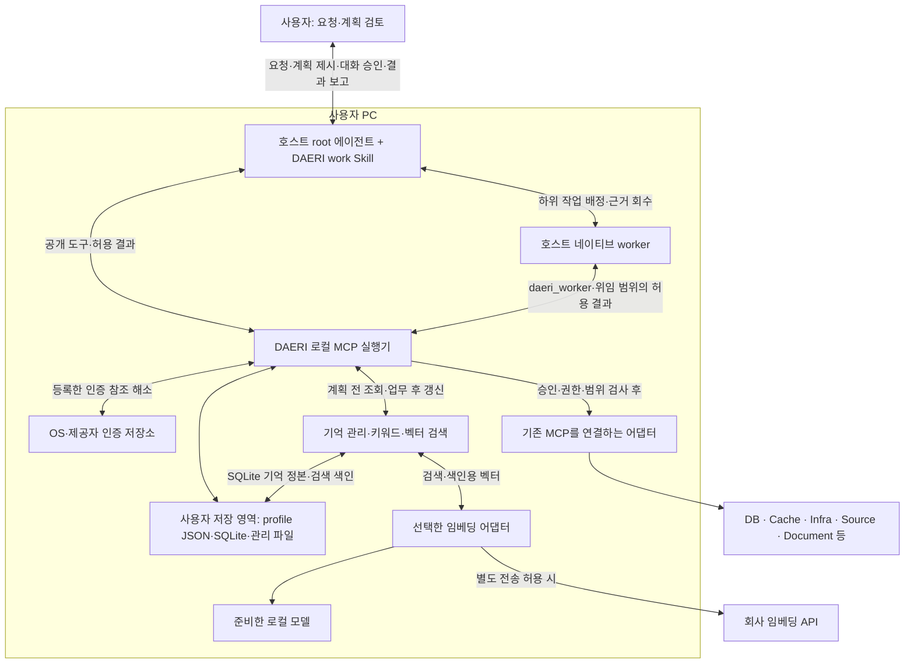

# DAERI 구조 설명

상태: 호스트·Skill·로컬 MCP와 worker 위임 구조; 첫 버전의 읽기·분석 범위

선택한 구조는 기존 Codex 또는 Claude Code의 root 에이전트·worker + Skill + 로컬 MCP 실행기다.
이 문서는 구성 요소의 책임과 권한 경계를 설명한다.

## 실행 위치와 책임

MCP(Model Context Protocol)는 호스트가 외부 도구를 찾아 호출하는 통신 규격이다.
MCP 서버는 도구 요청을 처리하는 프로그램이며 DAERI 실행기는 사용자 PC에서 동작한다.
설정·승인 검사·기록은 사용자 PC의 실행기가 관리한다.
모델 추론의 실행 위치와 제공자는 호스트의 계정·플랫폼 설정을 따른다.

| 구성 요소 | 책임 |
|---|---|
| 호스트 root 에이전트 | 요청 해석·계획 제시·실제 승인 응답 연결·하위 작업 분해와 worker 배정·결과 통합·최종 보고·기억 후보 정리 |
| 호스트 worker | root가 배정한 목표·단계 안에서 기억 검색·방법·다음 호출을 판단하고 실제 근거·제한을 반환 |
| 플러그인·Skill·worker 정의 | 공통 업무 지침·조정자와 worker의 역할·호스트별 MCP 실행 설정 |
| 관리 CLI·준비 도구 | 명시적인 프로그램·profile·인증·모델 준비와 연결 진단 |
| 로컬 DAERI | 등록부·root 업무의 계획·실제 승인·위임·호출 검사·공유 예산·이력·기억의 검증·보존·검색·허용 자료 제공 |
| 포트·어댑터 | 제품별 대상·입출력·제약을 공통 실행 계약으로 연결 |
| 사용자 저장 영역 | 현재 profile JSON, SQLite의 업무·기억 정본·검색 색인, 본문·산출물·모델 파일 |
| 인증 저장소 | OS·제공자 저장소에서 비밀 관리; profile·업무 기록에는 인증 참조만 저장 |
| 임베딩 어댑터 | 선택한 로컬 모델·회사 API로 허용 텍스트와 검색 질의를 벡터로 변환; 키워드 전용은 호출 생략 |

한 로컬 애플리케이션 안에서 공개 DTO·저장·어댑터·기억의 책임을 나눈다.

## 개발 방식과 선택 근거

호스트의 추론을 재사용하고 연결·승인·이력은 공통 실행기로 관리한다.
root는 하나의 업무·계획·사용자 승인·누적 예산을 관리하고 독립적인 하위 작업은 호스트 네이티브 worker에 배정한다.
root와 worker는 승인한 의존 관계·분기·예산과 배정받은 단계 안에서 리소스·도구·분석 방법·수행 순서·후속 조회를 자율적으로 선택한다.
실행기는 실제 호출의 입력·효과·범위를 검사한다.
[플러그인·Skill](../spec/hosts/plugins.md)이 호스트 연결을 정의한다.
두 호스트의 같은 오프라인 실행 구성과 실제 stdio 전달은 구현했으며 호스트 설치·대화 UI는 별도 검증 대상이다.

worker의 생성·추론·대화 수명은 호스트가 담당하고 DAERI는 승인된 단계의 위임·토큰·기한·철회·호출과 공유 예산을 관리한다.
worker의 DAERI 접점은 기억 검색·허용 근거 읽기·기능 실행·완료를 제공하는 `daeri_worker`다.
worker의 실제 리소스 호출도 같은 root 업무의 원자적 예약·정산 기록에 연결한다.
업무별 분해·배정·통합은 호스트의 판단이며 실행기는 [위임 조건](../spec/tasks/approval.md#worker-위임과-승인-범위)과 [실행 수명](../spec/tasks/workflow.md#worker-위임과-병렬-실행)을 검사한다.
호스트별 worker 전달 방식과 실제 확인 범위는 [플러그인 사양](../spec/hosts/plugins.md)을 따른다.

기억 활용에는 검색한 지식을 참고해 계획·답을 만드는 Agentic RAG 방식을 채택한다.
호스트가 필요한 맥락과 후속 검색을 판단하고 계획·답변을 생성한다.
실행기는 키워드·벡터 검색을 결합하고 정본과 색인의 수명·권한을 검사한다.
로컬 저장은 SQLite·파일, 키워드 검색은 SQLite FTS5를 채택한다.
벡터는 SQLite 확장에 보관하며 임베딩은 profile별로 로컬 모델·회사 API·키워드 전용 중에서 선택한다.
회사 API의 전송 허용은 호스트 모델 제공과 구분한다.
지원 조합과 고정한 패키지는 [의존성 정본](../development/dependencies.md#의존성의-정본), 모델·색인·부분 검색 처리는 [기억 사양](../spec/tasks/memory.md)을 따른다.

리소스는 [기존 MCP 재사용](../spec/resources/contract.md)을 기본으로 한다.
DAERI는 호스트에는 MCP 서버, 하위 MCP에는 클라이언트로 동작한다.
어댑터는 연결 제품의 의미·제약을 설명하고 확인된 부족분만 보완한다.

## 요청과 구성

요청 → 기억 조회 → 계획·승인 → 자율 실행 → 검증·보고·기억 갱신은 [업무 흐름](../spec/tasks/workflow.md)과 공통 [MCP 도구](../spec/mcp/common.md)로 연결한다.
[profile](../spec/configuration/profiles.md)이 서비스별 리소스·인증 참조·업무의 고정 구성과 사용자 저장소를 관리한다.
저장별 정본·조회 경로·파일 발행·만료·복구는 [로컬 저장 구조](../spec/configuration/profiles.md#로컬-저장-구조)에 모은다.
설치·배포는 [환경 준비](../spec/installation/environment.md)를 따른다.
대화 응답·파일 형식은 내부 저장 기술과 구분하며 [등록 출력 생성기](../spec/mcp/tasks.md#결과-형식과-생성기)로 확장한다.

업무 이력은 추적·복구를, [기억 정본](../spec/tasks/memory.md)은 선별 경험의 재사용을 담당한다.
검색 색인은 정본에서 재생성하며 제공 권한은 정본의 정책으로 판정한다.

## 실제 요청이 왕복하는 방식

준비와 업무 실행은 다른 진입 경로다.
setup은 선택한 리소스·모델의 YAML에 접속 정보·인증값을 입력받고 검증·확인 뒤 적용한다.
로컬 실행기가 인증값을 OS 인증 저장소에 등록하고 같은 파일을 인증 참조로 정리하며 profile과 기능 계약을 준비한다.
profile로 대화의 기본 대상을 선택하고 list-profiles로 저장 목록을 확인하며 work로 업무를 시작한다.
진입점별 역할은 [Skill 지침](../spec/hosts/plugins.md#skill-지침), 대상 선택은 [profile 계약](../spec/configuration/profiles.md#선택과-기본값)을 따른다.
일반 MCP 시작은 준비된 실행기를 연결한다.

1. 호스트가 자연어 요청과 선택한 profile로 업무를 접수한다.
   실행기는 업무 ID·상태·개정과 해당 업무에 고정한 구성을 저장한다.
2. 호스트가 등록 기능과 관련 기억을 읽어 방법·허용 범위·결과·자료 정책을 계획한다.
   실행기는 실제 검색 기록과 기능 계약에 연결된 불변 계획을 저장한다.
3. 호스트가 저장된 계획을 같은 대화에 제시하고 실제 사용자 응답을 전달한다.
   실행기는 응답의 업무·계획·버전·대기 요청·현재 상태를 대조한다.
4. root가 승인한 단계를 직접 수행하거나 위임을 발급하고 호스트 worker를 시작한다.
   실행기는 root와 worker의 현재 권한·위임·대상·기능·입력·자료 범위·공유 예산과 멱등 기록을 확인한 뒤 하위 MCP로 보낸다.
5. 하위 결과를 정규화하고 허용된 필드만 보존·제공한다.
   호스트가 근거를 보고 완료 조건과 보고·표·파일을 제출하면 실행기가 출처·구조·계산·형식을 검사한다.
6. root가 worker의 실제 근거를 통합해 사용자에게 결과·제한과 관리된 파일 참조를 보고한다.
   필요한 재사용 지식만 별도 제출하며 실행기는 승인한 출처·정책·기간 안에서 profile의 공유 기억 정본과 색인을 갱신한다.

호스트의 활성 루프가 다음 행동을 선택하고 입력·승인·일시중지 대기에서는 상태를 보존해 멈춘다.
범위 확대는 수정 계획을 승인받고, 재개는 보존한 업무·계획·호출 기록에서 시작한다.
조회·보고·파일 반환은 현재 권한·기한·무결성을 검사한다.
부분 결과·잘림·미확인 호출은 원 호출 연결을 유지하며 세부 처리는 [업무 흐름](../spec/tasks/workflow.md)·[공통 응답](../spec/mcp/common.md#완료-응답)을 따른다.

## 권한과 데이터의 경계

Skill·프롬프트는 호스트의 행동 지침을 제공하고 실행기는 실제 호출의 권한을 검사한다.
DAERI를 통한 호출은 로컬 실행기의 승인·범위 검사와 리소스 자체 권한으로 제한한다.
호스트 shell·다른 MCP의 직접 접근은 각 호스트·리소스의 권한 체계가 관리한다.
worker 위임은 DAERI 도구의 접수 범위를 정하며 호스트의 도구·프로세스 권한은 해당 호스트에서 관리한다.
위임 토큰의 소지는 해당 범위의 호출 자격이며 토큰을 전달받은 호스트 worker와 통신 경로는 호스트의 신뢰 경계에 속한다.

[사용자 승인](../spec/hosts/approval.md)은 호스트 대화에서 현재 계획에 대한 명시적 응답으로 받는다.
호스트는 사용자 응답을 업무·계획에 연결해 전달하고 실행기는 현재 상태·계획·허용 범위를 검사한다.
현재 승인 경로는 사용자가 로그인한 호스트 대화와 정상 동작하는 로컬 실행기의 연결을 신뢰한다.

비밀값은 로컬 인증 저장소에서 해소하고 전송 경계에서 주입한다.
허용 자료는 호스트 모델 입력에 포함될 수 있어 모델 제공·마스킹·내보내기·보관 범위도 승인한다.
로그·코드·문서·기억은 분석 자료로 해석한다.
실행 정책은 관리 설정과 실제 사용자 승인에서 해소하며 기억 검색도 현재 profile·실제 대상·기한을 검사한다.

현재 판단·실행 루프의 수명은 호스트·PC의 활성 상태를 따른다.
재개·무인 실행의 범위는 [업무 흐름](../spec/tasks/workflow.md)과 [최초 구현 계획](../plans/initial-implementation.md)을 따른다.

## 첫 버전의 확장 경계

현재 등록 목적은 `collect`·`verify`이며 파일 생성기는 텍스트·JSON·CSV를 제공한다.
추가 실행 목적·측정 상한·출력 형식은 검사·강제·완료 확인 계약을 갖춘 뒤 등록한다.
새 제품은 기존 포트에 맞는 대상 해석·권한·입출력·제약 검사를 갖춰 추가한다.

패키징·실제 로컬 모델·하위 프로그램 조합·모의 리소스 통합은 [최초 구현 계획](../plans/initial-implementation.md#현재-구현-단위와-검증-경계)에서 확인 범위를 구분한다.
실제 회사의 리소스·인증·호스트 설치와 Windows 실행은 해당 환경에서 검증해야 한다.
