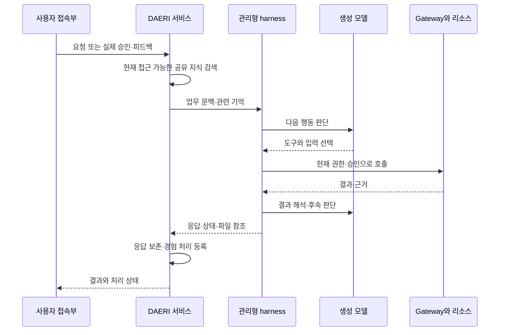

# DAERI 아키텍처

상태: AWS 공용 서비스의 확정 구조와 연결 설계.
사용자 동작·입출력·접근·실패 조건은 [제품 명세](../spec/product.md), 구현 단계와 실제 검증 범위는 [개발 안내](../development/dependencies.md#클라우드-개발-상태)가 소유한다.

DAERI는 같은 서비스를 담당하는 사람들이 업무 경험을 공유하는 멀티 오케스트레이션 에이전트다.
사용자는 Claude Code·Codex에서 요청하고 AWS 관리형 실행 환경이 업무를 수행하며 공용 지식을 다음 업무에 제공한다.

## 구성과 책임

[구성도 SVG](../assets/daeri-agentcore-architecture.svg) · [편집 가능한 FigJam](https://www.figma.com/board/608t1y0YwO88V7Q60xhkkq?node-id=1-2)

| 구성 | 책임 |
|---|---|
| Claude Code·Codex 접속부 | 사용자 요청·실제 승인·피드백 전달, 진행·결과 표시 |
| AgentCore managed harness | 모델·도구 반복·문맥, 총괄 에이전트(orchestrator)의 수행 |
| 하위 에이전트(subagent) | 별도 agent/harness를 MCP 도구로 연결해 배정 목표 수행·근거 반환하는 안 |
| AgentCore Runtime | 에이전트 실행의 격리·확장·호스팅 |
| Gateway·Policy·Identity | MCP·API 연결·인증·접근 정책 집행 |
| AgentCore Memory | 업무별 대화·도구 이력 저장·복구 |
| DAERI 서비스 | 업무·승인·실행 근거, 자동 기억 검색과 경험 정리·저장·정정 |
| PostgreSQL·pgvector | 공유 지식·출처·벡터와 업무·처리 상태 |
| S3 | 근거 자료·분석 파일·산출물 보관안 |
| Observability·Evaluations | 실행 추적과 업무·기억 검색 품질 평가 |

## 요청과 응답의 연결

서버 연결부는 `InvokeHarness`를 호출하고 managed harness가 모델·도구 루프를 담당한다.
DAERI는 호출 전 관련 지식을 제공하고 응답에서 경험 처리 작업을 보존한다.
재사용할 경험의 정리·임베딩·색인은 [지식 처리 서비스](../spec/product.md#공유-기억)가 수행한다.

현재 하위 에이전트 연결안은 총괄 managed harness가 별도 agent/harness를 MCP 도구로 호출하는 agent-as-tool 방식이다.
개별 harness의 생성·대상 연결·결과 수집은 후속 구현이며 고급 라우팅·병렬 조정은 별도 코드가 필요한 범위다.
이는 AWS의 [멀티 에이전트 지원 범위](https://docs.aws.amazon.com/bedrock/latest/userguide/agents-classic-maintenance-mode.html#comparing-capabilities)에 맞춘 분담이다.

## 관리형 기능과 확장

생성 모델은 harness의 지원 제공자 설정, 경험 정리·임베딩은 DAERI의 어댑터로 구성한다.
각 역할은 사내 API 또는 Amazon Bedrock을 독립 선택하며 인증 참조·규격·모델 공간은 [구성 계약](../spec/product.md#설정과-제공자)을 따른다.

다음은 현재 구현에 연결할 관리형 기능의 적용안이며 리소스 배포와 실제 검증은 후속 단계다.

| 역할 | 적용 판단과 연결 조건 |
|---|---|
| 승인 집행 | [Lambda lifecycle hooks](https://docs.aws.amazon.com/bedrock-agentcore/latest/devguide/harness-lifecycle-hooks.html)의 `before_invocation`에 신원·업무 상태, `before_tool_call`에 현재 승인·대상 대조 연결. SNS·EventBridge는 알림·후속 처리 |
| Gateway 승인 이력 | [Temporal policies](https://docs.aws.amazon.com/bedrock-agentcore/latest/devguide/policy-temporal.html)는 DAERI가 검증한 승인 이벤트·대상과 현재 호출을 대응시키는 후보. 같은 계정·리전의 인증된 policy session으로 검증 |
| 경험 처리 실행 | 기존 PG 처리 대기와 점유를 유지한다면 [Scheduler](https://docs.aws.amazon.com/scheduler/latest/UserGuide/schedule-types.html) → 짧은 Lambda 처리안 우선 검증. 1분급 처리 지연과 호출 제한 확인 |
| 분석·파일 | [Code Interpreter·S3](https://docs.aws.amazon.com/bedrock-agentcore/latest/devguide/code-interpreter-s3-integration.html)로 분석·파일 생성을 수행하고 DAERI는 업무·출처·다운로드 접근 연결 |
| 관측·개선 | [기본 CloudWatch 추적](https://docs.aws.amazon.com/bedrock-agentcore/latest/devguide/harness-operations.html)과 Evaluations 활용. 운영 데이터가 쌓이면 [Recommendations·A/B 검증](https://docs.aws.amazon.com/bedrock-agentcore/latest/devguide/optimization.html)으로 변경 효과 평가 |

공유 지식은 두 경로를 비교한다.
현재 PG 구현은 사내 임베딩 API 선택·출처 집합 필터·업무와 처리 대기의 원자적 보존을 지원한다.
관리형 Memory의 [공유 namespace](https://docs.aws.amazon.com/bedrock-agentcore/latest/devguide/specify-long-term-memory-organization.html)·[episodic 전략](https://docs.aws.amazon.com/bedrock-agentcore/latest/devguide/episodic-memory-strategy.html)·[Gateway FGAC](https://docs.aws.amazon.com/bedrock-agentcore/latest/devguide/memory-gateway-fgac.html)는 추출·통합·검색·접근 관리 코드를 줄일 대안이다.
[내장 전략의 모델 선택](https://docs.aws.amazon.com/bedrock-agentcore/latest/devguide/memory-custom-strategy.html), 출처별 접근·정정·업무 저장 조건의 충족 여부를 검증한 뒤 전환을 결정한다.

Gateway가 지원하는 연결은 관리형 기능을 활용하고 stdio·특수 네트워크는 필요한 호스팅·변환 어댑터로 연결한다.
프로젝트의 공유 지식과 업무별 목표·승인·소스 사본을 구분하며 소스 실행 위치·Git 자격은 [배포 조건](../development/dependencies.md#배포와-확장-시-확인할-조건)에서 결정한다.

회사의 신원·현재 프로젝트·출처·승인 문맥은 [접근 계약](../spec/product.md#접근과-동시-업무)에서 해소한다.
코드의 포트·어댑터·조립 경계는 [패키지 안내](../development/dependencies.md#실행-진입점과-모듈)를 따른다.

## 근거

AWS 기능의 책임 분담은 공식 문서의 [Harness와 Runtime](https://docs.aws.amazon.com/bedrock-agentcore/latest/devguide/harness-vs-runtime.html), [모델](https://docs.aws.amazon.com/bedrock-agentcore/latest/devguide/harness-models.html), [도구](https://docs.aws.amazon.com/bedrock-agentcore/latest/devguide/harness-tools.html), [대화 기억](https://docs.aws.amazon.com/bedrock-agentcore/latest/devguide/harness-memory.html), [Gateway 정책](https://docs.aws.amazon.com/bedrock-agentcore/latest/devguide/use-gateway-with-policy.html), [관리형 평가](https://docs.aws.amazon.com/bedrock-agentcore/latest/devguide/evaluations.html)를 기준으로 구성했다.
회사의 실제 지원·인증·네트워크와 전체 서비스 연결은 [개발 상태](../development/dependencies.md#클라우드-개발-상태)에서 검증한다.
