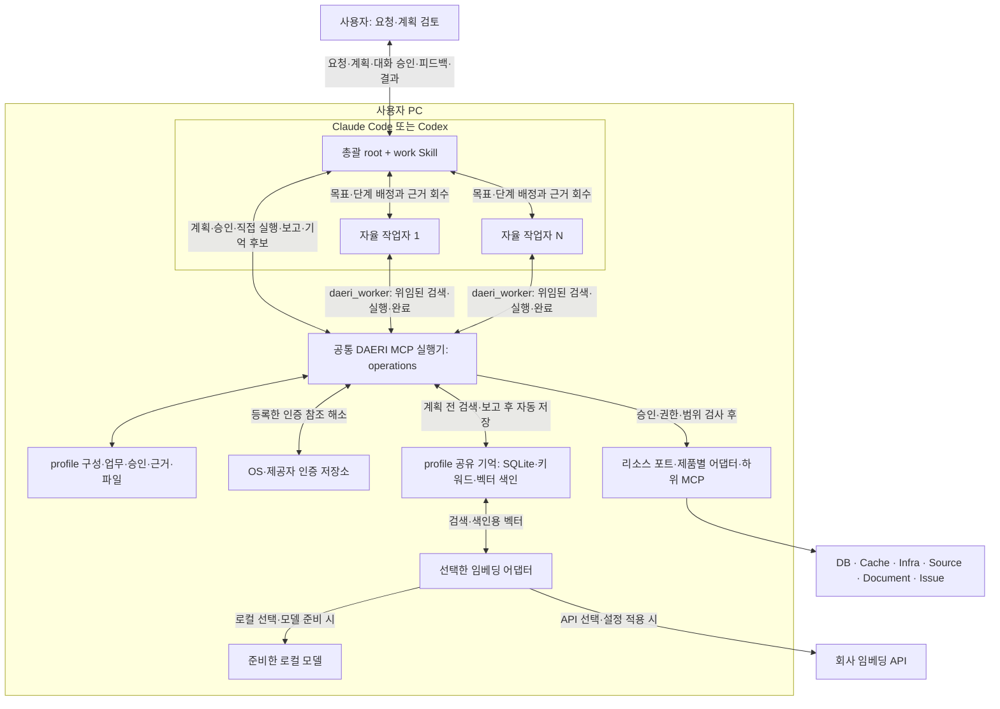

# DAERI 멀티 에이전트 아키텍처

상태: 총괄·호스트 작업자·공통 MCP 실행기의 위임 구현; 실제 호스트 작업자 실행은 별도 검증

Claude Code 또는 Codex의 총괄(root) 에이전트가 요청·계획·사용자 승인을 맡고 필요한 작업자(worker)와 협업한다.
총괄과 작업자는 같은 로컬 DAERI 실행기를 통해 리소스와 profile 기억을 사용한다.
이 문서는 에이전트의 판단·협업과 실행기의 검증·저장 책임을 설명한다.

## 구조와 용어

| 개념 | DAERI에서의 역할 |
|---|---|
| 멀티 에이전트 | 호스트의 총괄과 필요한 수의 작업자가 목표·완료 조건을 나눠 수행하는 구성 |
| 오케스트레이션 | 총괄의 업무 분해·배정·진행 확인·재배정·근거 통합과 실행기의 위임·상태 검사 |
| MCP | 총괄·작업자와 DAERI 실행기, 실행기와 하위 리소스 도구 사이의 통신 규격 |
| 포트·어댑터 | DB·Cache·Infra·Source·Document·Issue의 공통 기능과 제품별 연결·입출력 검사 |

작업자의 역할은 맡은 목표·단계·기능 계약으로 정한다.
한 작업자가 여러 범주의 리소스를 조합할 수 있고 같은 범주의 독립 조사·검증을 여러 작업자에게 나눌 수 있다.

현재 에이전트 협업은 같은 호스트의 네이티브 위임을 사용한다.

## 실행 위치와 책임

MCP(Model Context Protocol)는 호스트가 외부 도구를 찾아 호출하는 통신 규격이다.
MCP 서버는 도구 요청을 처리하는 프로그램이며 DAERI 실행기는 사용자 PC에서 동작한다.
설정·승인 검사·기록은 사용자 PC의 실행기가 관리한다.
모델 추론의 실행 위치와 제공자는 호스트의 계정·플랫폼 설정을 따른다.

| 구성 요소 | 책임 |
|---|---|
| 총괄(root) | 요청 해석·계획·실제 승인 응답 연결·작업 배정·피드백 반영·근거 통합·최종 보고와 기억 후보 선별 |
| 작업자(worker) | 배정한 목표·단계 안에서 기억 검색·리소스 조합·다음 행동을 판단하고 실제 근거·제한·기억 후보를 반환 |
| 플러그인·Skill·worker 정의 | 공통 업무 지침·조정자와 worker의 역할·호스트별 MCP 실행 설정 |
| 관리 CLI·준비 도구 | 명시적인 프로그램·profile·인증·모델 준비와 연결 진단 |
| 로컬 DAERI 실행기 | 같은 업무의 등록부·계획·승인·위임·호출·공유 예산 검사, 이력과 기억의 검증·저장·색인·검색 |
| 포트·어댑터 | 제품별 대상·입출력·제약을 공통 실행 계약으로 연결 |
| 사용자 저장 영역 | 현재 profile JSON, SQLite의 업무·기억 정본·검색 색인, 본문·산출물·모델 파일 |
| 인증 저장소 | OS·제공자 저장소에서 비밀 관리; profile·업무 기록에는 인증 참조만 저장 |
| 임베딩 어댑터 | 선택한 로컬 모델·회사 API로 허용 텍스트와 검색 질의를 벡터로 변환; 키워드 전용은 호출 생략 |

한 로컬 애플리케이션 안에서 공개 DTO·저장·어댑터·기억의 책임을 나눈다.

## 오케스트레이션과 자율 수행

호스트의 추론을 재사용하고 연결·승인·이력은 공통 실행기로 관리한다.
총괄은 독립 조사·분석·검증의 이득이 있을 때 승인된 단계를 필요한 수의 작업자에게 배정한다.
짧은 처리와 앞선 결과가 필요한 순차 판단은 총괄이 직접 이어간다.

총괄과 작업자는 승인한 의존 관계·분기·예산과 담당 단계 안에서 리소스·도구·분석 방법·다음 행동을 자율적으로 선택한다.
실행기는 각 호출의 입력·효과·범위와 같은 업무의 누적 사용량을 검사한다.

총괄이 `daeri_worker`의 `create`로 위임을 발급받은 뒤 호스트 도구로 실제 작업자를 시작한다.
작업자의 생성·추론·대기·중단은 호스트가, 위임·토큰·기한·철회와 실행 검사는 DAERI가 담당한다.

작업자는 `daeri_worker`로 할당 복구·기억 검색·허용 근거 읽기·실행·완료를 처리한다.
총괄은 저장한 근거를 대조하고 후속 수행·재배정·최종 보고를 결정한다.

작업자를 시작할 수 없는 환경은 위임을 회수하고 총괄이 직접 이어간다.
위임 철회·호스트 중단·진행 중 호출의 복구는 [위임 조건](../spec/tasks/approval.md#worker-위임과-승인-범위)과 [실행 수명](../spec/tasks/workflow.md#worker-위임과-병렬-실행)을 따른다.
호스트별 전달 방법·도구 권한·실제 확인 범위는 [플러그인 사양](../spec/hosts/plugins.md)이 소유한다.

## 공유 기억과 리소스 연결

기억 활용에는 검색한 지식을 참고해 계획·답을 만드는 Agentic RAG 방식을 채택한다.
총괄은 계획 전에 관련 기억을 조회하고 작업자는 배정 범위에서 필요한 경험과 후속 검색을 판단한다.
기억은 profile별로 공유하며 실제 대상·현재 권한·기한으로 제공 범위를 확인한다.

작업자의 실제 근거·기억 후보와 사용자 피드백을 종합해 총괄이 보고를 제출하면 실행기가 선별 지식을 자동 저장·임베딩·색인한다.
기억 처리의 대기·부분 실패는 업무 결과와 함께 반환한다.
같은 profile의 다음 총괄 기억 검색이나 같은 보고 재전달에서 대기 작업을 재시도한다.

실행기는 키워드·벡터 검색을 결합하고 정본과 색인의 수명·권한을 검사한다.
로컬 저장은 SQLite·파일, 키워드 검색은 SQLite FTS5를 채택한다.
벡터는 SQLite 테이블에 보관하고 벡터 확장으로 유사도를 계산한다.

임베딩은 profile별로 로컬 모델·회사 API·키워드 전용 중에서 선택한다.
회사 API 선택은 검색·색인의 임베딩 생성 위치를 결정하고 자료 사용 범위는 승인 계획과 현재 정책으로 검사한다.
지원 조합과 고정한 패키지는 [의존성 정본](../development/dependencies.md#의존성의-정본), 모델·색인·부분 검색 처리는 [기억 사양](../spec/tasks/memory.md)을 따른다.

리소스는 [기존 MCP 재사용](../spec/resources/contract.md)을 기본으로 한다.
DAERI는 호스트에는 MCP 서버, 하위 MCP에는 클라이언트로 동작한다.
어댑터는 연결 제품의 의미·제약을 설명하고 확인된 부족분만 보완한다.

## 업무와 설정의 연결

setup은 접속·인증 YAML을 검증·적용하고 로컬 실행기는 인증 등록과 연결·검색 준비를 처리한다.
준비한 profile의 work는 기억 조회 → 계획·대화 승인 → 총괄·작업자의 자율 수행 → 근거 통합·보고 → 자동 기억으로 이어진다.
실행 이력은 추적·복구에, 선별 기억과 검색 색인은 다음 업무의 판단에 사용한다.

| 상세 계약 | 정본 |
|---|---|
| 접수·반복 판단·협업·피드백·중단·재개·보고 | [업무 흐름](../spec/tasks/workflow.md) |
| 사용자 진입·호스트 작업자 생성·도구 권한 | [플러그인·Skill](../spec/hosts/plugins.md) |
| profile·YAML·인증·저장·삭제 | [사용자 구성](../spec/configuration/profiles.md) |
| 공개 도구·입출력·오류·멱등 처리 | [MCP 규격](../spec/mcp/common.md) |
| 설치·전달·업데이트·선택 모델 준비 | [환경 준비](../spec/installation/environment.md) |
| 담당 코드·자료 흐름·검증 위치 | [구현 모듈](../development/dependencies.md#실행-진입점과-모듈)·[검증 범위](../plans/initial-implementation.md#현재-구현-단위와-검증-경계) |

## 권한과 데이터의 경계

Skill·프롬프트는 호스트의 행동 지침을 제공하고 실행기는 실제 호출의 권한을 검사한다.
DAERI를 통한 호출은 로컬 실행기의 승인·범위 검사와 리소스 자체 권한으로 제한한다.
호스트 shell·다른 MCP의 직접 접근은 각 호스트·리소스의 권한 체계가 관리한다.

worker 위임은 DAERI 도구의 접수 범위를 정하며 호스트의 도구·프로세스 권한은 해당 호스트에서 관리한다.
위임 토큰의 소지는 해당 범위의 호출 자격이며 토큰을 전달받은 호스트 worker와 통신 경로는 호스트의 신뢰 경계에 속한다.

[사용자 승인](../spec/hosts/approval.md)은 호스트 대화에서 현재 계획에 대한 명시적 응답으로 받는다.
호스트는 사용자 응답을 업무·계획에 연결해 전달하고 실행기는 현재 상태·계획·허용 범위를 검사한다.
현재 승인 경로는 사용자가 로그인한 호스트 대화와 정상 동작하는 로컬 실행기의 연결을 신뢰한다.

비밀값은 로컬 인증 저장소에서 해소하고 전송 경계에서 주입한다.
허용 자료는 호스트 모델 입력에 포함될 수 있어 모델 제공·마스킹·내보내기·보관 범위도 승인한다.
로그·코드·문서·기억은 분석 자료로 해석한다.

실행 정책은 관리 설정과 실제 사용자 승인에서 해소하며 기억 검색도 현재 profile·실제 대상·기한을 검사한다.

현재 판단·실행 루프의 수명은 호스트·PC의 활성 상태를 따른다.
재개·무인 실행의 범위는 [업무 흐름](../spec/tasks/workflow.md)과 [최초 구현 계획](../plans/initial-implementation.md)을 따른다.

## 첫 버전의 확장 경계

현재 등록 목적은 `collect`·`verify`이며 파일 생성기는 텍스트·JSON·CSV를 제공한다.
추가 실행 목적·측정 상한·출력 형식은 검사·강제·완료 확인 계약을 갖춘 뒤 등록한다.
새 제품은 기존 포트에 맞는 대상 해석·권한·입출력·제약 검사를 갖춰 추가한다.

패키징·실제 로컬 모델·하위 프로그램 조합·모의 리소스 통합은 [최초 구현 계획](../plans/initial-implementation.md#현재-구현-단위와-검증-경계)에서 확인 범위를 구분한다.
실제 회사의 리소스·인증·호스트 설치와 Windows 실행은 해당 환경에서 검증해야 한다.
