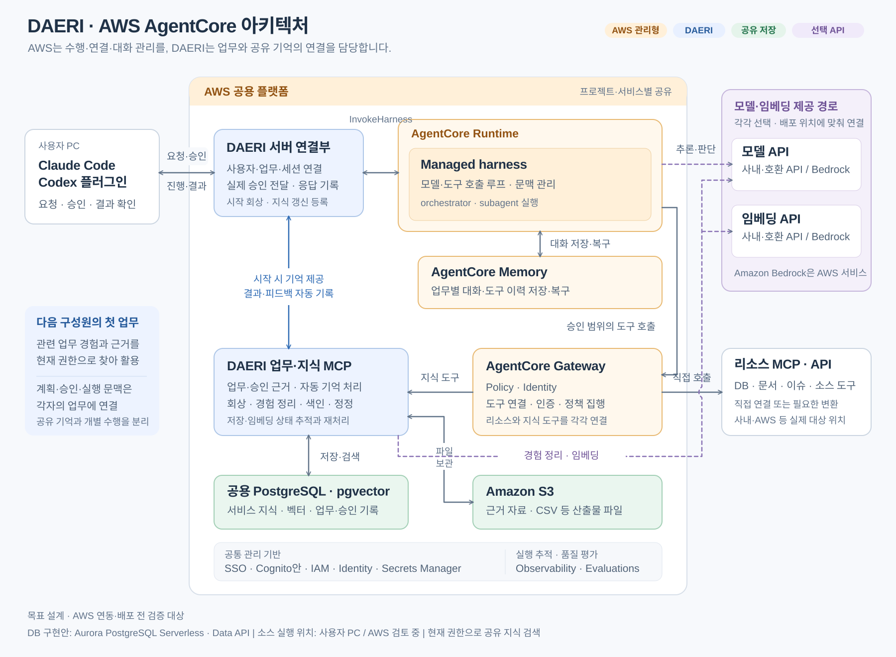
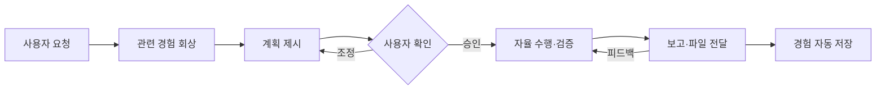
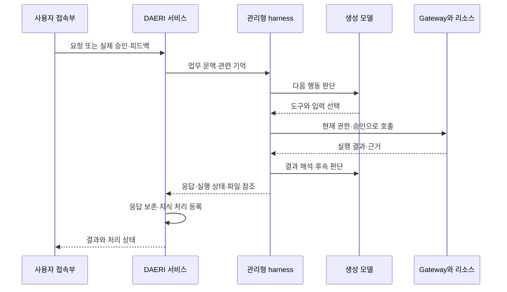

# DAERI 아키텍처

상태: AWS 기반 공용 서비스의 확정 구조와 구현 경계.
클라우드 기능은 개발 중이며 현재 구현·검증 범위는 [개발 안내](../development/dependencies.md#클라우드-개발-상태)를 따른다.
기존 PC 실행 제품은 `local-agent` 브랜치에 보존한다.

DAERI는 같은 서비스를 담당하는 사람들이 업무 경험을 공유하는 멀티 오케스트레이션 에이전트다.
사용자는 Claude Code·Codex에서 요청하고, AWS 관리형 실행 환경이 업무를 수행하며 공용 기억을 다음 업무에 제공한다.

## 구조와 용어

[구성도 SVG](../assets/daeri-agentcore-architecture.svg) · [편집 가능한 FigJam](https://www.figma.com/board/608t1y0YwO88V7Q60xhkkq?node-id=1-2)

| 구성 | 책임 |
|---|---|
| 접속부 | Claude Code·Codex에서 요청·실제 사용자 승인·피드백 전달과 진행·결과 표시 |
| AgentCore managed harness | 생성 모델·도구 호출 반복, 문맥 관리와 총괄 에이전트(orchestrator)의 수행 |
| AgentCore Runtime | 에이전트 실행의 격리·확장·호스팅 |
| Gateway·Policy·Identity | 리소스 MCP·API 연결, 인증과 접근 정책 집행 |
| AgentCore Memory | 업무별 대화·도구 이력의 저장·복구 |
| DAERI 서비스 | 업무·승인·실행 근거, 자동 회상과 공유 지식 정리·저장·정정 |
| PostgreSQL·pgvector | 프로젝트의 공유 지식·출처·벡터와 업무·승인·처리 상태 |
| S3 | 근거 자료·분석 파일·산출물 |
| Observability·Evaluations | 실행 추적과 업무·회상 품질 평가 |

프로젝트는 구성원과 공유 기억의 경계, 서비스는 업무 대상, profile은 서비스·환경별 연결 묶음이다.
기억은 현재 프로젝트·서비스·출처 접근 조건으로 제공하고, 목표·계획·승인·작업 사본은 개별 업무에 연결한다.
하위 에이전트(subagent)는 총괄 에이전트가 배정한 목표를 수행하며 생성·위임·취소·결과 수집의 연결은 구현·검증 범위다.

## 사용자 요청에서 결과까지

가상 사례: “국가별 EV 충전소 개수를 확인하고 CSV로 정리해 줘”라고 요청하면 이전 집계 기준·자료 구조·실패 경험을 참고해 계획한다.
승인 후 현재 자료를 조회·검증해 CSV를 제공하고, 확인한 절차와 피드백을 다음 구성원이 활용할 지식으로 남긴다.

## 오케스트레이션과 자율 수행

생성 모델이 다음 행동을 판단하고 harness가 도구 호출·결과 전달·반복을 담당한다.
승인 범위에서 도구·분석 방법·순서·하위 작업·결과 형식은 총괄 에이전트가 선택한다.
목표·대상·효과가 승인 범위를 바꾸면 변경 계획을 실제 사용자에게 확인한다.

서버 연결부는 AWS API인 `InvokeHarness`를 호출한다.
현재 로컬 MCP 연결과 별도로 요청·스트리밍·사용자 응답을 전달하는 클라우드 접속부를 구현한다.
계획 확인은 harness의 inline function 대기와 실제 사용자 응답을 연결하는 안이며 세부 경계는 [승인 명세](../spec/tasks/approval.md#클라우드-업무-승인)를 따른다.

## 공유 기억과 리소스 연결

DAERI는 요청을 받으면 현재 접근 가능한 기억을 검색해 계획 문맥에 제공한다.
결과·근거·피드백은 응답 처리에서 보존하고 지식 갱신 작업을 등록한다.
지식 서비스가 재사용할 경험을 정리하고 임베딩·색인을 처리하므로 기록·처리 등록은 서버가 보장한다.
저장·검색·색인 실패의 동작과 대화 기억의 구분은 [공유 기억](../spec/tasks/memory.md#클라우드-공유-기억)을 따른다.

Gateway에 직접 연결할 수 있는 리소스 MCP·API는 관리형 연결을 사용한다.
stdio·특수 네트워크 연결은 필요한 호스팅·변환 어댑터를 둔다.
DAERI 업무·지식 MCP는 프로젝트의 상태·기억 도구를 제공하며 리소스 호출의 중복 중계는 직접 연결 경로로 정리한다.

생성 모델과 임베딩 제공자는 독립적으로 선택한다.
생성 모델은 harness의 지원 제공자 설정, 임베딩은 DAERI의 연결 어댑터를 통해 사내 API 또는 Amazon Bedrock을 사용한다.
실제 API 호환성·모델 접근·인증·네트워크와 모델 변경의 재색인은 [구성 명세](../spec/configuration/profiles.md#클라우드-구성)를 따른다.

## 권한과 데이터의 경계

검증한 사용자 신원·프로젝트 구성원·현재 출처 권한을 기억·파일·도구 호출에 적용한다.
Gateway Policy·Identity는 리소스 접근을, DAERI는 업무와 실제 승인 응답의 연결을 담당한다.
기본 shell·파일 도구는 해당 실행 경계에서 검사하며 승인·자료·실행 문맥의 전달을 검증한다.

회사 SSO·Cognito·IAM, 외부 자격의 Identity, 별도 비밀의 Secrets Manager를 우선 활용하는 안이다.
구체 회사 설정과 계정·리전·보존 조건은 배포 환경을 연결할 때 확정한다.

## 동시 업무와 소스 수정

여러 사용자의 업무는 같은 서비스 지식을 회상하고 각자의 계획·승인·실행 상태를 사용한다.
코드 수정은 저장소별 기준 commit과 업무별 worktree·사본·브랜치에서 진행한다.
통합 시 최신 대상 브랜치와 충돌·테스트를 확인하고 미병합 변경·병합 commit·실제 배포 버전을 구별해 기억한다.

실제 코드 작업 위치는 PC 또는 AWS 중 사내망·도구·Git 자격·기존 작업 상태를 대조해 결정한다.
초기 개발은 공용 기억의 요청·저장 흐름을 먼저 완성하고 소스 실행 연결은 별도 단계로 진행한다.

## 제공 범위와 검증

기존 코드의 로컬 호스트 실행·MCP·SQLite 명세는 해당 문서의 로컬 구현 절에 유지한다.
클라우드의 현재 개발 단위·남은 결정·실제 연동 검증은 [개발 상태](../development/dependencies.md#클라우드-개발-상태)에서 관리한다.

AWS 기능의 근거: [Harness와 Runtime](https://docs.aws.amazon.com/bedrock-agentcore/latest/devguide/harness-vs-runtime.html), [모델](https://docs.aws.amazon.com/bedrock-agentcore/latest/devguide/harness-models.html), [도구](https://docs.aws.amazon.com/bedrock-agentcore/latest/devguide/harness-tools.html), [대화 기억](https://docs.aws.amazon.com/bedrock-agentcore/latest/devguide/harness-memory.html), [Gateway 정책](https://docs.aws.amazon.com/bedrock-agentcore/latest/devguide/use-gateway-with-policy.html), [관리형 평가](https://docs.aws.amazon.com/bedrock-agentcore/latest/devguide/evaluations.html).
