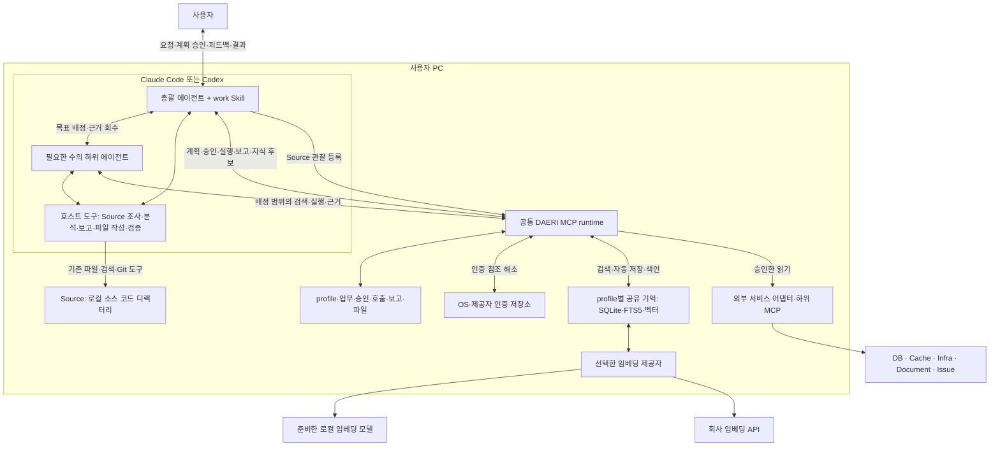

# DAERI 아키텍처

상태: 호스트 총괄 에이전트·하위 에이전트와 공통 MCP runtime의 협업 구현; 실제 호스트 하위 에이전트·회사 연결은 별도 검증

DAERI는 Claude Code·Codex의 총괄 에이전트와 하위 에이전트가 서버 운영 업무를 수행하는 멀티 오케스트레이션 에이전트다.
호스트는 판단·협업·분석을, 사용자 PC의 DAERI runtime은 승인된 실행·기록·공유 기억을 맡는다.
이 문서는 구성 요소와 책임 경계를 설명한다.

## 구조와 용어

| 개념 | 역할 |
|---|---|
| 멀티 오케스트레이션 에이전트 | 총괄 에이전트와 필요한 하위 에이전트가 목표·완료 조건을 나누어 협업하는 구성 |
| 총괄 에이전트(orchestrator) | 요청·계획·실제 승인 응답 연결·업무 배정·근거 통합·완료 판단·지식 선별 |
| 하위 에이전트(subagent) | 배정한 목표의 조회·분석·검증·후속 행동 선택과 근거 반환 |
| 오케스트레이션 | 업무 분해·배정·진행 확인·근거 통합 |
| runtime | 승인·위임·읽기 실행·이력·기억을 관리하는 로컬 DAERI MCP 서버 |
| MCP | 호스트·runtime·하위 리소스 도구 사이의 통신 규격 |
| 포트·어댑터 | 리소스 범주의 공통 기능과 제품별 연결·입출력 처리 |

하위 에이전트의 역할은 배정한 목표·단계로 정한다.
한 하위 에이전트가 여러 리소스를 조합하고 같은 범주의 독립 조사를 여러 하위 에이전트가 나누어 수행할 수 있다.
실제 협업은 호스트의 네이티브 하위 에이전트 기능을 사용한다.

## 실행 위치와 책임

모델 추론은 호스트의 계정·플랫폼 설정을 따른다.
플러그인이 연결한 DAERI MCP runtime은 사용자 PC에서 동작하고 하위 MCP·인증 저장소·로컬 자료를 사용한다.

| 구성 | 책임 |
|---|---|
| 호스트 도구 | 로컬 Source 조사, 계산·보고·표·파일 내용 작성·검증과 하위 에이전트 생성 |
| 플러그인·Skill | 업무 진입·역할 지침·호스트별 runtime 연결 |
| DAERI runtime | 연결·승인·범위·현재 상태 검사, 실행·보고·파일·기억 보존 |
| 포트·어댑터 | 실제 제품의 대상·입출력·읽기 의미를 공통 기능에 연결 |
| 관리 도구 | setup YAML·profile·인증·모델 준비와 연결 진단 |
| 사용자 저장 영역 | 편집 설정, profile 개정, 업무·기억 정본과 색인·등록 파일 |
| 임베딩 제공자 | 선택한 로컬 모델·회사 API로 기억·질의를 벡터로 변환; 키워드 전용은 FTS5 사용 |

## 오케스트레이션과 자율 수행

총괄 에이전트는 계획을 저장하고 대화에서 실제 사용자 승인을 받는다.
이후 승인한 연결·대상·명시 범위 안에서 도구·질의·필터·페이지·분석 방법·읽기 재시도를 선택한다.
독립 조사·검증의 이득이 있으면 하위 에이전트를 배정하고 순차 판단은 직접 이어간다.

runtime은 현재 연결의 읽기 도구·스키마·명시 범위와 실제 근거를 검사한다.
인증과 서비스의 실제 계정 권한은 연결 시 적용한다.
요청 ID·업무 개정·호출 ID·기능 지문과 승인 연결은 runtime의 기록 책임이다.
기본 업무는 누적 호출·시간 상한 없이 수행하며 명시한 한도를 공유 적용한다.

호스트는 자료의 전체성·시점·누락을 판단하고 보고·파일 내용을 검증한다.
runtime은 등록 출처·현재 제공 조건·파일 경로·무결성·기한을 확인한다.
하위 에이전트의 생성·신원·도구 권한은 호스트가, 위임과 DAERI 접수 범위는 runtime이 관리한다.

하위 에이전트 사용이 어려운 환경에서는 총괄 에이전트가 같은 승인으로 직접 수행한다.
위임·동시 실행·중단·재개는 [업무 흐름](../spec/tasks/workflow.md#하위-에이전트-위임과-병렬-실행), 승인 범위 변경은 [계획 명세](../spec/tasks/approval.md#자율-실행과-재계획의-경계)를 따른다.

## 공유 기억과 리소스 연결

호스트는 관련 지식을 검색하고 현재 목표에 적용할지를 판단하는 Agentic RAG를 사용한다.
총괄 에이전트는 계획 전 관련 기억을 확인하고 하위 에이전트는 배정 범위에서 필요한 후속 검색을 판단한다.
검색의 실패·0건·생략은 부족한 맥락으로 처리하고 실제 선택한 기억의 유효성을 확인한다.
선택 기억의 만료·정정은 현재 상태로 안내하고 호스트가 같은 승인 범위의 관찰로 보완한다.

총괄 에이전트는 실제 관찰·하위 에이전트 근거·사용자 피드백에서 재사용할 지식을 선별해 보고와 함께 제출한다.
runtime은 현재 출처·대상·보존 조건을 검사하고 정본 저장·선택한 임베딩 색인을 자동 처리한다.
저장·색인 대기는 같은 보고 재전달이나 다음 profile 검색에서 재시도한다.
후보와 상태의 의미는 [자동 기억](../spec/tasks/memory.md#업무-후-갱신과-정정)이 정의한다.

SQLite는 업무·profile별 기억 정본과 벡터를 보관하고 FTS5·sqlite-vec가 검색을 담당한다.
임베딩은 로컬 모델·회사 API·키워드 전용 중 setup에서 선택한다.
회사 API는 OpenAI 호환 규격을 사용하며 설정 적용은 해당 API의 검색·색인 전송 선택을 포함한다.
정본·벡터는 로컬에 유지하고 profile·실제 대상·현재 제공 조건·기한으로 기억을 구분한다.

리소스 연결은 [기존 도구 재사용](../spec/resources/contract.md)을 기본으로 한다.
DAERI는 호스트에는 MCP 서버, 외부 서비스의 하위 리소스에는 MCP 클라이언트로 동작한다.
어댑터는 제품별 대상·입출력·읽기 의미를 해소한다.
로컬 Source는 호스트가 등록 디렉터리를 기존 도구로 조사하고 `local_source` 어댑터가 그 관찰을 업무 근거로 연결한다.
로컬 편집·실행·Git 작업의 권한과 인증은 호스트 환경을 따르며 [Source 지원 범위](../spec/resources/adapters.md#로컬-소스-코드)를 따른다.

## 업무와 설정의 연결

setup의 접속·인증 YAML 적용 → 업무 요청 → 계획 승인 → 자율 수행 → 보고·자동 기억으로 이어진다.
실행 이력은 추적·복구에, 선별 기억은 다음 업무의 판단에 사용한다.

| 상세 내용 | 정본 |
|---|---|
| 업무·협업·보고·중단·재개 | [업무 흐름](../spec/tasks/workflow.md) |
| 사용자 진입·하위 에이전트 연결 | [플러그인·Skill](../spec/hosts/plugins.md) |
| YAML·profile·인증·저장·삭제 | [사용자 구성](../spec/configuration/profiles.md) |
| 도구·입출력·오류 | [MCP 규격](../spec/mcp/common.md) |
| 설치·업데이트·모델 준비 | [환경 준비](../spec/installation/environment.md) |
| 구현·검증 위치 | [패키지 책임·의존 관계](../development/dependencies.md#실행-진입점과-모듈)·[구현과 검증](../development/dependencies.md#구현과-대표-검증) |

## 권한과 데이터의 경계

DAERI 도구의 실행은 실제 사용자 승인·읽기 전용 경계·연결 계정의 권한을 적용한다.
호스트 shell·다른 MCP·하위 에이전트의 실제 도구 권한은 해당 호스트와 리소스가 관리한다.
위임 토큰은 배정의 호출 자격이며 실제 하위 에이전트 신원과 전달 경로는 호스트의 책임이다.

사용자 결정은 [현재 계획에 대한 실제 대화 응답](../spec/hosts/approval.md)에서 해소한다.
호스트는 응답의 출처·의미를, runtime은 저장 계획·현재 상태·연결을 검사한다.
자료의 코드·로그·문서·기억은 분석 입력으로 사용한다.

비밀값은 로컬 인증 저장소에서 해소하고 필요한 전송에 주입한다.
자료에는 현재 연결의 제공·보관 조건, profile 분리, 실제 대상·만료·삭제 상태를 적용한다.
무관한 profile 변경·설명·인증값 갱신은 현재 업무를 유지한다.
연결·대상 변경은 설정·진단 뒤 새 업무로 접수하고 같은 연결의 스키마·읽기 의미 변경은 계획에 반영한다.

## 제공 범위와 검증

현재 실행은 등록된 읽기·검증 기능을 사용한다.
보고·파일의 형식과 내용은 호스트 도구가 작성하고 runtime은 실행·출처·저장을 맡는다.
판단·실행 루프는 호스트·PC의 활성 상태를 따르며 중단 뒤 저장 기록에서 재개한다.

로컬 계약·모의 리소스·패키징·임베딩의 확인 범위는 [구현과 검증](../development/dependencies.md#구현과-대표-검증)을 따른다.
실제 회사 인증·API·리소스, 호스트 설치·하위 에이전트 실행과 Windows 환경은 별도 검증 대상이다.
