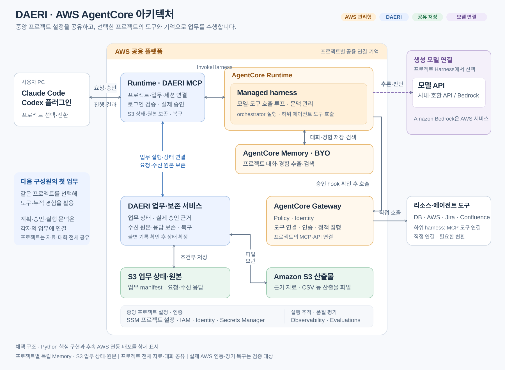
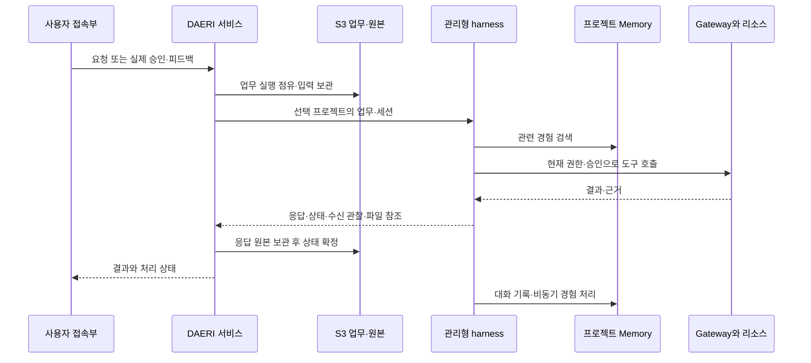

# DAERI 아키텍처

상태: AgentCore Memory·S3를 채택한 AWS 공용 서비스 구조.
사용자 동작·입출력·접근·실패 조건은 [제품 명세](../spec/product.md), 구현 단계와 실제 검증 범위는 [개발 안내](../development/dependencies.md#클라우드-개발-상태)가 소유한다.

DAERI는 같은 프로젝트의 구성원이 중앙 연결한 리소스와 업무 경험을 함께 사용하는 멀티 오케스트레이션 에이전트다.
사용자는 Claude Code·Codex 플러그인에서 회사 로그인 뒤 프로젝트를 선택하고 AWS 관리형 실행 환경에 업무를 맡긴다.

## 구성과 책임

DAERI 자체의 업무·기억 저장은 Memory·S3로 구성하며 업무 대상 DB·API는 프로젝트 리소스로 연결한다.
아래 그림은 채택 구조와 후속 접속·승인·관리형 연결을 함께 나타내며 실제 제공 범위는 [제품 명세](../spec/product.md#현재-제공-범위)를 따른다.

| 구성 | 책임 |
|---|---|
| Claude Code·Codex 접속부 | 회사 로그인·프로젝트 선택, 요청·실제 승인·피드백 전달, 진행·결과 표시 |
| 회사 IdP·인증 경계 | 사용자 신원과 프로젝트 전체 자료·대화·과거 기억을 공유할 수 있는 구성원인지 확인 |
| SSM Parameter Store | 프로젝트 이름·harness ARN의 중앙 참조 |
| AgentCore managed harness | 모델·도구 반복·문맥, 총괄 에이전트 수행과 inline 도구의 대기·재개 |
| AgentCore Runtime | 에이전트 실행의 격리·확장·호스팅 |
| 프로젝트별 BYO Memory | 업무 대화와 공유 namespace의 경험 추출·통합·의미 검색 |
| DAERI 서비스 | 허용 목록·업무·세션·실제 승인 연결, S3 상태·원본 보존과 저장 장애 복구 |
| S3 | 업무별 상태 문서(manifest), 접수·수신한 불변 원본과 산출물 |
| Gateway·Policy·Identity | MCP·API 연결·자격 관리·리소스 접근 정책 집행 |
| Observability·Evaluations | 실행 추적과 업무·기억 검색 품질 평가 |

하위 에이전트는 총괄 managed harness가 별도 agent/harness를 MCP 도구로 호출하는 agent-as-tool 방식으로 연결한다.
개별 harness 생성·대상 연결·결과 수집은 후속 구현이며 고급 라우팅·병렬 조정은 별도 코드가 필요한 범위다.
이는 AWS의 [멀티 에이전트 지원 범위](https://docs.aws.amazon.com/bedrock/latest/userguide/agents-classic-maintenance-mode.html#comparing-capabilities)에 맞춘 분담이다.

## 요청과 응답의 연결

회사 인증 경계는 검증한 사용자·프로젝트를 전달하고 DAERI는 중앙 설정을 조회해 허용된 목록을 반환한다.
사용자가 선택한 프로젝트에서 업무를 시작하면 harness ARN을 업무에 고정하며 재개·복구는 작성 사용자·프로젝트와 원래 실행 대상을 확인한다.

서버 연결부는 `InvokeHarness`를 호출하고 managed harness가 모델·도구 루프와 [Memory 자동 검색·수집](https://docs.aws.amazon.com/bedrock-agentcore/latest/devguide/harness-memory.html)을 담당한다.
Memory가 경험 추출·임베딩·색인과 [내장 의미 검색](https://docs.aws.amazon.com/bedrock-agentcore/latest/devguide/memory-types.html)을 관리한다.
자동 경험 추출·검색의 실제 사용자 간 공유·지연·정정 동작은 AWS 연동에서 검증한다.

## 중앙 리소스 연결

프로젝트 운영자는 모델·도구·자격·Memory를 AWS 리소스에 중앙 등록하고 구성원은 해당 프로젝트를 선택한다.
[Parameter Store](https://docs.aws.amazon.com/systems-manager/latest/userguide/systems-manager-parameter-store.html)는 프로젝트와 배포된 harness를 연결하며 JSON·허용 목록은 [프로젝트 설정 계약](../spec/product.md#중앙-프로젝트-설정)을 따른다.
Harness의 [도구 설정](https://docs.aws.amazon.com/bedrock-agentcore/latest/devguide/harness-tools.html)에 Gateway ARN을 연결하면 Gateway가 제공하는 MCP 도구를 사용할 수 있다.

Gateway는 [remote MCP](https://docs.aws.amazon.com/bedrock-agentcore/latest/devguide/gateway-target-MCPservers.html), [OpenAPI](https://docs.aws.amazon.com/bedrock-agentcore/latest/devguide/gateway-schema-openapi.html), [Lambda](https://docs.aws.amazon.com/bedrock-agentcore/latest/devguide/gateway-add-target-lambda.html) 대상을 연결·변환한다.
모델·도구·자격과 Memory 설정은 각 AWS 리소스에서 관리하며 DAERI는 프로젝트·업무·승인·보존을 연결한다.

stdio MCP는 중앙에서 실행 가능한 HTTP MCP로 호스팅·변환한다.
[AgentCore Runtime의 MCP 계약](https://docs.aws.amazon.com/bedrock-agentcore/latest/devguide/runtime-mcp-protocol-contract.html)은 Streamable HTTP를 요구하므로 패키지·프로세스·의존성의 배포가 필요하다.
사내 리소스는 [Gateway VPC 연결](https://docs.aws.amazon.com/bedrock-agentcore/latest/devguide/gateway-vpc-egress.html)이나 VPC 내 실행 위치에서 접근하고 회사 네트워크·CA·자격 조건을 확인한다.
프로젝트 자격·공유 PAT·사용자별 OAuth의 구분은 [접근 계약](../spec/product.md#접근과-동시-업무)을 따른다.

## 기억과 원본의 수명

[BYO Memory](https://docs.aws.amazon.com/bedrock-agentcore/latest/devguide/harness-memory.html)는 프로젝트마다 harness와 독립된 수명으로 생성하고 고정된 [공유 namespace](https://docs.aws.amazon.com/bedrock-agentcore/latest/devguide/specify-long-term-memory-organization.html)를 사용한다.
`actorId`는 실사용자로 유지하며 장기 전략·자동 검색을 harness에 연결한다.
공유 namespace는 출처별 검색 권한을 대신하지 않으므로 프로젝트 전체 공유가 가능한 구성원을 인증 경계에서 확인한다.

단기 이벤트의 [보존 한도는 최대 365일](https://docs.aws.amazon.com/bedrock-agentcore-control/latest/APIReference/API_Memory.html)이며 장기 기억은 [TTL을 생략하면 만료되지 않는다](https://docs.aws.amazon.com/bedrock-agentcore/latest/devguide/long-term-record-ttl.html).
장기 기억은 [통합 과정에서 교체·삭제될 수 있으므로](https://docs.aws.amazon.com/bedrock-agentcore/latest/devguide/memory-record-streaming.html) 원본은 S3에 별도로 보존한다.
S3 원본은 자동 만료를 생략하고 버전 관리·삭제 권한·배포 제거 정책으로 Memory·harness와 독립된 수명을 유지한다.

[원본 보관 범위](../spec/product.md#공유-기억)는 DAERI가 실제 접수·수신한 기록이다.
추가 Memory 이벤트 수집·재구성과 중복 처리는 후속 개발이며 S3 보관만으로 Memory의 자동 재색인이나 원래 세션의 영구 재개가 보장되지는 않는다.
단기 이벤트 만료 뒤 S3 원본으로 새 세션·현재 계획·승인을 준비하는 복구 경로도 실제 AWS에서 검증한다.

## S3 업무 상태와 장애 복구

업무 manifest는 [S3 조건부 쓰기](https://docs.aws.amazon.com/AmazonS3/latest/userguide/conditional-writes.html)의 `If-Match`로 같은 업무의 동시 진입을 조정한다.
호출 후에는 `If-None-Match: *`로 불변 응답 원본을 먼저 보관하고 실제 보관 성공을 확인한 뒤 manifest를 확정한다.
상태 갱신 실패에는 저장된 응답으로 복구하며 원본이 없는 불확실한 실행은 실제 세션·외부 효과를 확인해야 한다.
사용자에게 보이는 오류·재개 조건은 [요청과 재개](../spec/product.md#요청과-재개)를 따른다.

[S3 원자성은 단일 객체에 한정](https://docs.aws.amazon.com/AmazonS3/latest/userguide/Welcome.html)되므로 Harness 호출·원본·상태를 묶는 트랜잭션과 외부 작업의 정확히 한 번 실행은 보장하지 않는다.
운영 서비스 수를 줄이는 구성이며 충돌·중간 장애 판정·운영 목록·상태 복구는 DAERI의 책임이다.
SDK·모의 검증과 실제 S3·Memory 연결의 경계는 [구현과 대표 검증](../development/dependencies.md#구현과-대표-검증)에서 구분한다.

## 관리형 기능과 확장

다음은 현재 핵심 구현에 연결할 관리형 기능이며 리소스 배포와 실제 검증은 후속 단계다.

| 역할 | 적용 판단과 연결 조건 |
|---|---|
| 승인 집행 | [Lambda lifecycle hooks](https://docs.aws.amazon.com/bedrock-agentcore/latest/devguide/harness-lifecycle-hooks.html)의 `before_invocation`에 신원·업무 상태, `before_tool_call`에 현재 승인·대상 대조 연결 |
| Gateway 승인 이력 | [Temporal policies](https://docs.aws.amazon.com/bedrock-agentcore/latest/devguide/policy-temporal.html)에 검증한 승인 이벤트·현재 호출을 대응시키는 후보; 같은 계정·리전의 인증된 policy session으로 검증 |
| 분석·파일 | [Code Interpreter·S3](https://docs.aws.amazon.com/bedrock-agentcore/latest/devguide/code-interpreter-s3-integration.html)로 분석·파일을 생성하고 업무·다운로드 접근 연결 |
| 관측·개선 | [CloudWatch 추적](https://docs.aws.amazon.com/bedrock-agentcore/latest/devguide/harness-operations.html)·Evaluations와 [Recommendations·A/B 검증](https://docs.aws.amazon.com/bedrock-agentcore/latest/devguide/optimization.html)으로 변경 효과 평가 |

업무별 소스 실행 위치·Git 자격은 [배포 조건](../development/dependencies.md#배포와-확장-시-확인할-조건), 포트·어댑터·조립 경계는 [패키지 안내](../development/dependencies.md#실행-진입점과-모듈)를 따른다.
