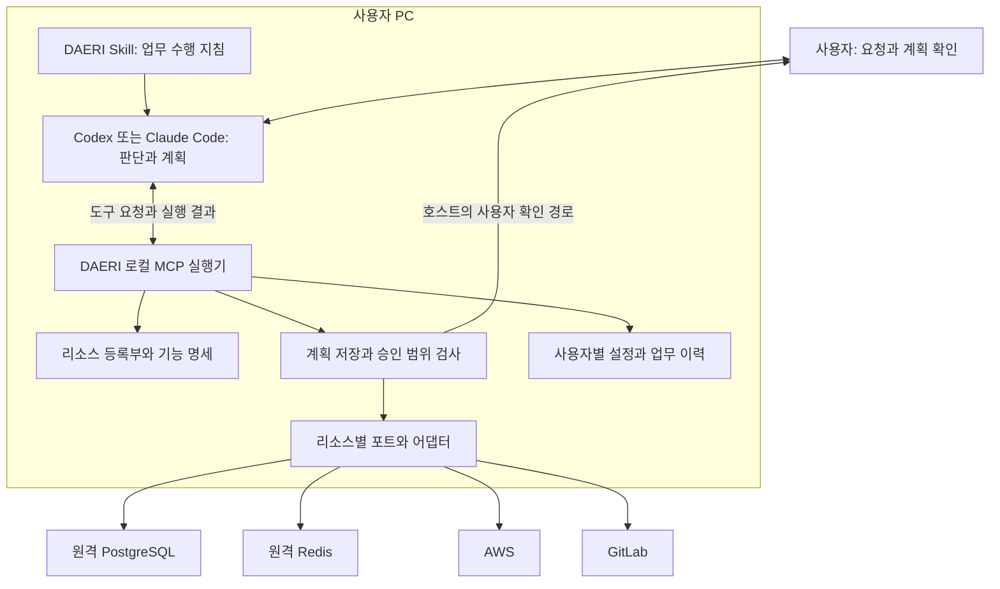

# DAERI 구조 설명

상태: 제품 설계 초안

## 실행 위치와 책임

DAERI는 사용자가 설치한 Codex 또는 Claude Code의 에이전트와 로컬 MCP 프로그램으로 구성한다.
로컬 MCP 프로그램은 사용자 PC에서 실행한다.

MCP 서버는 도구 요청을 처리하는 프로그램을 뜻한다.
개발자가 운영하는 중앙 DAERI 서버를 전제로 하지 않는다.

기존 호스트가 목표 해석, 계획, 다음 도구 선택, 결과 해석을 맡는다.

로컬 DAERI는 접근 가능한 리소스와 기능을 제공한다.
계획·승인·실행 이력을 저장한다.
실제 호출의 범위를 검사한다.

이 선택의 이유와 대안은 [ADR-0001](decisions/0001-host-agent-local-runtime.md)에 있다.

호스트의 모델 추론은 해당 플랫폼의 실행 방식과 계정 설정을 따른다.
로컬 DAERI 실행이 모델 추론까지 PC 내부에서 처리한다는 뜻은 아니다.

호스트에 반환한 자료가 모델 입력에 포함될 수 있다.
따라서 데이터 제공 범위도 계획과 설정에 반영한다.

## 구성 요소별 책임

| 구성 요소 | 맡는 일 | 판단의 원본 |
|---|---|---|
| 호스트 에이전트 | 요청 이해, 계획, 리소스·다음 행동 선택, 답변 | 요청 + 리소스 계약 + 관찰 결과 |
| 플러그인과 Skill | 호스트가 업무 흐름을 따르게 하는 지침, 로컬 MCP 실행 설정 | 배포한 호스트별 패키지 |
| 업무·계획 관리 | 요청, 계획 버전, 상태, 승인, 결과와 실행 참조 보존 | DAERI 로컬 저장소 |
| 리소스 등록부 | 인스턴스와 기능·스키마·제약 제공, 접근 가능한 범위만 노출 | 사용자·부처별 연결 설정 |
| 승인 정책과 실행 제어 | 사용자 확인·정책 결정 기록, 권한·범위·입력·한도 검사 | 승인된 계획 버전 + 현재 권한 |
| 포트와 어댑터 | 공통 실행 계약을 실제 제품 API로 구현, 제품별 의미와 제한 반환 | [리소스 계약](../spec/resources/contract.md) |
| 결과·근거 관리 | 결과물과 원본 위치·실행 내역·검증 결과 연결 | 실제 실행 결과 |

호스트는 관찰 결과에 따라 다음 행동을 선택한다.
승인 정책과 실행 제어는 실제 사용자 확인 또는 정책 결정을 기록한다.
호출 전에 현재 권한·계획 범위·입력을 검사하고 실행 한도를 적용한다.

초기에는 하나의 로컬 MCP 애플리케이션 안에서 모듈의 책임을 나눈다.
별도 LangGraph 판단 루프, 자체 모델 API 호출, 서비스 분리는 초기 구조에 추가하지 않는다.
구체적인 코드 디렉터리와 자료형은 구현 계획에서 정한다.

## 한 번의 요청이 흐르는 방식

호스트가 사용 가능한 리소스 기능을 읽어 계획을 작성한다.
로컬 DAERI가 그 계획을 저장하고 실제 사용자 확인을 연결한다.

승인 후 호스트가 기능 호출을 요청한다.
DAERI가 저장된 승인 범위와 현재 권한을 확인한다.
조건을 충족하면 어댑터를 호출한다.

반환 결과는 실행 기록으로 보존한다.
호스트가 그 결과를 해석한다.
다음 호출도 같은 경계에서 검사한다.

호스트가 범위 밖의 방법을 제안해도 실행기는 먼저 차단해야 한다.
새 계획이 승인되면 새 버전의 범위에서 재개한다.
자세한 행동은 [업무 흐름](../spec/tasks/workflow.md), 예시는 [수행 사례](../spec/tasks/scenarios.md)에 있다.

## 권한과 데이터의 경계

프롬프트와 Skill은 호스트의 행동을 안내한다.
실행 권한을 강제하는 장치는 아니다.
DAERI 도구를 통한 호출의 강제 경계는 로컬 실행기와 리소스 자체의 권한이다.

호스트가 shell이나 별도 도구로 같은 시스템에 직접 접근할 수 있다.
이 경로까지 DAERI가 자동 통제한다고 보장하지 않는다.
실제 배포에서는 별도 접근 경로와 자격 증명 권한도 검토해야 한다.

인증은 사용자 로컬 설정의 참조로 해결한다.
비밀값은 모델에 제공하지 않는다.

읽은 로그·코드·문서·메일의 내용은 업무 자료다.
승인이나 실행 정책을 바꾸지 못한다.

업무 이력과 설정은 업데이트되는 플러그인 디렉터리 밖에 보존한다.

호스트 종료나 PC 종료 뒤 판단과 실행이 계속된다고 보장하지 않는다.
재개 시에는 로컬 상태와 외부 실행 결과를 확인한다.
정기 실행·상시 감시는 별도 실행 조건을 설계해야 한다.

## 관련 계약

각 계약의 정본은 다음과 같다.

- 제품 조건: [제품 명세](../spec/product.md)
- 업무 동작: [흐름·상태](../spec/tasks/workflow.md)
- 실행 확인: [계획·승인](../spec/tasks/approval.md)
- 이력과 보고: [결과·근거](../spec/tasks/results.md)
- 리소스 확장: [공통 계약](../spec/resources/contract.md)
- 최초 제품 연동: [어댑터 명세](../spec/resources/initial-adapters.md)
- 설치: [환경 준비](../spec/installation/environment.md)
- 배포: [전달·업데이트](../spec/installation/distribution.md)
