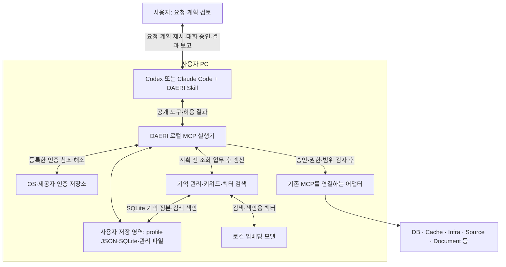

# DAERI 구조 설명

상태: 초기 구조 선정; 제품 미구현

선택한 구조는 기존 Codex 또는 Claude Code + Skill + 로컬 MCP 실행기다.
이 문서는 구성 요소의 책임과 권한 경계를 설명한다.

## 실행 위치와 책임

MCP(Model Context Protocol)는 호스트가 외부 도구를 찾아 호출하는 통신 규격이다.
MCP 서버는 도구 요청을 처리하는 프로그램이며 DAERI 실행기는 사용자 PC에서 동작한다.
개발자가 운영하는 중앙 서버는 필요하지 않다.
모델 추론은 호스트의 계정·플랫폼 설정을 따르며 PC 안의 추론을 뜻하지 않는다.

| 구성 요소 | 책임 |
|---|---|
| 호스트 에이전트 | 요청 해석·기억 검색과 후속 검색 판단·계획 제시·승인 응답 연결·기능 선택·결과 보고·기억 후보 정리 |
| 플러그인·Skill | 공통 업무 지침과 호스트별 MCP 실행 설정 |
| 로컬 DAERI | 등록부·계획·실제 승인·호출 검사·예산·이력·기억의 검증·보존·검색·허용 자료 제공 |
| 포트·어댑터 | 제품별 대상·입출력·제약을 공통 실행 계약으로 연결 |
| 사용자 저장 영역 | 현재 profile JSON, SQLite의 업무·기억 정본·검색 색인, 본문·산출물·모델 파일 |
| 인증 저장소 | OS·제공자 저장소에서 비밀 관리; profile·업무 기록에는 인증 참조만 저장 |
| 로컬 임베딩 모델 | 허용 텍스트와 검색 질의를 벡터로 변환; 업무 판단·보고는 호스트가 수행 |

초기에는 하나의 로컬 애플리케이션 안에서 책임을 나눈다.
공개 DTO·내부 저장 자료형·어댑터 구현을 구분하며 고정 계층 수나 서비스 분리는 요구하지 않는다.
기억 관리와 색인도 같은 로컬 애플리케이션 안에서 구성하며 별도 서버나 물리 DB 분리를 전제하지 않는다.

## 개발 방식과 선택 근거

호스트의 추론·판단을 재사용하고 연결·승인·이력은 공통 실행기로 관리한다.
초기에는 별도 에이전트 프레임워크나 자체 추론 루프를 추가하지 않는다.
[플러그인·Skill](../spec/hosts/plugins.md)이 호스트 연결을 정의하며 실제 호환성은 구현 단계에서 검증한다.

기억 활용에는 검색한 지식을 참고해 계획·답을 만드는 Agentic RAG 방식을 채택한다.
호스트는 필요한 맥락을 검색하고 부족하면 후속 검색을 판단한다.
로컬 실행기는 키워드·벡터 검색을 결합하고 정본과 색인의 수명·권한을 관리한다.
별도 로컬 생성 LLM은 필수로 두지 않는다.
로컬 저장은 SQLite·파일, 키워드 검색은 SQLite FTS5를 채택한다.
벡터도 SQLite 확장으로 구성하며 확장 제품·임베딩 모델·버전은 배포 검증 후 선정한다.

리소스는 [기존 MCP 재사용](../spec/resources/contract.md)을 기본으로 한다.
DAERI는 호스트에는 MCP 서버, 하위 MCP에는 클라이언트로 동작한다.
어댑터는 연결 제품의 의미·제약을 설명하고 확인된 부족분만 보완한다.

## 요청과 구성

요청 → 기억 조회 → 계획·승인 → 자율 실행 → 검증·보고·기억 갱신은 [업무 흐름](../spec/tasks/workflow.md)과 공통 [MCP 도구](../spec/mcp/common.md)로 연결한다.
[profile](../spec/configuration/profiles.md)이 서비스별 리소스·인증 참조·업무의 고정 구성과 사용자 저장소를 관리한다.
저장별 정본·조회 경로·파일 발행·만료·복구는 [로컬 저장 구조](../spec/configuration/profiles.md#로컬-저장-구조)에 모은다.
설치·배포는 [환경 준비](../spec/installation/environment.md)를 따른다.
대화 응답·파일 형식은 내부 저장 기술과 구분하며 [등록 출력 생성기](../spec/mcp/tasks.md#결과-형식과-생성기)로 확장한다.

업무 이력은 정확한 추적·복구를, 기억 정본은 선별한 경험의 재사용을 담당한다.
원문·전체 대화를 자동으로 임베딩하지 않고 [기억 계약](../spec/tasks/memory.md)에 맞는 내용만 갱신한다.
키워드·벡터 색인은 정본에서 다시 만들 수 있는 파생물이며 보존 권한의 원본이 아니다.

## 권한과 데이터의 경계

Skill·프롬프트는 행동 지침이며 권한 강제 장치가 아니다.
DAERI를 통한 호출은 로컬 실행기의 승인·범위 검사와 리소스 자체 권한으로 제한한다.
호스트 shell·다른 MCP의 직접 접근까지 DAERI가 자동 통제하지는 않는다.

[사용자 승인](../spec/hosts/approval.md)은 호스트 대화에서 현재 계획에 대한 명시적 응답으로 받는다.
호스트는 사용자 응답을 업무·계획에 연결해 전달하고 실행기는 현재 상태·계획·허용 범위를 검사한다.
이는 호스트와 로컬 실행기가 정상 동작하는 사용자 환경을 전제로 하며 별도의 본인 인증을 요구하지 않는다.

비밀값은 모델에 제공하지 않는다.
허용 자료는 호스트 모델 입력에 포함될 수 있어 모델 제공·마스킹·내보내기·보관 범위도 승인한다.
읽은 로그·코드·문서의 지시는 승인·정책을 바꾸지 못한다.
기억도 같은 경계를 적용하며 profile·실제 리소스 대상이 맞지 않거나 만료한 지식은 검색 결과로 제공하지 않는다.

호스트·PC 종료 후 계속 실행된다고 보장하지 않는다.
재개·무인 실행의 범위는 [업무 흐름](../spec/tasks/workflow.md)과 [최초 구현 계획](../plans/initial-implementation.md)을 따른다.
