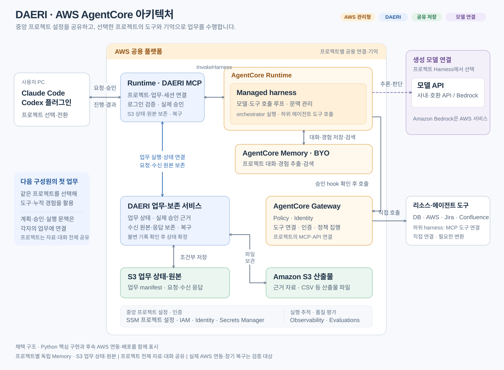

# DAERI 서비스 설계

상태: AWS 공용 서비스의 채택 구조와 요구 동작.
사용자 흐름·책임·공유·승인·복구를 이 문서에서, 설정·API·배포·구현 검증은 [개발·운영 안내](development.md)에서 관리한다.

[업무 흐름](#업무-흐름) · [구성](#구성과-책임) · [프로젝트](#프로젝트와-접근) · [승인](#계획과-승인) · [기억](#공유-기억) · [소스·파일](#소스와-산출물) · [복구](#실패와-복구)

## 목적과 제공 범위

DAERI는 여러 직군의 구성원이 자연어로 업무를 맡기고 프로젝트의 경험을 함께 축적하는 멀티 오케스트레이션 에이전트다.
신규 구성원도 기존 지식·성공 절차·실패 경험·피드백을 첫 업무부터 활용한다.
숙련도 향상은 누적 경험을 검색·적용·검증하는 능력으로 평가한다.

사용자는 Claude Code·Codex 플러그인에서 회사 로그인 뒤 허용된 프로젝트를 선택한다.
운영자가 모델·도구·자격을 중앙 연결하면 구성원은 요청·승인·피드백으로 업무를 진행한다.
생성 모델은 사내·호환 API 또는 Bedrock을 선택하고 경험 추출·검색은 AgentCore Memory를 사용한다.

제공 단위는 도구 연결 규격인 MCP의 원격 서버·호스트별 플러그인·Python 업무 서비스와 배포 도구다.
구현 근거와 AWS·회사 로그인·호스트의 실제 연동 경계는 [구현과 검증](development.md#구현과-검증)에서 확인한다.

## 업무 흐름

| 순서 | 사용자와 서비스의 동작 |
|---|---|
| 1. 요청 | 선택한 프로젝트에서 목표·조건·원하는 결과 접수 |
| 2. 기억 검색 | Harness가 관련 프로젝트 경험을 검색해 문맥에 활용 |
| 3. 계획 | 총괄 에이전트가 대상·예상 효과·수행 범위·완료 조건 제시 |
| 4. 승인 | 호스트 확인창에서 현재 계획을 승인·수정·거절 |
| 5. 위임 | 총괄 에이전트가 필요한 하위 목표·역할·수·순서를 선택 |
| 6. 수행 | 승인 범위에서 도구·분석·페이지 조회·재시도를 자율 선택 |
| 7. 보고 | 실제 결과·근거·파일·미충족 조건 전달과 S3 원본 보존 |
| 8. 기억 저장 | Memory가 경험을 비동기로 추출·통합해 다음 업무에 제공 |

가상 사례: “국가별 EV 충전소 개수를 확인하고 CSV로 정리해 줘”라는 요청에는 이전 집계 기준·자료 구조·실패 경험을 참고해 계획한다.
승인 뒤 최신 자료를 조회·검증하고 결과·한계·파일을 제공하며 피드백은 후속 업무에 활용한다.
보고 형식은 목표와 실제 근거에 맞춰 선택하고 한 응답의 종료와 업무 전체의 목표 달성을 구별한다.

## 구성과 책임

| 구성 | 책임 |
|---|---|
| Claude Code·Codex 플러그인 | 회사 로그인·프로젝트/업무 선택·요청·실제 승인·피드백·결과 표시 |
| 회사 인증 제공자(IdP) | 로그인 토큰과 프로젝트 구성원 권한 발급 |
| DAERI 서비스 | 검증한 신원·프로젝트·업무·승인·파일·복구 연결 |
| SSM Parameter Store | 프로젝트 이름과 배포한 harness 릴리스의 중앙 참조 |
| AgentCore managed harness | 총괄·하위 에이전트의 모델·도구 반복과 문맥 관리 |
| AgentCore Runtime | MCP 접속부와 에이전트 실행의 격리·확장·세션 라우팅 |
| AgentCore Memory | 프로젝트별 대화·경험 추출·통합·의미 검색 |
| S3 | 업무 상태·접수/수신한 불변 원본·산출물 |
| Gateway·Policy·Identity | 도구 연결·자격 관리·리소스 접근 정책 집행 |
| Observability·Evaluations | 실행 추적·업무와 기억 검색 품질·비용 평가 |

관리형 harness의 [Strands 기반 실행 루프](https://docs.aws.amazon.com/bedrock-agentcore/latest/devguide/harness-vs-runtime.html)를 사용한다.
DAERI 자체의 업무·기억 보관은 Memory·S3로 구성하며 업무 대상 DB·API는 프로젝트 리소스로 연결한다.

### 멀티 에이전트와 도구

총괄 에이전트(orchestrator)는 별도 하위 에이전트(subagent)의 harness를 Gateway의 MCP 도구로 호출한다.
등록된 Lambda 대상이 프로젝트·도구·하위 릴리스를 검사하고 새 하위 세션의 응답·완료 여부·오류를 반환하면 총괄 에이전트가 근거를 대조·통합한다.
이는 [agent-as-tool 방식](https://docs.aws.amazon.com/bedrock/latest/userguide/agents-classic-maintenance-mode.html#comparing-capabilities)이며 업무 분해·위임·결과 통합은 관리형 실행 안에서 판단한다.

부모의 승인 검사는 위임 도구 호출에 적용한다.
하위 harness는 같은 프로젝트 Memory·서비스 자격과 Lambda 시간 안에 종료하는 서버 실행 도구를 사용한다.
하위 세션의 사용자 식별자 `agent:<project>:<subagent>`는 역할을 나타내며 실제 사용자의 개인 OAuth 위임과 구분한다.
추가 입력 대기·불완전 응답·실패에는 미완료 상태와 확보한 근거로 실제 효과를 확인해 후속 동작을 판단한다.

운영자는 [Gateway](https://docs.aws.amazon.com/bedrock-agentcore/latest/devguide/gateway-target-MCPservers.html)에 remote MCP·OpenAPI·Lambda를 연결한다.
stdio MCP는 실행 가능한 HTTP MCP로 호스팅·변환하고 사내 리소스는 [VPC 연결](https://docs.aws.amazon.com/bedrock-agentcore/latest/devguide/gateway-vpc-egress.html)·DNS·CA·자격을 갖춘 실행 위치에서 접근한다.
분석과 파일 생성은 기본 shell·파일 도구 또는 [Code Interpreter·S3](https://docs.aws.amazon.com/bedrock-agentcore/latest/devguide/code-interpreter-s3-integration.html)를 사용한다.

## 프로젝트와 접근

프로젝트는 자료·대화·도구 결과·과거 기억을 모든 구성원에게 공유할 수 있는 범위다.
일부 자료만 공유 가능한 구성원은 공유 범위별 프로젝트·Memory로 나눈다.
목표·계획·실제 승인·실행 세션·소스 사본은 개별 업무에 연결한다.

서버는 로그인 토큰의 신원·권한을 검증하고 매 요청·확인 응답에서 유효 기간과 선택 프로젝트를 다시 검사한다.
같은 권한의 토큰 갱신은 연결을 유지하고 권한 변경은 새 MCP 연결에 반영한다.
실제 대상 권한은 Gateway·Identity·리소스가 집행하며 개인 자격으로 얻은 자료의 프로젝트 공유 범위도 인증·운영 정책에 맞춰 구성한다.

| 자격 경로 | 동작 |
|---|---|
| 프로젝트 서비스 자격 | 운영자가 중앙 등록한 IAM·공유 자격으로 접근 |
| 개인 OAuth | 현재 검증한 사용자의 JWT로 harness에 연결하고 Identity가 동의한 사용자별 자격 해소 |
| 별도 비밀 | Secrets Manager 등 인증 저장소의 참조로 연결 |

개인 위임 JWT는 요청 문맥에서 사용하고 모델 입력·S3에는 검증한 사용자 문맥을 연결한다.
회사 SSO·Cognito·IAM·Identity의 실제 연결은 [인증 설정](development.md#서버-설정)을 따른다.

Claude Code와 Codex는 같은 중앙 서비스에 연결하고 같은 프로젝트에서 자신의 업무를 선택해 이어간다.
새 업무는 현재 검증한 harness 릴리스에 고정하고 기존 업무는 저장한 릴리스·세션을 유지한다.
배포가 중앙 참조를 바꿔도 이전 업무의 릴리스를 유지하며 endpoint의 실제 버전이 바뀌면 실행 전 확인 오류로 중단한다.
버전 정보가 없는 기존 업무는 보관 상태를 확인한 뒤 새 계획으로 시작한다.

## 계획과 승인

총괄 에이전트는 목표·대상·예상 효과·완료 조건을 자유로운 계획 본문으로 제시한다.
`confirm_plan`의 실제 대기를 서버가 보관한 뒤 [호스트 확인창](https://code.claude.com/docs/en/mcp#respond-to-mcp-elicitation-requests)에 현재 계획을 표시한다.

| 사용자 응답·상태 | 처리 |
|---|---|
| 승인·추가 조건 없음 | 현재 업무·계획·대기에 결정을 보존하고 같은 세션 재개 |
| 수정 요청·추가 조건 입력 | 수정 내용을 반영한 새 계획 확인; 승인 선택에 조건을 입력한 경우도 동일 |
| 거절 | 거절을 전달하고 계획 조정 |
| 확인창 닫기·미지원·300초 초과·연결 종료 | 현재 계획의 확인 대기 유지 |
| 확인 중 계획 변경·중복 응답·로그인 만료·권한 변경 | 현재 조건 재확인 후 유효한 계획에서 진행 |
| 결정 보존 뒤 실행 요청이 명확히 거부됨 | 같은 계획의 보관된 실제 응답으로 명시 재개 |

일반 업무 입력의 승인 문구는 후속 요청으로 해석하며 대기 중 요청 변경은 수정 계획으로 연결한다.
새 요청·새 계획에는 이전 실행 허가를 해제하고, 이미 보존한 결정도 실행 전에는 수정 요청으로 철회할 수 있다.
확인창 뒤에는 로그인·대기와 실행 점유 시점의 상태를 다시 대조한다.

호스트는 실제 확인 응답을 전달하는 신뢰 주체이며 호스트의 응답 자동화·수정 기능도 같은 경계에 속한다.
서버의 승인 근거는 현재 확인창 응답이며 기억·문서·도구 결과는 판단 자료로 사용한다.

실행 전 [Lambda hook](https://docs.aws.amazon.com/bedrock-agentcore/latest/devguide/harness-lifecycle-hooks.html)은 보호된 업무·세션 연결과 보관된 현재 승인을 검사한다.
계획 확인 도구를 허용하고 나머지 도구는 승인 뒤에 허용하며 조회 실패·연결 불일치·잘린 입력에는 실행을 중단한다.
계획의 의미적 범위는 에이전트가 판단하고 실제 대상 권한은 리소스 경계에서 집행한다.

## 공유 기억

프로젝트마다 별도로 생성해 연결하는 [BYO Memory](https://docs.aws.amazon.com/bedrock-agentcore/latest/devguide/harness-memory.html)를 두고 실제 사용자 식별자를 유지한다.
구성원은 가입 시점·호스트와 관계없이 같은 공유 namespace의 경험을 활용한다.

| 전략 | 저장·검색할 내용과 범위 |
|---|---|
| Semantic | 프로젝트 사실·용어·구조; `/shared/facts/` |
| Episodic·reflection | 성공·실패 절차와 교훈; `/shared/experiences/` |
| Summarization | 사용자·업무 세션 문맥; `/summaries/{actorId}/{sessionId}/` |

Memory는 경험 추출·임베딩·색인·의미 검색을 관리한다.
추출·통합은 비동기이며 검색 가능 시점은 실제 처리 결과로 확인한다.
확정된 업무 절차는 Git/S3의 Harness Skills, 누적 경험은 Memory로 관리한다.

### 보존과 재구성

단기 이벤트는 [최대 보존 기간인 365일](https://docs.aws.amazon.com/bedrock-agentcore-control/latest/APIReference/API_Memory.html)로 설정하고 장기 기억은 [TTL을 생략](https://docs.aws.amazon.com/bedrock-agentcore/latest/devguide/long-term-record-ttl.html)한다.
장기 기억은 [통합 중 교체·삭제될 수 있어](https://docs.aws.amazon.com/bedrock-agentcore/latest/devguide/memory-record-streaming.html) S3 원본을 독립 보존한다.
S3는 자동 만료를 생략하고 버전 관리·삭제 권한·배포 제거 정책으로 원본 수명을 유지한다.

S3 보관 범위는 접수한 요청·승인·피드백과 수신한 응답·도구 관찰·파일·산출물이다.
예약 수집은 Memory의 원래 actor·session·시각·분기·payload를 불변 객체로 추가 보존하고 같은 이벤트의 재수집은 원본과 대조한다.
수집 주기·실패 알림은 원본 이벤트의 보존 기간 안에 복구할 수 있게 운영한다.

재구성은 같은 프로젝트 소유의 비어 있는 독립 Memory에 보관 이벤트를 재생한다.
원본별 고정 요청 토큰·진행 기록으로 이어가며 네이티브 원본이 없으면 DAERI가 수신한 업무 기록과 그 보관 시각을 사용한다.
비동기 추출·검색 품질을 확인한 뒤 복원 대상을 새 릴리스로 공개하며 이전 장기 기억의 ID·통합 결과는 재구성 결과에 따라 달라진다.
설정과 실행 절차는 [Memory 수집과 복원](development.md#memory-수집과-복원)에 둔다.

기억은 적용 조건·불확실성·실패를 현재 자료와 대조해 사용하고 최신 수치·리소스 상태는 실제 대상으로 확인한다.
미병합 변경·병합 commit·배포 상태를 구별한다.
품질 평가는 A의 경험을 신규 구성원 B가 재사용하는지, 다른 프로젝트가 차단되는지, 잘못된 경험이 정정되는지를 확인한다.
AWS 관리형 관측·평가로 업무 성공률·기억 오적용률·도구 호출·완료 시간·비용을 비교한다.

## 소스와 산출물

### 소스 개발

프로젝트 실행 환경에 여러 저장소를 등록하고 표준 Git 자격·사내망으로 연결한다.
새 작업은 기준 commit과 업무별 브랜치·사본을 사용하며 같은 사본의 재호출은 기존 변경을 유지한다.
새 실행 환경은 원격 업무 브랜치를 가져오고 로컬 전용 commit을 보존하며 양쪽 이력이 분기되면 비교·통합할 충돌 상태로 반환한다.
이전 환경의 미반영 변경은 해당 파일시스템에서 확인한다.

통합 검사는 최신 대상과 업무 commit을 임시 사본에서 병합해 충돌과 검증 결과를 반환한다.
실제 commit·push·병합은 에이전트가 승인 범위·저장소 정책에 따라 표준 Git으로 수행하고 반영·배포 완료는 실제 근거로 판정한다.
실행 도구와 사본·브랜치 규격은 [Git 작업 환경](development.md#git-작업-환경)을 따른다.

### 산출물

서버는 매 호출에 현재 업무의 S3 파일 저장 위치를 내부 문맥으로 제공한다.
에이전트가 생성한 파일을 업로드하면 실제 객체를 작성 사용자·프로젝트·업무의 산출물 목록에 연결한다.
다운로드는 현재 접근과 파일 버전을 확인하고 해당 버전에 한정된 임시 링크를 발급한다.
링크의 유효 기간은 최대 300초·현재 로그인 잔여 시간 이내이며 소지자는 그 기간에 파일을 받을 수 있다.

사용자 안내는 한국어로 확인한 결과·필요한 선택·다음 조치를 전달한다.
직접 조치에는 로그인·편집·다운로드 등 필요한 위치를 제공하고 상세 진단 요청에는 확인한 기술적 원인·설정·조치의 영향을 설명한다.

## 실패와 복구

업무·승인·원본은 S3에, 일시적인 MCP 연결은 Runtime 프로세스에 보관한다.
재연결·호스트 전환에는 자신의 업무 목록과 마지막 보관 응답으로 이어가며 상태 조회와 실행·복구 호출을 구별한다.
S3 조건부 갱신은 같은 업무의 동시 실행과 확인 중 변경을 대조한다.

| 상황 | 처리 |
|---|---|
| 같은 업무 실행 중 | 상태를 조회하고 추가 실행은 대기 |
| 응답 보관 뒤 상태 확정 실패 | 저장한 불변 응답을 반영해 복구 |
| 응답 원본 없는 실행·세션 만료 | 기존 실행의 종료·실제 효과를 사용자와 확인한 뒤 새 세션 복구 |
| 새 세션 복구 | 이전 상태 보존·승인/대기 해제 후 원래 목표·마지막 응답·확인 내용으로 새 계획과 승인 연결 |
| 복구 확인창 취소·미지원·시간 초과·로그인 만료·업무 변경 | 기존 상태 유지 |
| 도구·스트림 실패 | 확보한 응답·오류를 보존하고 실제 실행 효과·현재 대기로 후속 동작 판단 |

복구 도중 새 응답을 받기 전에 중단돼도 이전 보관 결과를 조회해 다시 판단한다.
호스트 연결 종료와 원격 실행 중단을 구별하며 실제 외부 효과의 판정은 리소스·운영자의 확인에 근거한다.
[S3 원자성은 단일 객체](https://docs.aws.amazon.com/AmazonS3/latest/userguide/Welcome.html)에 적용되므로 외부 작업의 실행과 상태 보관 사이 장애는 원본·실행 상태를 대조해 처리한다.
호출별 실패 코드·입력·원본 보관 조건은 [API와 저장 계약](development.md#api와-저장-계약)에 둔다.
