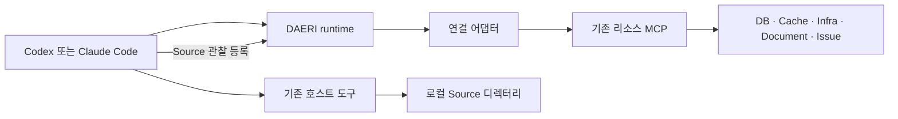

# 리소스 연결·도구 등록·실행 계약

상태: 클라우드 리소스 연결 설계와 기존 로컬의 MCP 읽기·Source 관찰 계약.

에이전트가 승인 범위 안에서 리소스를 자율적으로 사용할 때의 연결·권한·전송 기준이다.
기존 로컬 제품의 연결은 [어댑터](adapters.md), 공개 입력·응답은 [리소스 MCP](../mcp/resources.md)를 따른다.

## 클라우드 리소스 연결

Gateway에 연결 가능한 MCP·API는 관리형 연결을 사용하고 Policy·Identity와 실제 서비스 권한으로 접근을 검사한다.
DAERI는 업무·현재 승인·사용자·프로젝트 문맥을 연결하며 필요한 업무·지식 도구를 제공한다.
stdio·특수 네트워크의 리소스는 실행 위치와 인증 조건을 확인한 호스팅·변환 어댑터로 연결한다.
코드 작업은 [업무별 사본·브랜치](../../architecture/overview.md#동시-업무와-소스-수정)를 사용한다.

관리형 도구와 기본 shell·파일 도구의 실제 승인·대상 검사는 [승인 설계](../tasks/approval.md#클라우드-업무-승인), 연결·권한·실제 리소스 검증은 [개발 단계](../../development/dependencies.md#클라우드-개발-상태)를 따른다.

## 기존 로컬 구현의 적용 범위

아래 절은 PC의 runtime·stdio MCP·호스트 Source 도구가 사용하는 구현 계약이다.
클라우드의 리소스 연결은 위 설계로 이관하며 실제 회사·호스트 연결은 별도 검증한다.

## 연결 구조

외부 서비스는 DAERI runtime의 어댑터가 등록한 기존 리소스 MCP로 구조 탐색·검색·조회를 수행한다.
로컬 Source는 호스트가 기존 파일·검색·실행·Git 도구로 조사하고 runtime에 관찰을 등록한다.

외부 서비스용 내장 어댑터는 로컬 stdio, 로컬 Source는 `host` 연결을 사용한다.
지원 전송·제품별 읽기 판정은 [실제 연결 방식](adapters.md#지원-연결-방식)을 따른다.

## 기능 설계 단위

호스트는 사용자 목표·승인 범위·실제 결과로 도구·질의·필터·페이지·분석·검증·파일·기억을 선택한다.
runtime은 실제 승인·배정·연결·인증·명시적 범위·선택한 상한·자료 제공·기록을 검사한다.
읽기에도 접근 로그·요금·서비스 부하가 발생한다.

## 리소스와 profile

범주는 DB·Cache 같은 역할, 어댑터는 제품·연결 방식, 인스턴스는 실제 연결 대상이다.
한 profile에 같은 범주의 여러 제품·인스턴스를 등록할 수 있다.
설정·인증은 [profile](../configuration/profiles.md)에서 관리한다.

기본 조회 영역은 등록 계정의 실제 읽기 권한 영역 또는 등록한 로컬 Source 디렉터리다.
DB 권한·Redis ACL·제공자 권한과 명시한 추가 범위가 실제 대상 접근을 제한한다.
자료 제공·보관·기억 정책은 등록 profile에서 해소하고 기존 명시적 설정을 유지한다.

## 기능 계약

기능은 도구 이름·설명·입출력 스키마·읽기 효과·명시적 제약을 전달한다.
외부 서비스 어댑터는 검증한 하위 읽기 모드·도구 구현과 readOnlyHint를 함께 사용해 실행 가능성을 판정한다.
로컬 Source 어댑터는 호스트 관찰을 받는 고정 기능과 경로 검사를 제공하며 실행 책임은 [Source 계약](adapters.md#로컬-소스-코드)을 따른다.
하위 요청량·일관성·실제 자료 의미는 해당 제공자의 지원 범위와 관찰로 판단한다.

## 도구 등록

setup·연결 갱신의 [관리 진단](../configuration/profiles.md#관리-등록과-진단)은 하위 MCP 초기화·도구 목록·스키마를 확인한다.
로컬 Source 진단은 등록 디렉터리의 접근과 고정 관찰 기능을 확인한다.
실제 자료 조회는 업무 계획 승인 뒤 수행한다.

새 외부 서비스 연결은 지원하는 읽기 도구를 탐색한다.
명시한 도구의 기능 ID·제약은 유지하고 추가 도구는 실제 이름으로 등록한다.
도구 부재·읽기 미확인·잘못된 스키마는 진단 실패이며 처리 상한은 [등록 기준](adapters.md#등록-설정과-진단)을 따른다.

## 등록부와 계약 변경

진단 등록은 실제 연결·대상·주체 참조·선택 기능·명시적 제약·입출력 스키마·정규화 의미를 식별한다.
같은 등록 연결의 하위 도구 스키마·읽기 의미 변경은 재진단한 뒤 수정 계획을 승인받는다.
사용한 연결의 실행 설정·인증 참조·대상·계정·주체·명시적 기능 조건을 바꾸면 새 업무를 접수해 이전 관찰과 분리한다.
등록 파일의 종류·손상은 STORE_UNAVAILABLE로 반환한다.

무관한 profile 개정·기본 맥락·자료 정책과 표시용 도구 설명·annotation 변경은 연결 진단을 유지한다.
비밀번호·토큰·SSO 캐시 갱신은 현재 인증으로 이어가며 실행 직전 실제 대상·계정·읽기 상태를 확인한다.
현재 정규화 의미를 확인할 수 없는 과거 등록은 재진단으로 갱신한다.

## 계획과 승인 범위

계획은 사용할 연결·읽기 기능 또는 묶음·필요한 추가 범위·결과·완료 근거를 제시한다.
사용자는 현재 대화에서 승인하고 호스트는 그 범위 안에서 다음 관찰과 하위 에이전트 구성을 선택한다.
범위 확대는 [수정 계획](../tasks/approval.md)으로 확인한다.

### 실제 요청 정규화와 범위 판정

전송 순서는 인수 정규화 → 현재 조건 검사 → 실행 의도 기록 → 전송 직전 검사 → 실제 읽기다.
고정값·스키마 기본값·어댑터 변환을 적용한 같은 최종 인수를 검사하고 전송한다.
인증은 전송 직전 해소하고 기존 읽기 모드·대상·주체·명시한 값·경로·숫자 상한을 확인한다.

로컬 Source는 호스트가 승인한 범위에서 먼저 조사하고 같은 실행 도구로 관찰을 등록한다.
runtime은 현재 승인·연결·루트·상대 경로와 제공 조건을 검사하고 호스트가 확인한 요약을 근거로 보존한다.
정확한 입력·반환과 호스트 책임은 [관찰 등록 DTO](../mcp/resources.md#로컬-source-관찰-등록)를 따른다.

명시한 제한 인수는 실제 값 또는 유효한 하위 기본값이 필요하다.
확인할 수 없는 조건은 UNSUPPORTED_CONSTRAINT, 범위 이탈은 SCOPE_VIOLATION이다.
제품별 대상·범위 검사는 [어댑터 기준](adapters.md#범위-조건)을 따른다.

## 호출과 결과

후속 페이지·재시도도 현재 승인·연결·범위를 검사한 새 읽기다.
전체 상한을 지정했으면 총괄 에이전트·하위 에이전트가 누적 호출·시간을 공유한다.
미측정 하위 요청 수는 null로 표시하고 호스트가 실제 cursor·total·잘림·시점을 보고 조회를 이어간다.

runtime은 출력 스키마·비밀 제거·현재 자료 조건을 검사하고 실제 확보한 결과·실패·잘림을 기록한다.
중단한 읽기는 실패로 정리해 새 관찰이 가능하며 동작·오류는 [실행 응답](../mcp/resources.md#결과와-오류)을 따른다.
보고·파일·기억의 출처는 선언한 실제 기여 기록으로 검사하고 내용의 의미·충분성은 호스트가 판단한다.

## 결과와 제품 교체

호스트는 실제 결과를 분석해 [보고·파일·선별 기억](../mcp/tasks.md#daeri_result_submit)을 제출한다.
새 제품은 연결·실제 대상·읽기 의미를 처리할 어댑터와 카탈로그를 추가하고 외부 프로그램이 필요하면 설치 recipe·인증을 함께 구성한다.
제품 교체 후에는 실제 도구·자료 구조·조건을 진단하고 그 연결로 계획을 구성한다.

등록·정규화·전송의 담당 구현과 로컬·실제 환경의 검증 범위는 [개발 안내](../../development/dependencies.md#구현과-대표-검증)를 따른다.
