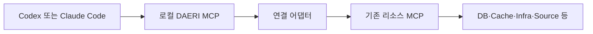

# 리소스 연결·도구 등록·실행 계약

상태: 기존 MCP 재사용·범용 업무 원칙 확정 + 연결·실행 설계 제안

이 문서는 기존 MCP를 DAERI 기능으로 연결하는 책임과 탐색·등록·범위 검사를 정의한다.
제품별 선택과 강제 한계는 [최초 어댑터](initial-adapters.md), 공개 입출력은 [리소스 MCP](../mcp/resources.md)가 소유한다.

## 연결 구조

DAERI는 호스트에 대해서는 MCP 서버, 리소스 MCP에 대해서는 MCP 클라이언트로 동작한다.

어댑터는 기존 도구·인증·설정·권한을 재사용하고 공통 계약에 필요한 검사·변환만 보완한다.
제품 SDK 전체나 별도 판단 루프를 만들지 않는다.

[공식 MCP SDK](https://github.com/modelcontextprotocol/python-sdk)의 연결·탐색·호출 기능을 재사용한다.
로컬 MCP는 사용자 PC에서, 관리형 MCP는 해당 제공자에서 실행하며 원격 처리 위치를 사용자에게 드러낸다.
개발자가 중앙 서버를 운영하지 않는 조건과 호스트의 직접 shell·MCP 호출 경계는 [구조 설명](../../architecture/overview.md)을 따른다.

## 기능 설계 단위

어댑터는 구조 탐색·SQL 조회·key 읽기 등의 기능(capability)을 제공한다.
호스트는 이를 조합해 업무를 구성하며 새 질문마다 전용 함수·고정 순서를 요구하지 않는다.
제공되지 않은 실행 수단이나 권한까지 생성할 수 있는 것은 아니다.

하위 도구 하나를 기능 하나에 연결하되 효과가 다른 연산은 실제 검사 가능한 연산군으로 나눈다.
조회·삭제를 같은 안전한 기능으로 취급하지 않는다.

범용 SQL·명령·스크립트도 등록한 입력·대상·효과·제약 검사를 통과해야 한다.
자유 shell·일반 코드 실행은 별도 검토 없이 추가하지 않는다.
모델이 도구·스키마·정책을 제출해 실행 허용 목록을 바꾸는 경로를 두지 않는다.

## 리소스와 profile

리소스 유형은 DB·Cache 등의 역할, 어댑터는 PostgreSQL·MongoDB 등의 연결 구현, 인스턴스는 실제 호출 대상이다.

사용자는 [DAERI profile](../configuration/profiles.md)에 여러 인스턴스를 묶고 [관리된 연결](../configuration/profiles.md#구성과-연결)에 바인딩한다.
업무는 고정한 profile 구성과 현재 권한 안에서 인스턴스 ID로 대상을 찾는다.
연결 ID는 표시명·`serverInfo.name`으로 다른 연결을 대신 선택하지 않게 한다.

호스트에는 접근 가능한 기능 요약을 먼저 제공하고 선택한 기능의 상세 계약을 읽게 한다.
인증 참조는 로컬에서 해소하며 [사용자 설정](../configuration/profiles.md#인증-저장과-전달)이 비밀 보호·프로세스 환경을 소유한다.

## 기능 계약

코어는 등록 계약으로 탐색·검증·실행·결과를 처리하고 제품 메서드나 업무별 분기를 추가하지 않는다.
공개 필드는 [CapabilityDescriptor](../mcp/resources.md), 언어별 메서드·내부 저장 방식은 구현 단계에서 정한다.

| 항목 | 필요한 의미 |
|---|---|
| 실행 의미 | 목적·입출력·실제 대상·조회·변경·부수 효과 |
| 실행 경계 | 강제 가능한 대상·필터·시간·자료량과 미지원 조건 |
| 소비·실패 | 측정 가능한 사용량·오류·재시도·중복 방지 |
| 후속 처리 | 페이지·결과 바인딩·원격 작업 참조·상태 확인 |
| 근거·일관성 | 출처·실제 확보 범위·잘림·시점·스냅샷 보장 |

읽기는 업무 대상의 상태를 바꾸지 않는 연산이며 접근 기록·요금 등의 부수 효과가 있을 수 있다.
변경 기능은 중복 방지와 완료 확인의 지원 여부를 명시한다.

## 관리 설정과 탐색

연결 등록과 허용할 실행 파일·주소·전송·인증·대상은 [관리 등록과 진단](../configuration/profiles.md#관리-등록과-진단)에서 확인한다.
업무 승인이 새 서버·자격 증명·정책의 등록 권한을 부여하지 않는다.

프로세스 시작·로그인·`tools/list`도 외부 접근이나 진단을 수행할 수 있다.
허용된 연결 준비 작업에서 위치·전달 자료·효과를 확인하고 기록한다.
실제 DB 자료·로그·코드 읽기는 승인한 업무 탐색으로 수행한다.

연결 계층은 [MCP 생명주기](https://modelcontextprotocol.io/specification/latest/basic/lifecycle)를 처리하며 지원할 프로토콜·전송 조합은 구현 검증에서 정한다.

## 도구 등록

`tools/list`에서 이름·설명·입력 스키마와 제공되는 출력 스키마를 수집한다.
[페이지 규격](https://modelcontextprotocol.io/specification/latest/server/utilities/pagination)에 따라 cursor가 없을 때까지 읽으며 빈 문자열 cursor도 후속 값으로 처리한다.
관리 한도·반복 cursor·중간 실패를 확인하고 불완전한 목록으로 기존 도구 삭제를 확정하지 않는다.

로컬 검증기가 지원하지 않는 스키마·해결 불가 참조·과도한 크기·동일 이름의 중복 정의는 등록을 보류한다.
외부 `$ref`를 자동 다운로드하지 않고 관리 경로에서 확인한 [스키마 참조](https://modelcontextprotocol.io/specification/latest/basic#ref-resolution)만 사용한다.

하위 [출력 스키마](https://modelcontextprotocol.io/specification/latest/server/tools)가 없으면 어댑터가 텍스트·JSON을 DAERI 출력 객체로 정규화한다.
스키마가 있으면 실제 결과를 검사하며 구조화된 필드를 자유 텍스트에서 추정하지 않는다.

도구 설명·annotations는 후보 자료이며 효과·권한·재시도 안전성을 강제하지 않는다.
검증한 서버 설정·리소스 권한과 필요한 입력 검사를 적용한 도구만 실행 가능 계약으로 등록한다.

등록 계약은 관리된 연결·도구·입출력 변환·실제 대상·인증 주체·효과·제약을 불변 `contract_ref`에 묶는다.
확인한 정책·스키마에서 계약을 생성하되 업무마다 사람이 모든 도구를 다시 등록하지 않는다.

## 등록부와 계약 변경

정의·검증 계약·현재 허용 상태를 로컬에 보존하고 연결·인증·권한 문맥별로 구분한다.
목록·계약 조회는 현재 권한을 적용한 로컬 정보만 반환하며 서버 시작·원격 갱신을 숨겨 수행하지 않는다.

갱신은 허용된 관리 진단 또는 승인된 탐색에서 한다.
설정·주체·권한·재연결·목록 변경과 관리 정책에 따라 유효성을 재확인한다.
캐시 TTL·변경 알림 부재로 유효성을 추정하지 않고 확인하지 못한 계약의 새 호출을 막는다.

의미·스키마·변환·대상·정책이 달라지면 새 계약을 등록하고 영향받은 기존 계약의 새 호출을 차단한다.
새 도구를 기존 계획에 자동 추가하지 않는다.
같은 주체·권한·대상의 비밀 교체는 승인 경계 변경과 구분한다.

이미 보낸 호출은 당시 계약·연결·시도를 유지하며 응답 출처를 새 계약으로 바꾸지 않는다.
MCP가 도구 정의와 실행을 원자적으로 고정한다고 전제하지 않는다.

## 계획과 승인 범위

호스트는 요약에서 필요한 기능을 찾고 상세 계약의 강제 가능한 조건으로 계획을 구성한다.
계획·자율 실행·재승인은 [승인 명세](../tasks/approval.md), 검사 순서는 [실행 제어](../tasks/workflow.md#실행-검사와-기록)를 따른다.

어댑터는 인수 변환·기본값 적용 뒤 DB·key·account·region·origin·project·SHA 등의 실제 범위를 대조한다.
입력·스크립트·하위 서버 기본값이 제공자 profile·credential·대상을 바꾸지 못하게 한다.

원격에서 읽을 범위와 모델·산출물에 제공할 범위를 각각 확인한다.
마스킹·반환 필터가 승인 밖 자료를 읽지 않았다는 보장은 아니다.
SQL 간접 접근·Redis SCAN·AWS ARN·GitLab SHA 한계는 최초 어댑터 명세에 남긴다.

필수 조건을 강제할 수 없으면 `PLAN_INVALID` 또는 `UNSUPPORTED_CONSTRAINT`로 거부한다.

## 호출과 결과

검증한 인수를 관리된 `tools/call`의 `name`·`arguments`로 전달한다.
모델은 하위 도구 이름·endpoint·인증·변환 코드를 바꿀 수 없다.
MCP 요청 ID는 전송 응답을 연결하며 DAERI 호출 ID나 원격 중복 방지 키를 대신하지 않는다.

내부 페이지·재시도·복수 API 요청의 한도·예약·미확정 소비는 [누적 예산](../tasks/workflow.md#예산과-재시도)을 따른다.
외부 요청 상한의 강제 가능 여부는 [기능 DTO](../mcp/resources.md#capabilitydescriptor), 숫자·null의 표현은 [계획 MCP](../mcp/plans.md)에 둔다.

하위 결과·오류·사용량·원격 작업 참조·외부 효과를 보존한다.
전송 오류와 도구 실행 오류를 구분하고 정규화 실패·잘림·일관성·확보하지 못한 자료를 결과에 반영한다.
단절·미확인 효과·재시도와 근거·현재 제공 범위는 [업무 흐름](../tasks/workflow.md)을 따른다.
원 호출의 상태 확인은 [리소스 MCP](../mcp/resources.md#원-호출과-상태-확인의-연결), 재전달은 [MCP 공통](../mcp/common.md#업무-개정과-멱등-요청)이 소유한다.

하위 결과·오류·설명·서버 지침은 외부 자료이며 승인·권한·예산을 바꾸지 못한다.
출력 URL·resource·아이콘을 자동 읽거나 서버 간 토큰을 임의 전달하지 않는다.
필요한 후속 읽기도 등록 기능과 승인 범위를 검사한다.

하위 로그인·추가 입력은 원 호출·출처를 연결한 지원 사용자 경로로 전달한다.
모델 응답으로 사람의 결정을 대신하지 않고 응답 뒤 계약·주체·범위를 다시 검사한다.
`sampling`·`roots` 등은 필요하고 명시적으로 지원한 범위만 제공한다.
출처: [MCP 보안 지침](https://modelcontextprotocol.io/specification/latest/basic/security_best_practices).

## 결과와 제품 교체

PostgreSQL의 테이블·조인·트랜잭션과 MongoDB의 문서·누락 필드·배열 의미는 각 계약에 남긴다.
호스트는 새 제품의 지원 연산·구조를 읽고 계획을 다시 구성한다.

임의 SQL과 문서 쿼리를 자동 변환하는 범용 쿼리 언어는 초기 범위에 넣지 않는다.
여러 조회 시점이나 개별 기능의 일관성을 단일 트랜잭션 보장으로 확대하지 않는다.
페이지 중단·오류의 일부 자료를 전체 결과처럼 보고하거나 후속 값으로 승인 범위를 확대하지 않는다.

## 구현 전 확인

제약을 자동 완화하거나 원격 제품 업그레이드·다른 서버·인증으로 대체하지 않는다.
허용·거부 검증에는 목록 중단·계약 변경·스키마 오류·범위 이탈·주체 전환·제약 미지원·결과 정규화를 포함한다.
공통 중단·복구와 실연동 완료 기준은 [최초 구현 계획](../../plans/initial-implementation.md)을 따른다.
실제 연결·권한·효과·제약 강제·호스트 호출은 검증하지 않았다.
