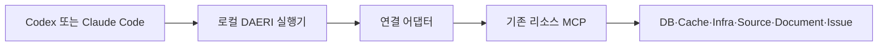

# 리소스 연결·도구 등록·실행 계약

상태: 기존 MCP 재사용·읽기 기능 탐색·연결별 승인 묶음 구현; 로컬 시험 MCP 검증, 실제 회사 리소스는 별도

호스트가 기존 MCP의 기능을 찾아 자율적으로 수행하고 DAERI가 승인·연결·자료 제공·기록을 검사하는 기준이다.
범주와 제품별 연결은 [리소스 범주](initial-adapters.md), 공개 입력과 반환은 [리소스 MCP](../mcp/resources.md)를 따른다.

## 연결 구조

DAERI는 호스트의 요청을 받아 등록한 기존 리소스 MCP를 연결한다.
제품별 어댑터는 인증·실제 대상·읽기 효과와 입출력 차이를 처리한다.
DB 조회·키 탐색·서비스 읽기·문서 검색의 실행은 기존 MCP가 담당한다.

현재 내장 어댑터의 검증된 연결은 로컬 stdio다.
원격 MCP는 실제 리소스 대상과 인증 문맥을 검증하는 별도 어댑터 계약이 필요하다.
지원·미지원 전송은 [실제 연결 방식](initial-adapters.md#첫-버전의-실제-연결-방식)을 따른다.

## 기능 설계 단위

호스트는 사용자 목표·승인 범위·사용 가능한 기능으로 수행 방법·질의·필터·페이지·분석·검증 순서를 정한다.
업무 결과의 의미·완료 여부·다음 조회·기억 후보와 파일 생성도 호스트가 판단한다.

실행기는 현재 승인·위임·연결·인증·명시적 조건·누적 예산과 자료 제공 범위를 검사한다.
읽기 전용은 원격 변경을 제한하는 조건이며 읽을 대상의 허용 범위와 구분한다.
읽기에도 접근 기록·요금·부하가 발생할 수 있다.

## 리소스와 profile

리소스 범주는 DB·Cache 같은 역할, 어댑터는 제품·연결 방식, 인스턴스는 실제 연결 대상이다.
한 profile에서 같은 범주의 여러 인스턴스와 서로 다른 범주의 기능을 함께 사용할 수 있다.
등록된 어댑터 식별자와 범주가 다르거나 이름·호환 이름이 충돌하면 연결을 거부한다.

사용자는 [profile](../configuration/profiles.md)에 연결·인증 참조·자료 정책을 등록한다.
업무는 그 연결의 실제 읽기 권한 영역을 기본 대상으로 승인받고 필요한 추가 조건을 명시한다.
DB 역할·Redis ACL·제공자 권한은 실제 대상에 대한 서비스의 강제 수단이다.
그보다 좁은 테이블·프로젝트·키 영역을 보장하려면 해당 서비스 권한 또는 실행기가 지원하는 명시적 조건이 필요하다.

## 기능 계약

기존 MCP가 제공하는 도구 이름·설명·입출력 스키마를 등록한다.
어댑터는 연결별 읽기 전용 강제 수단과 하위 메타데이터를 대조해 재사용 가능한 읽기 기능을 판정한다.
`readOnlyHint`와 고정 패키지의 실제 실행 모드·구현을 함께 확인한다.

기능 계약은 실제 대상·효과·제약·출력·실패·재시도 조건을 전달한다.
호스트는 계약을 읽고 승인 범위 안에서 사용할 기능과 인수를 선택한다.
자료의 업무 의미·서버 내부 요청량·일관성 보장처럼 제공자별 차이는 지원 한계로 드러낸다.

## 도구 등록

연결 추가·기능 갱신·로그인은 [관리 등록과 진단](../configuration/profiles.md#관리-등록과-진단)에서 수행한다.
진단은 초기화·도구 목록·스키마를 확인하고 실제 구조 탐색·검색·조회는 승인된 업무에서 수행한다.

새 setup 연결은 하위 MCP의 실제 목록에서 지원하는 읽기 도구를 탐색한다.
명시한 기존 도구는 기능 ID·제약으로, 추가 도구는 실제 도구 이름을 기능 ID로 등록한다.
같은 하위 도구에 기존 ID가 있으면 그 설정을 사용하므로 명시한 제약도 이어진다.
과거 설정의 탐색 선택이 생략·false이면 기존 명시적 기능 선택을 유지한다.

선택한 도구의 부재·읽기 효과 미확인·입출력 스키마 오류는 진단 실패다.
목록·스키마의 처리 상한과 제품별 읽기 판정은 [최초 어댑터](initial-adapters.md#어댑터별-실제-지원-경계)를 따른다.
추가 기능을 사용하려면 기능 갱신의 변경 범위를 확인하고 재진단한 계약으로 계획을 승인받는다.
호스트는 로컬 기능 요약에서 사용할 개별 기능 또는 [연결별 읽기 묶음](../mcp/resources.md#리소스-읽기-묶음)의 계약을 조회한다.

## 등록부와 계약 변경

등록부는 profile 개정·설정·현재 인증 문맥·도구 스키마·정규화 계약을 함께 식별한다.
연결별 읽기 묶음은 현재 구성 기능과 각 계약 참조를 고정한다.
구성 기능·연결·인증·입출력·정규화 의미가 바뀌면 새 계약으로 재진단·승인받는다.

인증 문맥 키와 진단 등록 파일은 일반 파일 여부를 확인한 뒤 읽는다.
파일 종류 변경·손상은 원본을 유지하고 `STORE_UNAVAILABLE`로 관리 경로의 복구를 요구한다.

현재 정규화 계약 이전의 진단 저장본은 명시적 재진단이 필요하다.
이전 생성 설정의 갱신과 명시적 관리자 제한의 보존은 [설정 변경](../configuration/profiles.md#검증과-변경-의미)을 따른다.
과거 실행·출처·자료는 당시 계약과 실제 기록을 유지한다.

## 계획과 승인 범위

호스트는 사용할 연결·읽기 기능 또는 묶음·자료 제공·예산·기대 결과·완료 조건을 계획으로 제시한다.
사용자는 현재 대화에서 승인하며 [계획·승인](../tasks/approval.md)을 따른다.
호스트는 승인한 연결과 기능 안에서 질의·페이지·추가 관찰을 선택하고 범위 확대에는 수정 계획을 연결한다.

설정과 계획의 명시적 필드 조건은 계속 강제한다.
필터·정렬·페이지 크기는 승인한 명시적 범위 안에서 매 호출마다 선택한다.
서비스에서 실제 읽는 대상과 모델·파일에 제공하는 필드는 각각 검사한다.

### 실제 요청 정규화와 범위 판정

전송 경계는 `정규화 → 검사 → 의도 보존·예산 예약 → dispatch 직전 재검사 → 전송`이다.
고정값·하위 스키마 기본값·연결별 변환을 적용한 하나의 최종 요청을 같은 지문으로 검사하고 전송한다.

| 내부 정보 | 역할 |
|---|---|
| `NormalizedInvocation` 식별 | 연결·실제 기능·진단 계약·요청 참조 |
| 대상과 주체 | 비밀 없는 `target_binding`·`identity_ref`와 인증 문맥 지문 |
| 연산과 접근 | 실제 하위 도구·효과·검사한 명시적 인수 조건 |
| 전송 | 최종 `prepared_request`·스키마·연결과 요청 지문 |
| 제어 | 지원하는 예산·재시도 조건과 실행기의 현재 기록 |

인수 스키마와 명시적 고정값·허용값·경로·숫자 상한을 검사한다.
제한한 인수는 명시한 값 또는 하위 입력 스키마에 있는 유효한 기본값으로 조건을 확인한다.
기본값도 확인할 수 없는 제한 인수는 `UNSUPPORTED_CONSTRAINT`로 명시 입력을 요구한다.
하위 MCP의 읽기 전용 모드는 실행 직전까지 유지하고 주소·저장 영역·인증·AWS profile과 위치 등 연결 대체를 차단한다.
실행기가 해석하는 제약과 실패 코드는 [명시적 범위 조건](initial-adapters.md#범위-조건)을 따른다.

과거 SQL 의미 제약이 남아 있으면 지원 오류로 반환하고 명시적 설정 갱신과 새 계획을 안내한다.
세부 자료 접근은 실제 DB 권한이나 현재 지원하는 명시적 필드 조건으로 제한한다.

인증 미해소는 `AUTHENTICATION_REQUIRED`, 미진단은 `CONNECTION_NOT_READY`, 연결·계약 변경은 `CONTEXT_CHANGED`다.
실행은 대상·효과·명시적 제약을 검증한 조건에서 허용한다.

## 호출과 결과

각 후속 호출·재시도·페이지는 현재 승인·연결·기능·누적 예산 검사를 거친다.
하위 MCP 내부의 페이지·재시도 수는 미측정 값 `null`, 외부 요청 상한 강제 지원은 `false`로 제공한다.
같은 호출 ID는 저장 상태를 재전달하고 새 실행은 새 호출로 식별한다.

하위 오류는 오류 상태로, 확인한 일부 응답은 실제 확보 범위와 경고를 가진 관찰로 보존한다.
출력 스키마·비밀 제거·현재 모델 제공·내보내기·보존 조건을 검사한다.
MCP 콘텐츠의 지원 표현과 수신 상한은 [호출·출력](initial-adapters.md#호출출력실패)을 따른다.

호스트는 단건·표본·전체 조회 등 승인한 목표를 실제 결과와 대조하고 필요한 후속 조회를 선택한다.
실행기는 보고의 참조·권한·보존·실제 기록을 검사하고 호스트는 내용의 의미와 업무 완료를 판단한다.

## 결과와 제품 교체

호스트는 허용된 MCP 결과로 분석·보고·파일·기억 후보를 구성한다.
DAERI의 결과 경로는 해당 자료의 출처·현재 제공 권한·기한과 보존을 관리한다.
제품을 바꾸면 새 도구·질의·자료 구조·일관성·제약을 확인하고 그 계약으로 계획을 구성한다.

새 제품은 연결·인증·실제 대상·효과를 검증할 어댑터와 필요한 recipe·카탈로그를 추가한다.

## 구현과 검증 경계

로컬 시험 MCP에서 기능 탐색·기존 ID·읽기 묶음·명시적 조건·연결 이탈 거부·계약 변경·출력·실패를 검증한다.
고정 하위 패키지의 읽기 강제 방식은 설치된 패키지 원문과 대조한다.
실제 회사의 권한·네트워크·호스트 대화와 전체 사용자 흐름은 별도 검증이며 [최초 구현 계획](../../plans/initial-implementation.md)을 따른다.
