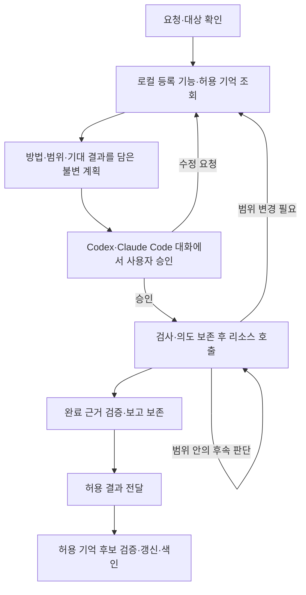

# 업무 흐름·실행·결과

상태: 첫 버전의 읽기·분석·보고·복구 동작 구현; 실제 회사 리소스·호스트 사용 검증은 별도

호스트의 root와 worker는 방법·다음 행동을 판단하고 DAERI는 root 업무의 승인·위임·호출·근거를 관리한다.
이 문서는 요청부터 실행·복구·완료 보고까지의 동작을 함께 정의한다.
승인 범위는 [계획·승인](approval.md), 공개 필드·오류는 [MCP 규격](../mcp/common.md)을 따른다.
기억의 내용·검색·갱신·수명은 [기억 계약](memory.md)이 소유한다.
SQLite·본문 파일·인증 저장소·색인의 역할과 저장·조회·삭제 절차는 [로컬 저장 구조](../configuration/profiles.md#로컬-저장-구조)가 소유한다.

현재 구현의 실행 목적은 `collect`·`verify`다.
아래 `change`·`reconcile`·원격 보상 규칙은 해당 목적을 추가할 때 구현·검증할 확장 계약이다.
지원·검증 범위의 정본은 [최초 구현 계획](../../plans/initial-implementation.md)이다.

## 요청에서 결과까지

사용자는 배포 저장소를 호스트 마켓플레이스에 추가하고 DAERI 플러그인을 설치한다.
`/setup {profile}`에 해당하는 진입점에서 리소스 범주·어댑터·연결 대상·인증 방식을 정하고 필요한 프로그램을 준비한다.
호스트별 진입 방식은 [플러그인](../hosts/plugins.md), 준비 절차는 [환경 구성](../installation/environment.md)을 따른다.
준비 후 work로 업무를 요청하며 새 업무의 대상은 [profile 선택 계약](../configuration/profiles.md#선택과-기본값)에 따라 확인한다.

호스트는 결과를 바꾸는 모호한 조건만 질문한다.
업무는 선택한 [profile](../configuration/profiles.md)의 구성 스냅샷을 사용한다.
등록 기능과 사전에 제공을 허용한 로컬 기억을 먼저 읽고 실제 원문·원격 탐색은 제한된 계획부터 승인받는다.

계획 전 [기억 조회](memory.md#계획-전-조회와-활용)로 기본 맥락과 관련 경험을 확인한다.
실행기가 발급한 `memory_search_refs`를 계획에 연결하고 0건·부분 검색·실패·충돌·오래된 근거와 추가 확인 방법을 표시한다.

사용자는 제시된 현재 계획을 보고 “승인할게”처럼 명시적으로 답한다.
승인 뒤에는 그 범위 안에서 필요한 기능을 스스로 선택하고 결과를 같은 호스트 대화로 보고한다.
응답과 계획을 연결하는 기준은 [대화 승인](../hosts/approval.md)을 따른다.

범위 변경은 [재계획 원칙](approval.md#자율-실행과-재계획의-경계)을 따른다.
호스트는 승인한 의존 관계·분기·예산 안에서 도구·분석·수행 순서·후속 조회·재시도를 자율적으로 결정한다.
독립적인 하위 작업은 아래 [worker 실행](#worker-위임과-병렬-실행)으로 나누고 결과의 근거를 같은 업무에서 통합한다.

## 업무를 연결하는 식별자

| 식별자 | 의미 |
|---|---|
| `task_id` | 한 요청으로 접수한 root 업무; worker의 호출·근거·예산도 이 업무에 연결 |
| `plan_id`, `plan_version` | 불변 계획과 업무 내 증가하는 버전 |
| `step_id` | 계획의 논리 단계; 여러 호출을 포함할 수 있음 |
| `approval_id` | 특정 계획의 실제 승인 또는 향후 정책 결정 |
| `delegation_id` | root 업무의 승인된 단계를 worker에 배정한 위임 |
| `call_id` | 한 번의 구조화된 기능 실행; 내부 시도·페이지는 하위 기록 |

각 ID는 저장된 권한·승인·실행 근거를 조회하는 연결 키다.
수정 계획은 과거 호출의 당시 계획·승인 연결을 유지한다.

## 실행 상태와 전이

| 상태 | 의미 |
|---|---|
| `planning` | 조건 확인·기능·기억 조회·계획 구성 |
| `awaiting_input` | 대상·조건의 답변 대기 |
| `awaiting_approval` | 저장 계획의 실제 확인 대기 |
| `paused` | 사용자가 일시중지; 상태·계획 확인과 새 승인 전 실행 차단 |
| `running` | 유효 승인 범위의 실행 |
| `reconciling` | 이미 요청한 외부 작업의 성공·진행 여부 확인 |
| `verifying` | 완료 조건·산출물 확인 |
| `succeeded` | 필수 조건 충족과 결과·근거 보존 완료 |
| `partial` | 유용한 일부 결과가 있으나 전체 조건 미충족 |
| `failed` | 목적을 달성하지 못함 |
| `cancelled` | 취소로 추가 실행 중단 |

첫 버전의 정상 흐름은 `planning → awaiting_approval → running → succeeded|partial|failed`다.
결과 제출은 원본·완료 조건·산출물을 검증한 뒤 같은 처리에서 종료 상태를 보존한다.
`verifying`·`reconciling`은 검증·원격 확인 단계를 분리하는 확장 상태다.
질문은 `awaiting_input`으로 전환하며 답변 등록은 요청 맥락 개정을 갱신한다.
profile이 확정된 답변은 `planning`으로 돌아가 기억 재조회·수정 계획·새 승인을 거친다.
profile이 필요한 업무는 선택이 완료될 때까지 `awaiting_input`으로 유지한다.
범위 변경은 새 호출을 멈추고 수정 계획을 저장해 `awaiting_approval`로 돌아간다.
새 계획 제출의 허용 상태·원자적 전이는 [계획 도구](../mcp/plans.md#daeri_plan_submit)를 따른다.

신규 호출은 현재 유효한 승인이 있는 `running|verifying` 상태에서 접수한다.
확인 중인 업무의 호출 목적 제한은 [리소스 실행 규격](../mcp/resources.md#daeri_capability_execute)을 따른다.
이미 시작한 결과는 원 호출에 남긴다.
확인 불가·한도 소진은 불확실성을 보존해 `partial|failed`로 보고한다.

## 실행 검사와 기록

| 순서 | 실행기의 동작 |
|---|---|
| 1. 주체·업무 | 실제 연결 주체·현재 권한과 중복·충돌 확인; root 호출의 개정·소유권 또는 worker 위임과 현재 업무 상태 검사 |
| 2. 계획·방법 | 현재 불변 계획·유효 승인·철회·만료, 기능·분기·의존 관계·후속 값 출처 대조 |
| 3. 실제 대상 | 스키마와 변환한 하위 인수·기본값을 실제 대상·연산·범위에 대조 |
| 4. 예산·의도 | 제약 강제 가능성 확인, 누적 예산 예약과 정규화 입력·계획·승인·시도 영속 기록 |
| 5. dispatch | 현재 소유권·위임·상태·계획·승인·권한·예약 재검사, 시작 기록 후 호출 |
| 6. 보존·반환 | 외부 효과·범위·오류·소비량·근거 보존, 확인된 양 정산과 허용 자료 반환 |

신뢰할 원본·승인·범위 검사를 모두 통과하면 하위 요청을 전송한다.
원본 조회·검사 실패는 해당 오류와 차단 상태로 반환한다.
계획에서 적용한 기억은 [현재 유효성](memory.md#계획-전-조회와-활용)도 대조하고 정정·만료 등으로 전제가 깨지면 수정 계획을 요구한다.
실제 주체·대상은 고정한 연결·인증과 실제 DB·계정·리전·프로젝트로 대조한다.
계약 의미·제약 변경은 `CONTEXT_CHANGED` 등 문맥 오류로 반환하고 현재 계약을 진단·재승인받는다.

후속 값은 실행기가 보존한 실제 선행 호출에서 읽고 현재 허용된 원본 필드인지 확인한다.
`redact`는 `[REDACTED]` 표시를 남기고 계산·바인딩·기억에 사용할 실제 값은 제공 정책을 통과한 원본 경로에서 해소한다.
가림·누락 경로의 바인딩은 검증 오류로 반환한다.

후속 키·ID·경로·페이지 토큰도 저장 출처와 다음 호출의 범위를 검사한다.
실제 대상 확인에 필요한 원격 조회 역시 승인·기록·예산을 거친다.
설치·로그인·profile 구성 변경은 관리 경로에서 처리한다.
제품별 검사·변환은 [리소스 계약](../resources/contract.md)이 소유한다.

### 소유권과 중복

업무당 root 실행 소유자는 하나다.
여러 로컬 호스트 프로세스의 소유권·예약은 같은 저장소에서 원자적으로 검사한다.
root의 직접 실행은 현재 소유권, 일시중지·취소는 해당 주체 권한, worker의 실행은 현재 소유권에 연결된 위임으로 검사한다.
각 검사에 실패하면 신규 호출을 해당 소유권·위임 오류로 반환한다.

소유권 이전은 기록 확인 뒤 내부 세대를 갱신한다.
dispatch는 현재 소유권 세대에 허용한다.
이전 세대에서 시작한 결과는 원 호출에 보존하고 새 소유자는 진행 중·미확인 요청의 원 기록부터 확인한다.

제어 가능한 페이지·재시도도 dispatch 직전 검사를 거친다.
하위 MCP 내부 요청을 중단·통제하지 못하면 원 호출 전체를 확인 대상으로 유지한다.
로컬 의도 저장·네트워크 전송·원격 효과는 별도 단계로 기록해 각 단계의 확인 상태를 추적한다.

재전달은 기존 기록만 반환하며 키·개정 비교와 충돌은 [MCP 공통](../mcp/common.md#업무-개정과-멱등-요청)을 따른다.
새 호출의 반복 안전성은 원 호출 상태·원격 중복 방지·효과 확인 계약으로 판단한다.

## worker 위임과 병렬 실행

root는 현재 계획의 승인된 단계를 묶어 하위 목표를 정하고 실행기에 위임을 등록한다.
위임은 root 업무·현재 계획·승인·소유권 세대와 배정한 단계·완료 조건·허용 출처·기한에 연결한다.
실행기는 발급 응답에서만 위임 토큰을 반환하고 root는 위임 정보·토큰·worker 지침을 네이티브 worker에 전달한다.
worker는 `daeri_worker`에서 배정과 기능 계약을 확인하고 해당 범위의 기억 검색·근거 읽기·기능 실행·완료를 수행한다.
호스트별 생성·대기·결과 회수는 [호스트 연결](../hosts/plugins.md), 공개 입력·상태는 [업무 MCP](../mcp/tasks.md)가 정의한다.

실행기는 전달받은 토큰의 위임이 유효하고 현재 root의 실행 조건을 충족할 때 배정한 단계의 호출을 접수한다.
worker의 호출도 단계 의존 관계·허용 분기·실제 대상·출처·자료 정책과 공유 예산을 모두 검사한다.
worker가 필요한 추가 조회·재시도·방법을 선택할 수 있는 범위는 [같은 계획의 자율 실행 조건](approval.md#worker-위임과-승인-범위)을 따른다.
기억 검색은 배정 단계의 리소스 인스턴스에 한정하고 보존 결과 읽기는 배정에 명시한 출처와 해당 위임의 호출 결과를 대상으로 검사한다.
기억 본문은 현재 제공 검사를 거친 검색 결과로 받는다.

각 단계의 실행은 기한이 남은 활성 위임 하나에 배정한다.
배정한 단계의 새 호출은 해당 위임으로 접수하며 root가 직접 맡으려면 위임을 철회하고 진행 중 호출을 먼저 확인한다.
철회·만료한 위임에 진행 중·미확인 호출이 남아 있으면 원 호출의 상태를 해소할 때까지 해당 단계를 다시 배정할 수 없다.
토큰의 소지는 제한된 호출 자격이며 실제 호스트 worker의 신원·단일 수신자는 호스트의 전달 경계에서 관리한다.

worker의 실행 자격은 유효 위임과 현재 업무 조건으로 확인하며 다른 worker가 반영한 root 업무 개정의 증가와 독립적으로 접수한다.
동시 호출의 의도·예약·시도·소비·결과는 같은 저장소의 root 업무 기록에 원자적으로 반영한다.
각 worker는 남아 있는 업무 전체의 누적 한도 안에서 실행한다.

worker는 완료한 호출·근거와 실패·제한을 root에 반환하고 진행 중·미확인 호출이 없을 때 위임 완료를 기록한다.
root가 전체 완료 조건·근거를 확인해 보고·산출물·종료 상태를 제출하고 필요한 기억 후보를 profile의 공유 정본에 갱신한다.
worker의 작업 결과와 profile의 재사용 기억은 각각 업무 근거와 [선별 기억](memory.md)으로 관리한다.

root의 일시중지·취소·계획 교체·승인 무효화와 소유권 이전은 연결된 위임의 새 실행 자격을 함께 무효화한다.
개별 위임 철회는 해당 worker의 새 호출을 차단하고 다른 유효 위임은 현재 업무 조건 안에서 계속할 수 있다.
위임 기한이 지나면 새 실행을 차단하고 원 호출의 결과·소비·예약은 보존한다.
새 계획·승인 또는 재개 후의 worker 실행에는 현재 조건에 맞는 새 위임을 발급한다.
이미 시작한 결과는 원 계획·승인·위임·호출에 보존하며 철회·중지 후의 결과도 root 업무의 현재 상태를 유지한다.
프로세스 종료·원격 중단과 늦은 결과의 처리는 아래 [복구 절차](#중단재개와-외부-결과-확인)를 따른다.

## 예산과 재시도

논리 호출과 실제 외부 요청을 구분하고 페이지·재시도·상태 확인도 누적한다.
실행 전 최대 할당량을 예약하며 소비·미정산 예약과 합쳐 한도를 검사한다.
제어 가능한 하위 요청마다 같은 경계를 적용한다.
root와 모든 worker의 호출은 이 업무 전체 예산을 공유한다.

숫자 한도를 설정하려면 해당 기능에 실제로 관찰·통제할 수 있는 강제 수단이 필요하다.
실행기는 이 조건을 충족한 한도를 적용하고 나머지는 미지원 조건으로 반환한다.
외부 요청 상한의 `null`은 명시적인 무제한 값이다.
실제 측정 상태·승인·접근 범위는 각각의 필드와 검사로 유지한다.
원격 자료량·요청량의 상한은 실제 원격 강제 수단이 있는 기능에서 제공한다.

미확정 소비·효과는 미확정 상태로 유지하고 해당 예약은 원격 완료·사용량을 확인한 뒤 정산한다.
숫자 상한이 있는 예산은 확인된 소비·예약·잔여량을 계산하고 완료 후 확인된 미사용분을 반환한다.
재계획도 소비·예약을 승계하며 확대는 다시 승인받는다.
단위·지원 여부와 숫자·null의 필드는 [계획 MCP](../mcp/plans.md)가 정의한다.

DAERI 대기·dispatch 시간은 실행기에서 관찰·제어하는 시간이다.
원격 CPU·과금·작업 종료는 제공자가 지원하는 제약으로 별도 확인한다.
상위·SDK의 중첩 재시도도 합산하고 설정한 한도를 실제 강제할 수 있는지 검사한다.

첫 버전의 root 직접 호출은 남은 업무 시간과 60초 중 작은 값을 예약한다.
worker 호출은 [worker MCP](../mcp/tasks.md)의 호출 시간 제한과 남은 업무 시간 중 작은 값을 예약한다.
DAERI 실행기는 한 호출 ID당 한 번 전송하고 재전달에는 보존 기록을 반환한다.
호스트가 범위 안에서 추가 읽기를 선택하면 새 호출 ID로 접수하고 같은 승인·분기·예산 검사를 적용한다.
페이지 이어받기·원 호출 효과 확인은 해당 계약을 구현한 기능에서 확장한다.

읽기 재시도는 새 시점의 관찰이므로 일관성·부작용·승인·권한·예산을 확인한다.
변경은 중복 방지·안전한 반복 의미가 없으면 완료 확인을 우선한다.
과거 효과의 해소에는 원 호출과 연결한 실제 확인 근거가 필요하다.

### 일부 조회 실패의 기본 동작

개별 리소스 조회가 실패하면 그 결과에 의존하는 호출을 막는다.
유효 승인·현재 권한·남은 예산·기록 보존이 유지되는 독립적인 읽기는 계속하고 계획의 더 엄격한 중단 조건을 우선한다.
승인·대상 바인딩·공통 저장소·업무 전체 예산 등 공통 실행 조건이 깨지면 영향받는 업무의 신규 호출을 차단한다.

필수 조건을 충족하지 못했지만 유용한 결과가 있으면 `partial`, 유용한 결과도 없으면 `failed`로 보고한다.
보완 뒤 모든 필수 조건이 실제로 충족된 경우에만 `succeeded`로 마감하며 원 실패와 누락의 영향을 남긴다.
미확인 외부 효과·실패한 변경은 원 호출 확인·반복 안전성 검사를 거쳐 후속 방법을 정한다.

## 중단·재개와 외부 결과 확인

대화가 없어져도 로컬 업무·계획·승인·호출·근거를 읽어 복구한다.
업무 번호를 모르면 선택한 profile의 최근 업무 제목·상태를 보고 사용자가 이어갈 업무를 선택한다.
최근 목록은 선택한 profile의 현재 열람·제공 권한을 통과한 로컬 이력이며 사용자가 정확한 업무를 선택한다.
선택한 업무의 상태를 먼저 읽고 실행에는 유효 승인 검사를 적용한다.
종료 업무는 결과를 열람하고 추가 실행은 새 업무로 접수한다.
재개는 소유자·대기 이유·승인·현재 권한·고정 대상·계약·누적 예산을 확인한다.
현재 판단·실행 루프는 호스트·PC의 활성 상태를 따르며 중단 후 저장 기록에서 재개한다.

읽기 호출의 완료를 확인하지 못하면 재개 응답에 해당 호출 ID를 남기고 `resumed=false`로 알린다.
이전 소유자의 프로세스 종료가 확인된 뒤에도 dispatch 기록이 있으면 `unknown`과 미정산 시간 예약을 유지한다.
dispatch 전 의도만 남았다면 호출을 차단한 상태로 기록하고 그 호출의 미사용 예약을 해제한다.
첫 버전은 해당 호출의 `unknown` 상태·제한을 유지하며 부분·실패 보고로 마감할 수 있다.

| 사용자 요청 | 처리 |
|---|---|
| 일시중지 | `paused`로 보관하고 기존 승인·대기 응답 무효화; 결과·호출·효과·소비·예약 유지 |
| 일시중지 후 재개 | 현재 상태·남은 작업·계획·예산 확인 후 새 실제 승인; 같으면 동일 계획, 달라지면 수정 계획 |
| 취소 | `cancelled`로 종료; 추가 실행은 새 업무로 접수 |

늦은 응답은 원 호출 결과로 보존하고 업무의 현재 중지·종료 상태를 유지한다.
원격 중단·보상은 해당 기능이 지원하는 효과·확인 계약에 따라 처리한다.
입력·상태 전이는 [업무 MCP](../mcp/tasks.md#daeri_task_update)를 따른다.

실행 전 의도·예약 저장 실패는 요청 전송을 막는다.
실행 후 응답·저장 실패나 시간 초과로 외부 결과를 확정할 수 없으면 효과 미확인으로 남긴다.
신규 dispatch는 저장소 복구와 원 호출 상태·효과 확인을 완료한 뒤 허용한다.
실행기가 확인한 저장 중단의 상태·예약·경과 시간 정산과 같은 실행기에서의 복구는 [실행 오류 계약](../mcp/resources.md#결과와-오류)을 따른다.
조회 뒤 결과 보존 실패는 원 호출의 `unknown`·`RESULT_PERSIST_FAILED`를 유지하고 첫 버전은 부분·실패 보고로 마감한다.

완료 확인의 증거는 원 호출·실제 대상·원격 작업에 연결한 관찰과 검증 결과다.
[원 호출 확인 계약](../mcp/resources.md#원-호출과-상태-확인의-연결)에 따라 확인 결과·원 상태를 함께 보존하고 미확정 예약을 유지한다.

종료 업무의 후속 확인은 원 업무·호출을 명시한 새 승인 업무에서 수행한다.
양 업무 권한·실제 바인딩을 검사하고 신규 확인 사용량과 원 소비·예약을 각 업무에 남긴다.
원 종료 상태·보고는 유지하며 새 확인·원격 중단·보상에도 계약·권한·승인·예산이 필요하다.
여러 리소스의 보상은 각 리소스의 지원 효과·완료 확인·실패 상태를 개별 추적한다.

## 이력과 완료 근거

대화와 별도로 판단·추적·복구에 필요한 허용 기록을 보존한다.
본문은 승인한 제공·보관 범위로 보존하고 여러 계획의 근거는 각각의 원 연결을 유지한다.
업무 상태·고정 스냅샷·계획·승인·호출 메타데이터는 SQLite에서 추적한다.
허용 조회 본문·보고·산출물은 관리 파일로 보존하고 SQLite의 등록 참조로 연결한다.
본문을 포함하는 요청·대화·계획 설명도 추적 필드와 분리해 해당 본문의 기한과 삭제를 적용한다.

| 기록 | 최소 내용 |
|---|---|
| 요청 | 업무·주체·대상 맥락·목적·완료 조건 |
| 계획·승인 | 불변 계획·방법·범위·한도, 실제 요청·주체·경로·결정·시각·유효 조건 |
| worker 위임 | root 업무·계획·승인·소유권 세대, 하위 목표·단계·완료 조건·허용 출처·기한·상태·호출·철회·완료 근거 |
| 기억 활용 | 검색·갱신 참조, 적용한 지식의 개정·제한·현재 확인과의 연결 |
| 로컬 검사 | 업무·실제 준비/입력/계획 검사·성공 또는 실패·비밀을 제외한 이유 |
| 호출 | 단계·계획·승인·정규화 입력·실제 대상·시도·페이지·사용량·관찰·오류·효과·허용 원본·참조 |
| 산출물·보고 | 관리 참조·생성 근거·제공 범위·마스킹, 조건별 판단·상태·제한·후속 행동 |

비밀값은 입력·결과·오류에서 제외하고 민감 자료는 허용된 저장 범위로 제한한다.
삭제·가림의 영향과 하위 MCP가 숨긴 요청·사용량의 미확정 범위를 표시한다.

종료 후 조회 본문은 [계획 출력 규격](../mcp/plans.md#예산보고완료-조건)의 보관 필드로 축소하고 비밀 제거·마스킹 후 사용자 PC에 남긴다.
보관 범위·가림·원 호출 연결을 보존하며 향후 열람은 현재 권한·정책·기한을 다시 검사한다.
자료의 수명은 다음처럼 구분한다.

| 대상 | 보존·정리 기준 |
|---|---|
| 종료 업무의 허용 본문·산출물 | 요청·보완·승인 대화·계획 본문·표시본·호출 인수·검색 질의·조회·보고·파일에 아래 공통 보존기한 적용 |
| 활성·일시중지 업무의 허용 복구 자료 | 종료 후 본문 정리와 구분 |
| 최소 이력·멱등 비교 정보 | 자동 만료 없음; 상태·계획·승인·호출 참조·검증 방법·사용량·미확인 효과 유지 |
| 기억 정본·키워드·벡터 색인 | 일반 요약은 원 출처 기한 승계; 별도 허용한 장기 운영지식은 [기억 보존 기준](memory.md) 적용 |

최소 이력은 위 추적 필드를 담으며 본문·행값·파일·기억 본문은 각 정본의 제공·보존 정책으로 관리한다.

새 profile의 공통 보존기간은 기본 무기한이며 `retention_days=null`로 표현한다.
양의 정수를 설정하면 최초 `succeeded|partial|failed|cancelled` 전이의 UTC 시각부터 하루를 24시간으로 계산한 유한 기한을 적용한다.
기간 설정은 [profile 구성](../configuration/profiles.md#구성과-연결)에서 해소하고 업무의 고정 스냅샷에 연결한다.

보고·표·파일 등 파생 자료는 해당 업무와 모든 기여 출처의 유한 기한 중 가장 이른 값을 따른다.
모든 기여 출처·업무에 시간 제한이 없으면 파생 자료는 `expires_at=null`이다.
저장·모델 제공·내보내기는 보존기한과 별개로 필드별 허용·마스킹·현재 권한을 검사한다.
삭제·보존 허용 취소·권한 철회가 확인되면 기한 유무와 관계없이 해당 자료와 영향받는 파생물의 사용을 차단한다.

설정 변경은 새 업무에 적용하고 기존 profile의 명시적 기간·이미 확정한 유한 기한은 유지한다.
재조회·추가 보고·늦은 결과도 최초 종료·원 출처에서 해소한 기한을 승계한다.
만료한 본문·산출물은 반환·근거 승계·새 산출물 생성 시 만료 오류로 처리한다.
다시 원격 조회하려면 유효한 계획·승인으로 새 관찰을 확보한다.

실행기 시작 때 만료 자료를 정리하며 삭제 실패에도 열람 차단을 유지하고 관리 경로로 안내한다.
파일이 남아 있는 동안의 중복 요청 재전달·캐시·페이지 조회에도 같은 만료 검사를 적용한다.
자료 반환은 등록 참조·무결성·현재 권한·기한 검사를 통과해야 한다.
자동 정리는 DAERI 관리 자료를 대상으로 하며 호스트 대화·사용자 사본의 관리는 해당 저장 위치가 담당한다.
정리 후 최소 이력은 기존 업무 상태·사용량·효과와 종료 여부를 유지한다.

| 근거 종류 | 보고의 의미 |
|---|---|
| 관찰 | 실제 리소스 호출·로컬 검사·등록 요청 자료의 사실; 원본·범위·시점·스냅샷·가능한 원격 ID 연결 |
| 파생 결과 | 관찰로 계산·집계한 값, 원본·방법·대상 범위 |
| 과거 기억 | 이전에 확인한 지식·조건·출처와 검증 상태; 현재 관찰과 구분 |
| 가설·예상 | 가정·미확인 설명 또는 아직 실행·검증하지 않은 산출물 |

보고는 요청 자료·로컬 검사·실제 외부 관찰·코드 생성·적용·테스트를 수행 근거별로 구분한다.
원본을 다시 확보할 수 없으면 보존 관찰의 제한을 설명한다.
분석 자료는 출처로, 정책은 관리 설정·승인 기록으로 해소한다.
자연어 의미는 호스트가 해석하고 실행기는 구조화된 조건·실제 근거를 검사한다.

계획의 모든 완료 조건에 판단·방법·근거를 남긴다.
실제 대상·필터, 자료·페이지 완전성, 원본과 결과 대응, 변경 후 상태와 보존 완료를 확인한다.
필수 조건 제외는 승인 분기의 실제 관찰 등 검증 가능한 근거가 필요하다.

`succeeded`는 승인 이력·필수 조건 충족·결과 보존이 실제 기록으로 뒷받침돼야 한다.
활성 업무의 성공 마감은 현재 유효한 승인·필수 조건 충족·호출 종료·확인된 효과·필수 자료 보존을 요구한다.
조건이 부족하면 대기·부분·실패 상태와 보완 항목을 반환한다.
보완한 실패도 원 실패와 보완 근거를 유지한다.
검증 호출은 승인·권한·예산 검사를 거치고 보고 도구는 보존한 근거의 구조·조건·계산을 검증한다.

## 결과 제공과 전달

여러 리소스의 결과를 결합·비교·계산한 표와 CSV를 제공한다.
가상 예로 DB 업무 데이터와 Cache 상태의 불일치 목록을 만들 수 있다.
실제 결합·분석 방법은 요청·자료·승인 범위에서 정한다.
대화의 텍스트·표·구조화 응답과 파일 산출물을 구분하고 등록된 [출력 생성기](../mcp/tasks.md#결과-형식과-생성기)에 따라 다양한 형식을 제공한다.

파생 결과는 원본 참조, 결합 기준·계산 방법, 입력·결과의 대응과 검증 기록을 함께 보존한다.
대화로 제공하는 표도 같은 검증·보존을 거치며 필요한 파일은 검증한 표에서 생성한다.
누락·중복·조회 시점 차이·잘림의 영향을 확인하고 보존 원본의 키·셀로 계산을 재검증한다.
최초 계약은 승인한 유일키 결합과 원본 셀의 단일 연산 검산이며 [표 입력·검증](../mcp/tasks.md#파생-표와-셀-검증)에서 관리한다.
표·CSV는 사용자 결과 형식이며 내부 정본·파일·색인의 저장 역할은 로컬 저장 계약을 따른다.

파생 열은 기여 리소스별 제공·마스킹 조건의 교집합을 적용한다.
원본·검증이 부족하면 해당 완료 조건을 미충족으로 보고하고 필요한 보완을 표시한다.
자료 제공에는 유효한 출처·현재 제공 허용 확인이 필요하며 검사 실패는 제공 오류로 반환한다.

보고에는 요청 해석·실제 수행·완료 근거·제한·미확인 효과·산출물·후속 행동을 담는다.
업무 상태와 외부 효과는 별도 필드로 추적하고 저장·반환·내보내기·재조회에 현재 제공 조건을 적용한다.
Mail·Issue·Source·Document 게시·전송은 외부 변경으로 별도 승인받는다.
DB 형태의 파일 생성과 실제 리소스 DB 쓰기도 구분하며 후자는 변경 기능으로 승인받는다.

모델이 읽을 수 있는 자료와 파일로 내보낼 수 있는 자료의 범위는 다를 수 있다.
자유 보고 파일은 요약·JSON 변환·첨부 여부와 함께 그 업무에서 모델에 제공한 전체 필드의 내보내기 허용을 확인한다.
파일에는 기여 출처를 연결하므로 나중에 기억 후보로 인용해도 실제 관찰·사용자 확인까지 다시 검증한다.

보고 보존과 호스트 답변 전달은 별개다.
현재 전달 상태는 실제 호스트 증거를 확인할 때 확정하며 그 전에는 `not_confirmed`로 유지한다.
전달만 실패하면 현재 제공 권한으로 저장 보고를 다시 읽는다.
보고의 결과 상태·보존 성공·호스트 전달은 각각의 상태로 추적한다.

제출·조회 필드는 [업무·결과 MCP](../mcp/tasks.md)를 따른다.
최소 이력은 SQLite에, 보고·표·생성 파일은 관리 영역에 보존하고 등록 참조로 읽는다.
보고·파일은 [업무와 기여 출처의 보존 조건](#이력과-완료-근거)을 승계한다.

첫 구현의 결과 제출은 보고 초안 → 원본·키·셀 재계산 → 완료 조건 대조 → 파일 형식·크기 확인 → 원자적 보존 순서다.
새 표·파일 생성은 해당 계획의 승인·출력 범위 검사를 통과해야 한다.
활성 업무는 현재 유효한 승인, 종료 후 허용 추가 보고는 해당 계획의 실제 승인 이력과 기존 범위가 필요하다.
원본 셀 재계산·행 대응·필드 제공 검사에 실패하면 `RESULT_VALIDATION_FAILED`로 반환한다.
CSV의 수식·탭·개행 문자열은 파일로 내보낼 때 무해화하고 보존한 구조화 표의 원래 값과 구분한다.
형식과 검산을 통과해도 실제 호스트 전달 증거가 없으면 `delivery_status=not_confirmed`로 남긴다.
보존 보고·파일을 다시 읽거나 같은 제출 요청을 재전달할 때도 기여 기억의 정정·무효화와 원출처의 현재 제공 조건을 검사한다.
다른 업무의 기억 출처는 해당 기억의 출처 설명으로 연결하고 현재 업무는 그 지식의 현재 제공 권한을 확인한다.

구현·거부·복구 검증 순서는 [최초 구현 계획](../../plans/initial-implementation.md)을 따른다.

## 업무 후 기억 갱신

호스트는 보고 후 활성 대화 안에서 실제 근거가 있는 재사용 지식을 선별한다.
실행기는 [기억 갱신 계약](memory.md#업무-후-갱신과-정정)에 따라 출처·정책·보존을 검사하고 정본·색인을 갱신한다.
실패는 별도 제한으로 보고하며 완료 업무의 상태·호출 기록을 유지하고 다음 대화에서 남은 갱신을 확인한다.

## 가상 수행 사례

“지난주 실패 주문 원인을 분석해줘.”라는 요청의 서비스·환경·시간대·기간을 확인한다.
로컬 등록 기능과 해당 profile의 허용 기억을 읽는다.
예를 들어 과거에 확인한 집계 제외 조건이 있으면 현재 적용 여부를 확인할 방법과 함께 DB 집계·Source의 특정 개정과 경로 조회를 계획한다.
고객·결제 정보 제외, 한도·제공 필드·완료 근거도 표시한다.

사용자가 승인하면 범위 안의 후속 집계·파일 조회를 선택한다.
Infra 확인이 새로 필요해지면 차이·추가 예산을 담은 수정 계획을 먼저 승인받는다.
보고는 관찰·추정 원인을 구분하고 누락·잘림·필수 조건 미충족을 결과 상태와 제한에 표시한다.
업무 후에는 새로 검증한 집계 규칙이나 오류 예방 절차만 승인한 범위에서 기억으로 갱신한다.

이 사례는 해당 기능이 등록·지원된 환경의 가상 흐름이다.
