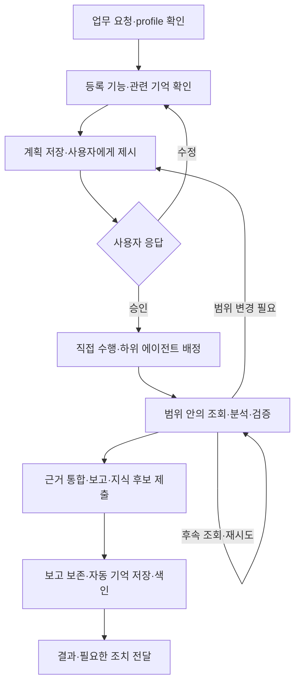

# 업무 흐름·실행·결과

상태: 읽기·분석·보고·자동 기억과 중단 복구 구현; 실제 호스트·회사 연결은 별도 검증

총괄 에이전트는 요청을 계획으로 만들고 사용자 승인 뒤 직접 수행하거나 하위 에이전트에게 배정한다.
DAERI runtime은 승인 범위의 읽기 실행·근거·보고·기억을 사용자 PC에 보존한다.
승인은 [계획 명세](approval.md), 기억은 [기억 명세](memory.md), 공개 도구는 [MCP 규격](../mcp/common.md)이 소유한다.

## 요청에서 결과까지

[setup](../hosts/plugins.md)에서 연결 정보와 임베딩 방식을 설정한 뒤 work로 업무를 요청한다.
호스트는 결과를 바꾸는 모호한 조건만 확인하고 다음 흐름으로 진행한다.

등록 설명·기능·관련 기억을 먼저 확인하고 필요한 원격 탐색은 계획에 포함한다.
기억 검색의 0건·실패·생략은 부족한 맥락으로 표시하고 확인 가능한 현재 조건으로 계획을 구성한다.
실제로 선택한 기억은 [현재 유효성](memory.md#계획-전-조회와-활용)을 검사한다.

계획 제출은 승인 대기를 함께 만든다.
호스트가 현재 계획을 제시하고 실제 사용자가 승인하면 같은 범위의 도구·질의·페이지·분석 방법을 자율적으로 선택한다.
새 연결·대상이나 더 넓은 범위가 필요하면 [수정 계획](approval.md#자율-실행과-재계획의-경계)을 제시한다.

## 업무를 연결하는 식별자

업무·계획·단계·위임·출처 참조는 실행과 근거를 연결한다.
호스트는 응답으로 받은 업무·계획·출처를 후속 요청에서 선택한다.
요청 ID·업무 개정·호출 ID·기능 계약 지문과 승인 연결은 runtime이 관리한다.
공개 입력과 중복 처리의 상세는 [MCP 공통](../mcp/common.md)을 따른다.

## 실행 상태와 전이

| 상태 | 의미 |
|---|---|
| `planning` | 조건·기능·기억 확인과 계획 구성 |
| `awaiting_input` | 사용자 조건·profile 선택 대기 |
| `awaiting_approval` | 저장한 현재 계획의 응답 대기 |
| `running` | 승인 범위의 실행·검증 |
| `paused` | 사용자 요청으로 새 실행 중지 |
| `succeeded` | 호스트가 목표 달성으로 판단한 결과 보존 |
| `partial` | 유용한 일부 결과와 미충족 조건 보존 |
| `failed` | 목적 달성 실패와 원인 보존 |
| `cancelled` | 취소로 업무 종료 |

정상 흐름은 `planning → awaiting_approval → running → succeeded|partial|failed`다.
질문의 답변·목표·결과 조건 변경은 요청 맥락에 반영하고 이전 승인·하위 에이전트 위임을 종료한 뒤 현재 조건의 계획을 확인받는다.
보고 제출은 승인·실제 출처·파일을 검사하고 호스트가 판단한 업무 종료 상태를 함께 보존한다.
계획 전에 수행할 수 없는 업무도 호스트가 실패 원인·확보한 근거·다음 조치를 보고해 `failed`로 마감한다.
공개 상태·허용 전이는 [업무 MCP](../mcp/tasks.md)가 정의한다.

## 실행 검사와 기록

runtime은 각 호출에서 다음 조건을 확인한다.

1. 현재 업무 소유권 또는 하위 에이전트 배정과 사용자 승인
2. 승인한 연결·읽기 기능·입력 스키마·대상·명시 범위
3. 명시한 선행 단계의 완료와 인용한 실제 보존 출처
4. 사용자가 정한 호출·시간 한도와 실행 기록의 보존 가능성

검사를 통과하면 호출 시작을 기록한 뒤 선택한 어댑터의 읽기·관찰 기능을 수행한다.
외부 서비스는 하위 MCP를 호출하고 로컬 Source는 호스트가 확인한 관찰을 [실행 계약](../mcp/resources.md#로컬-source-관찰-등록)으로 등록한다.
결과·오류·실제 소비·관찰 시점·출처를 보존하고 현재 제공 가능한 자료를 반환한다.
인증은 등록 참조로 해소하고 실제 계정의 읽기 권한은 연결한 서비스가 적용한다.

profile의 무관한 설정·설명 변경과 인증값 갱신은 기존 업무를 유지한다.
사용 중인 연결·실제 대상이 바뀌면 설정·진단 뒤 새 업무로 접수한다.
같은 연결의 입출력 스키마·읽기 의미 변경은 진단 결과와 계획에 반영한다.
입력·대상 검사와 오류는 [리소스 실행 규격](../mcp/resources.md#daeri_capability_execute)이 소유한다.

### 소유권과 중복

업무의 총괄 에이전트 실행 소유자는 하나이며 소유권·호출·결과는 같은 저장소에서 원자적으로 처리한다.
재개 시 다른 프로세스의 실행 여부와 보존 상태를 확인하고 현재 소유자를 연결한다.
중복 요청·호출의 재전달은 기존 기록에 연결하고 새 관찰은 새 호출로 기록한다.
이미 시작한 결과는 원 호출에 보존하며 현재의 일시중지·취소·종료 상태를 유지한다.

## 하위 에이전트 위임과 병렬 실행

독립 조사·분석·검증의 이득이 있으면 총괄 에이전트가 승인 단계의 하위 목표·완료 조건·입력 근거를 하위 에이전트에 배정한다.
실제 하위 에이전트 생성·추론·대기는 호스트가, 배정과 DAERI 도구 접수는 runtime이 담당한다.
한 하위 에이전트가 여러 연결을 사용할 수 있고 같은 단계의 독립 조사를 여러 하위 에이전트가 함께 맡을 수 있다.

하위 에이전트는 전달받은 배정에서 기억 검색·허용 근거 읽기·기능 실행·완료를 수행한다.
실행에는 같은 총괄 에이전트 계획·승인·연결 범위와 명시한 업무 한도를 적용한다.
위임 토큰은 배정 범위의 호출 자격이며 실제 하위 에이전트의 신원과 전달 경로는 호스트가 관리한다.
기본 위임은 별도 시간 만료 없이 해당 업무·계획의 유효 상태를 따른다.

하위 에이전트는 실제 근거·분석·실패·제한·기억 후보를 총괄 에이전트에 반환한다.
총괄 에이전트가 전체 결과를 대조하고 후속 수행·재배정·최종 보고를 판단한다.
하위 에이전트 사용이 어려운 환경에서는 총괄 에이전트가 같은 승인 범위에서 직접 이어간다.

일시중지·취소·계획 교체·소유권 이전은 연결된 하위 에이전트의 새 실행 자격을 종료한다.
진행 중 결과는 원 계획·위임·호출에 보존하고 필요한 작업은 현재 조건에서 다시 배정한다.
호스트 연결은 [플러그인 사양](../hosts/plugins.md), 공개 입력은 [하위 에이전트 MCP](../mcp/tasks.md)를 따른다.

## 예산과 재시도

기본 업무는 누적 호출 수·시간 상한 없이 수행한다.
사용자가 단순 한도를 지정하면 총괄 에이전트와 모든 하위 에이전트의 소비·예약을 같은 업무에 합산해 검사한다.
각 외부 호출에는 연결·대기 시간 제한을 적용하며 하위 서비스의 과금·자체 사용량 관리는 해당 제공자가 담당한다.
입력·기본값·지원 한도는 [계획 MCP](../mcp/plans.md#예산보고완료-조건)가 정의한다.

호스트는 승인 범위 안에서 후속 페이지·다른 질의·읽기 재시도를 선택한다.
각 호출은 새 시점의 관찰이며 원 실패와 보완 결과를 함께 기록한다.
수정 계획에도 실제 누적 사용량을 승계하고 명시한 한도 확대는 사용자에게 확인받는다.

### 일부 조회 실패의 기본 동작

개별 조회 실패는 해당 결과에 의존하는 작업에 반영하고 독립적인 읽기는 계속한다.
승인·대상·공통 저장소 등 업무의 공통 조건이 깨지면 영향받는 신규 호출을 멈추고 복구한다.
유용한 일부 결과가 있으면 `partial`, 목적을 달성하지 못하면 `failed`로 보고한다.
보완 결과로 목표를 달성했다고 판단하면 원 실패와 보완 근거를 연결해 `succeeded`로 마감한다.

## 중단·재개와 외부 결과 확인

대화·호스트가 중단되면 저장한 업무·계획·승인·호출에서 이어간다.
업무를 모르면 선택한 profile의 최근 제목·상태에서 사용자가 이어갈 항목을 고른다.
종료 업무는 보존 결과를 확인하고 추가 실행은 새 업무로 접수한다.

읽기 실행의 프로세스가 끝나 결과를 받을 수 없으면 해당 호출을 `failed / READ_INTERRUPTED`로 정리하고 남은 시간 예약을 해제한다.
응답 보존 실패도 실제 오류와 원 호출 기록을 남긴다.
현재 승인과 저장소가 유효하면 새 읽기로 다시 관찰할 수 있다.
진행 중 프로세스가 있는 호출은 현재 상태를 확인한 뒤 이어간다.

| 사용자 요청 | 처리 |
|---|---|
| 일시중지 | 상태·기록을 보존하고 새 실행 중지 |
| 재개 | 현재 조건·계획 확인; 일시중지 뒤에는 실제 새 승인 |
| 취소 | `cancelled`로 종료하고 결과·이력 보존 |

늦게 도착한 결과는 원 호출에 연결하며 현재 중지·종료 상태를 유지한다.
실행 전 기록 저장 실패는 호출 오류로 반환하고 저장소 복구 뒤 다시 접수한다.
공개 복구 상태와 오류는 [업무 재개](../mcp/tasks.md)·[실행 오류](../mcp/resources.md#결과와-오류)를 따른다.

## 이력과 완료 근거

SQLite는 업무 상태·계획·승인·호출·출처를, 관리 파일은 허용 본문·보고·등록 파일을 보존한다.
정확한 저장 위치·쓰기·조회·삭제는 [로컬 저장 구조](../configuration/profiles.md#로컬-저장-구조)가 정의한다.
실행 이력은 추적·복구에, 선별 기억은 다음 업무의 재사용에 사용한다.

종료 뒤 조회 본문은 연결에서 해소한 보관 범위로 축소한다.
현재 접근 범위·마스킹·기한은 이후 조회와 파일·기억에도 적용한다.
비밀은 인증 참조로 관리하고 알려진 비밀 패턴은 기록에서 가린다.

| 자료 | 보존 기준 |
|---|---|
| 요청·계획 본문·승인 대화·조회·보고·파일 | 업무 공통 보존기한과 기여 출처의 더 이른 기한 |
| 활성·일시중지 업무의 복구 자료 | 현재 업무 복구에 필요한 동안 유지 |
| 최소 추적 이력 | 상태·참조·검증 방법·사용량·중복 비교 정보 유지 |
| 선별 기억·색인 | [기억 보존](memory.md#보존과-장기-운영지식) 적용 |

새 profile의 업무 보존 기본값은 무기한이다.
유한 기간은 최초 종료의 UTC 시각부터 하루를 24시간으로 계산하며 설정 변경·추가 보고·재전달은 기존 확정 기한을 승계한다.
파생 자료는 업무와 기여 출처의 가장 이른 유한 기한을 사용하고 모두 무기한이면 `expires_at=null`이다.
만료·명시 삭제·현재 제공 허용 철회는 관련 자료의 열람과 재사용에 즉시 반영한다.
runtime은 시작 때 관리 자료를 정리하며 호스트 대화·사용자 사본은 해당 저장 위치가 관리한다.

호스트는 실제 관찰·분석·기억을 바탕으로 내용·계산·조회 충분성과 목표 달성 여부를 판단한다.
runtime은 현재 승인·진행 중 호출·취소 상태와 실제 출처·파일 무결성·기한을 검사하고 결과를 보존한다.
완료 상태는 호스트가 선택한 성공·부분·실패·취소로 기록하며 공개 입력은 [결과 제출](../mcp/tasks.md#daeri_result_submit)을 따른다.

## 결과 제공과 전달

호스트는 사용자 요청에 맞춰 텍스트·표·구조화 응답·파일의 형식과 분석 방법을 선택한다.
설명에 필요한 근거·수행 방법·제한은 사용자 목표와 실제 결과에 맞춰 제공한다.
표본·단건·전수 조사의 완료 기준은 승인한 목적을 따른다.
보존할 결과 본문은 호스트가 작성한 JSON 값으로 전달하고 출처·파일·상태는 별도로 연결한다.

파일은 업무 작업 영역에서 호스트가 작성·검증하고 실제 기여 출처를 선언해 등록한다.
runtime은 선언한 출처의 내보내기 허용·기한과 파일 경로·바이트 무결성을 검사한다.
같은 업무의 다른 요청·조회·기억은 해당 파일 출처로 자동 합산하는 대신 호스트가 실제 기여를 판단해 연결한다.
자유 문장·파일 내용의 의미는 호스트가 검증하고 runtime은 등록 출처와 보호 조건을 검사한다.

보고·등록 파일·업무 상태는 같은 저장 경계에서 보존한다.
호스트의 실제 전달은 별도 상태이며 지원하는 파일 링크로 결과를 안내한다.
입력·파일 경계·전달 상태는 [결과 MCP](../mcp/tasks.md#호스트-결과와-파일)를 따른다.

## 업무 후 기억 갱신

총괄 에이전트는 직접 수행·하위 에이전트 결과·사용자 피드백에서 재사용 지식을 선별해 보고와 함께 제출한다.
runtime은 [자동 기억 처리](memory.md#업무-후-갱신과-정정)로 정본 저장·선택한 임베딩 색인·재시도를 수행한다.
호스트는 다음 같은 profile의 업무에서 누적 지식을 회상한다.
기억 처리에 사용자 조치가 필요한 경우 해당 원인과 재개 방법을 안내한다.

## 구현과 검증 경계

담당 구현은 [runtime](../../../src/daeri/application/runtime.py), [위임](../../../src/daeri/application/subagents.py), [보고·파일](../../../src/daeri/application/results.py)다.
[업무 통합](../../../tests/test_execution_flow.py)·[병렬 하위 에이전트](../../../tests/test_subagents.py)·[후속 페이지](../../../tests/test_paged_execution.py)·[파일 경계](../../../tests/test_host_results.py)가 로컬 동작을 검증한다.
실제 호스트의 판단·표시·회사 연결과 OS별 확인 범위는 [구현 계획](../../plans/initial-implementation.md#확보한-검증-근거)을 따른다.
