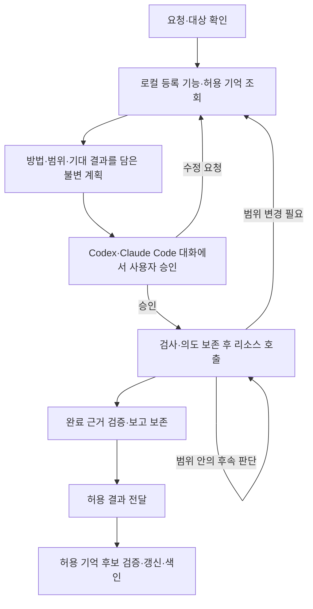

# 업무 흐름·실행·결과

상태: 첫 버전의 읽기·분석·보고·복구 동작 구현; 실제 회사 리소스·호스트 사용 검증은 별도

호스트는 방법·다음 행동을 판단하고 DAERI는 승인·호출·근거를 관리한다.
이 문서는 요청부터 실행·복구·완료 보고까지의 동작을 함께 정의한다.
승인 범위는 [계획·승인](approval.md), 공개 필드·오류는 [MCP 규격](../mcp/common.md)을 따른다.
기억의 내용·검색·갱신·수명은 [기억 계약](memory.md)이 소유한다.
SQLite·본문 파일·인증 저장소·색인의 역할과 저장·조회·삭제 절차는 [로컬 저장 구조](../configuration/profiles.md#로컬-저장-구조)가 소유한다.

현재 실행 목적은 `collect`·`verify`이며 원격 변경·변경 효과 확인은 제공하지 않는다.
아래 `change`·`reconcile`·원격 보상 규칙은 확장 시 지킬 경계이며 첫 버전에서 해당 기능이 실행된다는 뜻이 아니다.
지원·검증 범위의 정본은 [최초 구현 계획](../../plans/initial-implementation.md)이다.

## 요청에서 결과까지

사용자는 배포 저장소를 호스트 마켓플레이스에 추가하고 DAERI 플러그인을 설치한다.
`/setup {profile명}`에 해당하는 진입점에서 리소스 범주·어댑터·연결 대상·인증 방식을 정하고 필요한 프로그램을 준비한다.
호스트별 진입 방식은 [플러그인](../hosts/plugins.md), 준비 절차는 [환경 구성](../installation/environment.md)을 따른다.

호스트는 결과를 바꾸는 모호한 조건만 질문한다.
업무는 선택한 [profile](../configuration/profiles.md)의 구성 스냅샷을 사용한다.
등록 기능과 사전에 제공을 허용한 로컬 기억을 먼저 읽고 실제 원문·원격 탐색은 제한된 계획부터 승인받는다.

호스트는 소량의 profile 기본 맥락과 현재 요청에 관련된 경험을 검색해 계획 전에 확인한다.
검색은 선택한 profile·실제 리소스 대상·현재 제공 권한·유효기간 안에서 수행한다.
결과가 부족하면 질의를 바꾸거나 허용된 후속 검색을 하며 과거 경험으로 현재 상태를 단정하지 않는다.

계획 제출마다 실행기가 발급한 검색 기록을 `memory_search_refs`로 모아 조회 여부·결과·제한을 연결한다.
검색 결과가 없는 첫 업무도 정상적으로 계획할 수 있지만 검색 실패를 결과 없음으로 보고하지 않는다.
검토할 기억의 부재·충돌·오래된 근거와 추가 확인 방법을 계획에 표시한다.
기억 조회가 호스트의 올바른 해석을 자동 증명하지는 않는다.

사용자는 제시된 현재 계획을 보고 “승인할게”처럼 명시적으로 답한다.
승인 뒤에는 그 범위 안에서 필요한 기능을 스스로 선택하고 결과를 같은 호스트 대화로 보고한다.
응답과 계획을 연결하는 기준은 [대화 승인](../hosts/approval.md)을 따른다.

범위 변경은 [재계획 원칙](approval.md#자율-실행과-재계획의-경계-제안)을 따른다.
아래 상태는 업무 생명주기이며 업무별 도구 순서를 고정하지 않는다.

## 업무를 연결하는 식별자

| 식별자 | 의미 |
|---|---|
| `task_id` | 한 요청으로 접수한 업무 |
| `plan_id`, `plan_version` | 불변 계획과 업무 내 증가하는 버전 |
| `step_id` | 계획의 논리 단계; 여러 호출을 포함할 수 있음 |
| `approval_id` | 특정 계획의 실제 승인 또는 향후 정책 결정 |
| `call_id` | 한 번의 구조화된 기능 실행; 내부 시도·페이지는 하위 기록 |

ID 자체는 권한·완료 증거가 아니다.
수정 계획도 과거 호출의 계획·승인 연결을 바꾸지 않는다.

## 실행 상태와 전이

| 상태 | 의미 |
|---|---|
| `planning` | 조건 확인·기능·기억 조회·계획 구성 |
| `awaiting_input` | 대상·조건의 답변 대기 |
| `awaiting_approval` | 저장 계획의 실제 확인 대기 |
| `paused` | 사용자가 일시중지; 상태·계획 확인과 새 승인 전 실행 차단 |
| `running` | 유효 승인 범위의 실행 |
| `reconciling` | 이미 요청한 외부 작업의 성공·진행 여부 확인 |
| `verifying` | 완료 조건·산출물 확인 |
| `succeeded` | 필수 조건 충족과 결과·근거 보존 완료 |
| `partial` | 유용한 일부 결과가 있으나 전체 조건 미충족 |
| `failed` | 목적을 달성하지 못함 |
| `cancelled` | 취소로 추가 실행 중단 |

정상 흐름은 `planning → awaiting_approval → running → verifying → succeeded`다.
질문 대기는 복귀 단계를 저장하고 답변 후 유효 승인을 확인한 뒤 미확인 효과의 확인을 우선한다.
범위 변경은 새 호출을 멈추고 수정 계획을 저장해 `awaiting_approval`로 돌아간다.
새 계획 제출의 허용 상태·원자적 전이는 [계획 도구](../mcp/plans.md#daeri_plan_submit)를 따른다.

대기·일시중지·종료 상태에서는 새 업무 호출을 시작하지 않는다.
확인 중인 업무의 호출 목적 제한은 [리소스 실행 규격](../mcp/resources.md#daeri_capability_execute)을 따른다.
이미 시작한 결과는 원 호출에 남긴다.
확인 불가·한도 소진은 불확실성을 보존해 `partial|failed`로 보고한다.

## 실행 검사와 기록

| 순서 | 실행기의 동작 |
|---|---|
| 1. 주체·업무 | 실제 연결 주체·현재 권한과 중복·충돌을 확인하고 새 호출의 개정·상태·소유권을 검사 |
| 2. 계획·방법 | 현재 불변 계획·유효 승인·철회·만료, 기능·분기·의존 관계·후속 값 출처 대조 |
| 3. 실제 대상 | 스키마와 변환한 하위 인수·기본값을 실제 대상·연산·범위에 대조 |
| 4. 예산·의도 | 제약 강제 가능성 확인, 누적 예산 예약과 정규화 입력·계획·승인·시도 영속 기록 |
| 5. dispatch | 현재 소유권·상태·계획·승인·권한·예약 재검사, 시작 기록 후 호출 |
| 6. 보존·반환 | 외부 효과·범위·오류·소비량·근거 보존, 확인된 양 정산과 허용 자료 반환 |

신뢰할 원본을 읽지 못하거나 검사에 실패하면 하위 요청을 보내지 않는다.
계획에서 적용한 기억은 [현재 유효성](memory.md#계획-전-조회와-활용)도 대조하고 정정·만료 등으로 전제가 깨지면 수정 계획을 요구한다.
입력된 주체·표시명은 권한 원본이 아니며 고정한 연결·인증과 실제 DB·계정·리전·프로젝트를 대조한다.
계약 의미·제약이 바뀌면 기존 승인으로 실행하지 않는다.

후속 값은 실행기가 보존한 실제 선행 호출에서 읽고 현재 허용된 원본 필드인지 확인한다.
`redact`는 `[REDACTED]` 표시를 남기되 계산·바인딩·기억에 쓸 수 있는 원래 값으로 취급하지 않는다.
가림·누락된 경로를 값의 실제 부재로 추정하지 않고 바인딩을 거부한다.

후속 키·ID·경로·페이지 토큰도 저장 출처와 다음 호출의 범위를 검사한다.
실제 대상 확인에 필요한 원격 조회 역시 승인·기록·예산을 거친다.
업무 호출에서 설치·로그인·다른 profile 대체를 자동 수행하지 않는다.
제품별 검사·변환은 [리소스 계약](../resources/contract.md)이 소유한다.

### 소유권과 중복

업무당 실행 소유자는 하나다.
여러 로컬 호스트 프로세스의 소유권·예약은 같은 저장소에서 원자적으로 검사한다.
이 보장을 제공할 수 없으면 같은 업무를 동시에 실행하지 않는다.

소유권 이전은 기록 확인 뒤 내부 세대를 갱신한다.
이전 세대는 새 dispatch를 못 하고 이미 시작한 결과만 원 호출에 보존한다.
새 소유자는 진행 중 요청을 실패로 추정해 반복하지 않는다.

제어 가능한 페이지·재시도도 dispatch 직전 검사를 거친다.
하위 MCP 내부 요청을 중단·통제하지 못하면 원 호출 전체를 확인 대상으로 유지한다.
로컬 시작 기록·네트워크 전송·원격 효과를 하나의 트랜잭션으로 보장하지 않는다.

재전달은 기존 기록만 반환하며 키·개정 비교와 충돌은 [MCP 공통](../mcp/common.md#업무-개정과-멱등-요청)을 따른다.
새 ID는 안전한 반복 근거가 아니고 원격 중복 방지 미지원에서 정확히 한 번의 변경을 보장하지 않는다.

## 예산과 재시도

논리 호출과 실제 외부 요청을 구분하고 페이지·재시도·상태 확인도 누적한다.
실행 전 최대 할당량을 예약하며 소비·미정산 예약과 합쳐 한도를 검사한다.
제어 가능한 하위 요청마다 같은 경계를 적용한다.

강제 못 하는 숫자 한도는 거부한다.
외부 요청 상한의 `null`은 명시적인 상한 없음이며 미측정 소비·승인 면제·범위 확대가 아니다.
표시 결과를 자르거나 논리 호출만 세어 원격 자료량·요청량을 제한했다고 주장하지 않는다.

미확정 소비·효과를 0으로 채우거나 예약을 해제하지 않는다.
없는 상한에 가상 예약·잔여량을 만들지 않고 완료 후 확인된 미사용분만 반환한다.
재계획도 소비·예약을 승계하며 확대는 다시 승인받는다.
단위·지원 여부와 숫자·null의 필드는 [계획 MCP](../mcp/plans.md)가 정의한다.

DAERI 대기·dispatch 시간은 원격 CPU·과금·작업 종료 보장이 아니다.
원격 제약은 실제 지원할 때만 제공한다.
상위·SDK의 중첩 재시도도 합산하고 통제 못 하는 조건의 실행은 거부한다.

읽기 재시도는 같은 시점·값을 보장하지 않으므로 일관성·부작용·승인·권한·예산을 확인한다.
변경은 중복 방지·안전한 반복 의미가 없으면 완료 확인을 우선한다.
새 승인도 과거 효과를 확인한 증거를 대신하지 않는다.

### 일부 조회 실패의 기본 동작

개별 리소스 조회가 실패하면 그 결과에 의존하는 호출을 막는다.
유효 승인·현재 권한·남은 예산·기록 보존이 유지되는 독립적인 읽기는 계속하고 계획의 더 엄격한 중단 조건을 우선한다.
승인·대상 바인딩·공통 저장소·업무 전체 예산 등 공통 실행 조건이 깨지면 영향받는 업무의 신규 호출을 차단한다.

필수 조건을 충족하지 못했지만 유용한 결과가 있으면 `partial`, 유용한 결과도 없으면 `failed`로 보고한다.
보완 뒤 모든 필수 조건이 실제로 충족된 경우에만 `succeeded`로 마감하며 원 실패와 누락의 영향을 남긴다.
미확인 외부 효과는 기존 확인 절차를 따르고 실패한 변경을 자동 반복하지 않는다.

## 중단·재개와 외부 결과 확인

대화가 없어져도 로컬 업무·계획·승인·호출·근거를 읽어 복구한다.
업무 번호를 모르면 선택한 profile의 최근 업무 제목·상태를 보고 사용자가 이어갈 업무를 선택한다.
현재 열람·제공 권한을 적용한 로컬 이력만 보여 주며 다른 profile의 업무를 섞거나 같은 제목의 업무를 자동 선택하지 않는다.
선택은 실행 승인이 아니며 종료 업무는 결과를 열람하고 추가 실행은 새 업무로 접수한다.
재개는 소유자·대기 이유·승인·현재 권한·고정 대상·계약·누적 예산을 확인한다.
PC·호스트 종료 후 계속 판단·실행된다고 보장하지 않는다.

읽기 호출의 완료를 확인하지 못하면 재개 응답에 해당 호출 ID를 남기고 `resumed=false`로 알린다.
이전 소유자의 프로세스 종료가 확인된 뒤에도 dispatch 기록이 있으면 `unknown`과 미정산 시간 예약을 유지한다.
dispatch 전 의도만 남았다면 호출을 차단한 상태로 기록하고 그 호출의 미사용 예약을 해제한다.
첫 버전은 이러한 호출을 숨겨 반복하거나 원격 완료로 바꾸지 않으며 제한을 포함한 부분·실패 보고로 마감할 수 있다.

| 사용자 요청 | 처리 |
|---|---|
| 일시중지 | `paused`로 보관하고 기존 승인·대기 응답 무효화; 결과·호출·효과·소비·예약 유지 |
| 일시중지 후 재개 | 현재 상태·남은 작업·계획·예산 확인 후 새 실제 승인; 같으면 동일 계획, 달라지면 수정 계획 |
| 취소 | `cancelled`로 종료; 동일 업무 재실행 금지 |

일시중지 후 새 승인 전에는 원격 상태 확인도 시작하지 않고 승인 뒤 미확인 호출부터 확인한다.
이미 보낸 결과는 보존하되 늦은 응답이 중지·종료를 해제하지 않는다.
즉시 원격 중단·되돌리기를 보장하지 않으며 입력·상태 전이는 [업무 MCP](../mcp/tasks.md#daeri_task_update)를 따른다.

실행 전 의도·예약 저장 실패는 요청 전송을 막는다.
실행 후 응답·저장 실패나 시간 초과로 외부 결과를 확정할 수 없으면 효과 미확인으로 남긴다.
저장소 복구 전 새 행동을 시작하거나 동일 변경을 새 ID로 반복하지 않는다.

확인은 원 호출·실제 대상·원격 작업과 연결하며 일반 상태나 모델 요약을 완료 증거로 사용하지 않는다.
[원 호출 확인 계약](../mcp/resources.md#원-호출과-상태-확인의-연결)에 따라 확인 결과·원 상태를 함께 보존하고 미확정 예약을 유지한다.

종료 업무의 후속 확인은 원 업무·호출을 명시한 새 승인 업무에서 수행한다.
양 업무 권한·실제 바인딩을 검사하고 신규 확인 사용량과 원 소비·예약을 각 업무에 남긴다.
원 종료 상태·보고는 유지하며 새 확인·원격 중단·보상에도 계약·권한·승인·예산이 필요하다.
여러 리소스의 원자적 롤백은 보장하지 않는다.

## 이력과 완료 근거

대화와 별도로 판단·추적·복구에 필요한 허용 기록을 보존한다.
모든 원문을 복제하지 않고 여러 계획의 근거도 각각의 원 연결을 유지한다.
업무 상태·고정 스냅샷·계획·승인·호출 메타데이터는 SQLite에서 추적한다.
허용 조회 본문·보고·산출물은 관리 파일로 보존하고 SQLite의 등록 참조로 연결한다.
본문을 포함하는 요청·대화·계획 설명도 추적 필드와 분리해 해당 본문의 기한과 삭제를 적용한다.

| 기록 | 최소 내용 |
|---|---|
| 요청 | 업무·주체·대상 맥락·목적·완료 조건 |
| 계획·승인 | 불변 계획·방법·범위·한도, 실제 요청·주체·경로·결정·시각·유효 조건 |
| 기억 활용 | 검색·갱신 참조, 적용한 지식의 개정·제한·현재 확인과의 연결 |
| 로컬 검사 | 업무·실제 준비/입력/계획 검사·성공 또는 실패·비밀을 제외한 이유 |
| 호출 | 단계·계획·승인·정규화 입력·실제 대상·시도·페이지·사용량·관찰·오류·효과·허용 원본·참조 |
| 산출물·보고 | 관리 참조·생성 근거·제공 범위·마스킹, 조건별 판단·상태·제한·후속 행동 |

비밀값은 입력·결과·오류에서 제외하고 민감 자료는 허용된 저장 범위로 제한한다.
삭제·가림의 영향과 하위 MCP가 숨긴 요청·사용량의 미확정 범위를 표시한다.

업무 종료 후에도 보관을 허용한 최소 조회 자료는 비밀 제거·마스킹 후 사용자 PC에 남긴다.
모델 제공·산출물 내보내기와 종료 후 본문 보관 범위를 구분해 계획에서 리소스별로 확인받는다.
필드는 [계획 출력 규격](../mcp/plans.md#예산보고완료-조건)에 두고 보관 범위·가림·원 호출의 연결을 함께 보존한다.

승인하지 않은 조회 본문은 종료 후 제외하며 보관 자체는 향후 열람·제공 권한을 부여하지 않는다.
자료의 수명은 다음처럼 구분한다.

| 대상 | 보존·정리 기준 |
|---|---|
| 종료 업무의 허용 본문·산출물 | 요청·보완·승인 대화·계획 본문·표시본·호출 인수·검색 질의·조회·보고·파일에 아래 공통 보존기한 적용 |
| 활성·일시중지 업무의 허용 복구 자료 | 종료 후 본문 정리와 구분 |
| 최소 이력·멱등 비교 정보 | 자동 만료 없음; 상태·계획·승인·호출 참조·검증 방법·사용량·미확인 효과 유지 |
| 기억 정본·키워드·벡터 색인 | 일반 요약은 원 출처 기한 승계; 별도 허용한 장기 운영지식은 [기억 보존 기준](memory.md) 적용 |

최소 이력에 본문·행값·파일 내용이나 기억 본문을 복사해 보존 제한을 우회하지 않는다.

공통 보존기간은 기본 30일이며 profile별로 변경할 수 있다.
최초 `succeeded|partial|failed|cancelled` 전이의 UTC 시각부터 하루를 24시간으로 계산하며 재조회·추가 보고·늦은 결과가 기한을 연장하지 않는다.
기간 설정은 [profile 구성](../configuration/profiles.md#구성과-연결)에서 해소하고 업무의 고정 스냅샷에 연결한다.

만료한 본문·산출물은 실제 파일이 남아 있어도 반환·근거 승계·새 산출물 생성에 사용하지 않는다.
기존 자료를 복사·승계하거나 종료 후 보고·첨부를 추가해도 원 출처·기한을 유지한다.
새 요청 ID·승인으로 만료 자료를 되살리거나 같은 업무에 다시 보존하지 않는다.
다시 원격 조회하려면 유효한 계획·승인으로 새 관찰을 확보한다.

실행기 시작 때 만료 자료를 정리하며 삭제 실패에도 열람 차단을 유지하고 관리 경로로 안내한다.
파일이 남아 있는 동안의 중복 요청 재전달·캐시·페이지 조회에도 같은 만료 검사를 적용한다.
파일 경로나 SQLite 행이 존재한다는 사실만으로 반환하지 않고 등록 참조·무결성·현재 권한·기한을 먼저 확인한다.
이 정책은 DAERI가 관리하는 자료에 적용하며 이미 전달한 호스트 대화나 사용자가 별도로 저장한 사본을 자동 삭제하지 않는다.
정리 뒤에도 최소 이력으로 기존 실행을 식별하며 본문 삭제가 업무 상태·사용량·효과를 지우거나 종료 업무를 재개하지 않는다.

| 근거 종류 | 보고의 의미 |
|---|---|
| 관찰 | 실제 리소스 호출·로컬 검사·등록 요청 자료의 사실; 원본·범위·시점·스냅샷·가능한 원격 ID 연결 |
| 파생 결과 | 관찰로 계산·집계한 값, 원본·방법·대상 범위 |
| 과거 기억 | 이전에 확인한 지식·조건·출처와 검증 상태; 현재 관찰과 구분 |
| 가설·예상 | 가정·미확인 설명 또는 아직 실행·검증하지 않은 산출물 |

요청 자료·로컬 검사를 외부 확인으로, 코드 생성을 적용·테스트로 표현하지 않는다.
원본을 다시 확보할 수 없으면 보존 관찰의 제한을 설명한다.
읽은 자료의 지시가 승인·정책을 바꾸지 못하며 자연어 해석을 모두 자동 증명한다고 보장하지 않는다.

계획의 모든 완료 조건에 판단·방법·근거를 남긴다.
실제 대상·필터, 자료·페이지 완전성, 원본과 결과 대응, 변경 후 상태와 보존 완료를 확인한다.
필수 조건 제외는 승인 분기의 실제 관찰 등 검증 가능한 근거가 필요하다.

`succeeded`는 승인 이력·필수 조건 충족·결과 보존이 실제 기록으로 뒷받침돼야 한다.
활성 업무의 성공 마감에는 현재 유효한 승인이 필요하며 일시중지 후 재승인 대기를 우회해 마감할 수 없다.
진행 중 호출·미확인 효과·필수 자료 누락은 전체 성공으로 마감하지 않는다.
보완한 실패도 원 실패와 보완 근거를 유지한다.
검증 호출도 승인·권한·예산을 거치며 보고 도구가 원격 조회를 숨겨 실행하지 않는다.

## 결과 제공과 전달

최초 구현부터 여러 리소스의 결과를 결합·비교·계산한 표와 CSV를 제공하도록 요구를 확정했다.
예를 들어 DB의 업무 데이터와 Cache의 상태를 대조한 불일치 목록을 만들며 업무별 고정 기능으로 제한하지 않는다.
대화의 텍스트·표·구조화 응답과 파일 산출물을 구분하고 등록된 [출력 생성기](../mcp/tasks.md#결과-형식과-생성기)에 따라 다양한 형식을 제공한다.
표·CSV는 최초 검증 대상이며 다른 파일 형식의 추가를 막는 제품 상한이 아니다.

파생 결과는 원본 참조, 결합 기준·계산 방법, 입력·결과의 대응과 검증 기록을 함께 보존한다.
파일을 만들지 않는 표도 같은 검증·보존을 거치며 필요한 파일은 검증한 표에서 생성한다.
누락·중복·조회 시점 차이·잘림의 영향을 확인하고 모델이 작성한 값만으로 계산 검증을 대신하지 않는다.
최초 계약은 승인한 유일키 결합과 원본 셀의 단일 연산 검산이며 [표 입력·검증](../mcp/tasks.md#파생-표와-셀-검증)에서 관리한다.
표·CSV는 사용자 결과 형식이며 내부 저장 기술이나 모든 원자료의 저장 형식을 고정하지 않는다.

파생 열에도 기여한 리소스별 제공·마스킹 조건을 적용하고 계산·결합으로 범위를 넓히지 않는다.
원본·검증이 부족하면 제한을 밝히고 해당 완료 조건을 충족했다고 보고하지 않는다.
출처·제공 허용 여부를 확인하지 못하면 해당 자료를 제공하지 않는다.

보고에는 요청 해석·실제 수행·변경·완료 근거·제한·미확인 효과·산출물·후속 행동을 담는다.
`partial|failed|cancelled`는 이미 발생한 변경이 없다는 뜻이 아니다.
저장·반환·내보내기·재조회 모두 현재 열람 권한과 계획·설정의 제공 조건을 적용한다.

로컬 파일·과거 보고도 제공 범위를 넓히지 않으며 Mail·Ticket·Source·Document 게시·전송은 별도로 승인받을 외부 변경이다.
DB 형태의 파일 생성과 실제 리소스 DB 쓰기도 구분하며 후자는 변경 기능으로 승인받는다.

모델이 읽을 수 있는 자료와 파일로 내보낼 수 있는 자료의 범위는 다를 수 있다.
자유 보고 파일은 그 업무에서 모델에 제공한 전체 필드의 내보내기를 확인하며 요약문·JSON 변환·기존 파일 첨부로 제한을 우회하지 않는다.
파일에는 기여 출처를 연결하므로 나중에 기억 후보로 인용해도 실제 관찰·사용자 확인까지 다시 검증한다.

보고 보존과 호스트 답변 전달은 별개다.
실제 호스트 증거가 없으면 전달은 미확인으로 두고 전용 bridge·추가 도구는 초기 범위에 두지 않는다.
전달만 실패하면 저장 보고를 현재 제공 권한으로 읽으며 조회·변경을 반복하지 않는다.
실패 보고도 정상 전달할 수 있고 보존 자체 실패는 성공으로 마감하지 않는다.

제출·조회 필드는 [업무·결과 MCP](../mcp/tasks.md)를 따른다.
최소 추적 이력은 SQLite에 남기고 실제 보고·표 본문은 관리 참조로 등록한 파일에 보존한다.
텍스트·JSON·CSV 파일도 같은 관리 영역에 만들며 사용자가 지정한 임의 경로를 읽거나 덮어쓰지 않는다.
보고와 파일의 기한은 업무·기여 출처 중 가장 이른 보존기한을 적용한다.

첫 구현의 결과 제출은 보고 초안 → 원본·키·셀 재계산 → 완료 조건 대조 → 파일 형식·크기 확인 → 원자적 보존 순서다.
실패·부분 보고를 남길 수 있어도 미승인 계획의 새 표·파일을 생성할 수는 없다.
활성 업무는 현재 유효한 승인, 종료 후 허용 추가 보고는 해당 계획의 실제 승인 이력과 기존 범위가 필요하다.
숫자를 모델이 잘못 계산했거나 다른 행의 값·비공개 필드를 사용하면 보고·표·파일 참조를 발급하지 않는다.
CSV의 수식·탭·개행 문자열은 파일로 내보낼 때 무해화하고 보존한 구조화 표의 원래 값과 구분한다.
형식과 검산을 통과해도 실제 호스트 전달 증거가 없으면 `delivery_status=not_confirmed`로 남긴다.
보존 보고·파일을 다시 읽거나 같은 제출 요청을 재전달할 때도 기여 기억의 정정·무효화와 원출처의 현재 제공 조건을 검사한다.
과거 보고·파일로 금지된 자료를 되살리지 않으며 기억의 원문이 다른 업무에 속하면 그 원문을 현재 업무 자료로 다시 해석하지 않는다.

구현·거부·복구 검증 순서는 [최초 구현 계획](../../plans/initial-implementation.md)을 따른다.

## 업무 후 기억 갱신

호스트는 결과를 보고하는 활성 대화 안에서 재사용할 규칙·확인한 구조·검증된 절차·실패 예방 지식을 후보로 정리한다.
성공한 업무뿐 아니라 원인이 확인된 실패나 사용자 정정도 대상이지만 모델의 추측을 검증된 사실로 저장하지 않는다.

실행기는 현재 계획·profile 정책·출처·검증 근거·재제공·보존 허용 범위를 확인한 뒤 정본을 저장·수정·무효화하고 색인을 갱신한다.
정정·삭제·만료 시에는 기존 검색 결과와 캐시도 차단하며 상세 조건은 [기억 계약](memory.md)을 따른다.

기억 갱신 실패는 별도 제한으로 보고하고 완료한 업무 상태를 되돌리거나 실제 리소스 호출을 반복하지 않는다.
색인 실패를 지식 부재로 숨기지 않으며 정본에서 색인을 복구할 수 있어야 한다.
호스트·PC 종료 뒤 백그라운드 학습이나 자동 갱신을 보장하지 않는다.

## 가상 수행 사례

“지난주 실패 주문 원인을 분석해줘.”라는 요청의 서비스·환경·시간대·기간을 확인한다.
로컬 등록 기능과 해당 profile의 허용 기억을 읽는다.
예를 들어 과거에 확인한 집계 제외 조건이 있으면 현재 적용 여부를 확인할 방법과 함께 DB 집계·Source의 특정 개정과 경로 조회를 계획한다.
고객·결제 정보 제외, 한도·제공 필드·완료 근거도 표시한다.

사용자가 승인하면 범위 안의 후속 집계·파일 조회를 선택한다.
Infra 확인이 새로 필요해지면 차이·추가 예산을 담은 수정 계획을 먼저 승인받는다.
보고는 관찰과 추정 원인을 구분하고 누락·잘림·필수 조건 미충족을 성공으로 숨기지 않는다.
업무 후에는 새로 검증한 집계 규칙이나 오류 예방 절차만 승인한 범위에서 기억으로 갱신한다.

연결 기능이 지원된다는 조건의 예시이며 실제 결과나 고정 업무 목록이 아니다.
